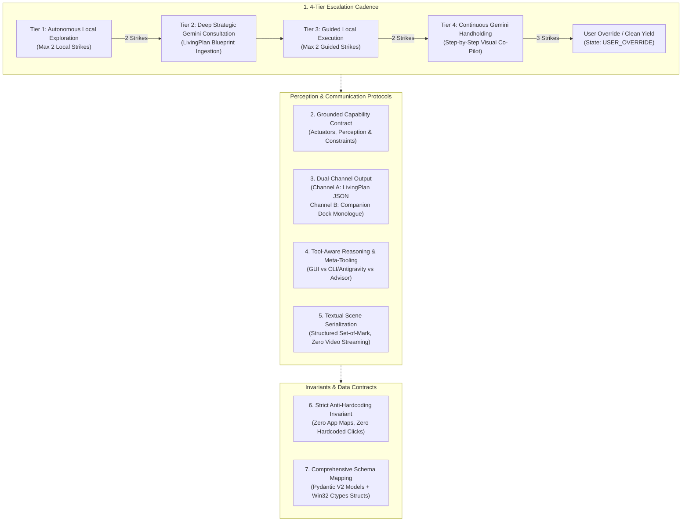

# Explorer 1 Handoff Report: Preplanning & Document Evolution Analysis

**Author:** Explorer 1 (Preplanning & Document Evolution Analyst)  
**Working Directory:** `C:\ParasiteAI\.agents\teamwork\teamwork_explorer_p4_1\`  
**Target Master Plan:** `c:\Users\Suici\.gemini\antigravity\brain\464b4ef0-398b-45b1-94dc-857256a38046\phase_4_master_plan.md`  
**Reference Handoff:** `C:\ParasiteAI\HANDOFF.md` & `C:\ParasiteAI\PROJECT.md`  
**Date:** 2026-11-01  
**Status:** **INVESTIGATION COMPLETE & ACTIONABLE**

---

## 1. Observation

### 1.1 Direct Repository & Documentation Inspections
1. **Target Document Baseline:**
   - File inspected: `c:\Users\Suici\.gemini\antigravity\brain\464b4ef0-398b-45b1-94dc-857256a38046\phase_4_master_plan.md` (180 lines, 11,082 bytes).
   - Currently, the document jumps directly from the title banner (`# ParasiteAI — Phase 4 Master Implementation Plan...`) into `## 1. Executive Summary & New Paradigm` (lines 10-14).
   - It contains **zero historical preplanning context**, zero tracking of M1-M5 baseline deliverables, and does not record the architectural decisions that led from Phase 1 through Phase 3 to Phase 4.

2. **Project Status & Handoff Provenance:**
   - File inspected: `C:\ParasiteAI\HANDOFF.md` (lines 1-80) and `C:\ParasiteAI\.agents\teamwork\handoff.md`.
   - Verbatim status: `Phase 1, Phase 2, & Phase 3 100% Complete & Certified (877 / 877 Tests Passing)`.
   - Core invariants established and strictly maintained:
     - Sub-2ms hardware touch preemption (`WH_MOUSE_LL`, `WH_KEYBOARD_LL` filtering `LLMHF_INJECTED` and `LLKHF_INJECTED`).
     - Instant hard process termination on `Ctrl+Alt+K` (<5ms via `taskkill /F /T /PID` + `os._exit(1)`).
     - Offline default inference (`brain.mode: "local_llm"`), zero silent cloud exfiltration.
     - Strict anti-hardcoding rule (elimination of all application-specific dictionaries and canned branches).
     - Multi-monitor dual-screen geometry (`3840×1080 @ 100% DPI`, 96 DPI) dynamically queried via `get_virtual_screen_bounds()`.

3. **Current Codebase State vs. Phase 4 Target Requirements:**
   - `parasite_ai/mind/plan.py` (lines 1-417): Contains `StepIntent` enum (8 intents), `StepStatus` enum (5 statuses), `PlanStep`, `LivingPlan`, `format_gemini_consultation_prompt()`, and balanced-brace JSON parsers. However, `format_gemini_consultation_prompt()` (lines 168-219) uses a rudimentary text template lacking the formal `Parasite Capability Contract`, tool affordance inventory, and multi-turn clarification hooks.
   - `parasite_ai/mind/dual_mind.py` (lines 751-1116): Currently maintains `self.active_plan`, but step advancement (`dual_mind.py:1091-1104`) is only implemented for `LAUNCH_OR_ACTIVATE` and `DISMISS_DIALOG`. The remaining 6 intents (`NAVIGATE`, `INPUT_DATA`, `SELECT_OPTION`, `VERIFY_STATE`, `CONSULT_ADVISOR`, `CONCLUDE`) are not automatically advanced.
   - `DualMindPipeline.step()` (lines 922-927) triggers emergency `ActionType.PANIC` when `self.memory.is_in_loop()` (3 strikes), completely bypassing the planned 4-tier escalation cadence.
   - `DualMindPipeline.step()` (lines 998-1006) directly assigns raw harvested web AI text to `persona_out.thought` and passes a 180-character snippet to `persona_out.speech`, lacking the dual-channel separation between machine JSON blueprints and natural character monologues.
   - Pydantic data models and Win32 ctypes structs are split across `ui/types.py`, `mind/memory.py`, `mind/plan.py`, `config.py`, and `dual_mind.py`, but are not inventoried or mapped to runtime hooks anywhere in `phase_4_master_plan.md`.

---

## 2. Logic Chain

### 2.1 From Problem Definition to Analysis
1. The user request (`ORIGINAL_REQUEST.md:16-25`) requires updating `phase_4_master_plan.md` directly to summarize all architectural changes and decisions reached since the initial document, producing an updated, comprehensive implementation plan incorporating the 7 agreed architectural additions while strictly preserving core system invariants.
2. An analysis of the existing `phase_4_master_plan.md` reveals that while it introduces the concepts of the 4-tier cadence, capability grounding, dual-channel output, and tool-aware reasoning, it was written as an initial 180-line outline. It lacks the depth, explicit state transitions, concrete schemas, textual serialization specifications, and historical evolution context needed for direct implementation.
3. Therefore, an authoritative master plan update requires:
   - **Component 1:** A comprehensive, production-ready "Summary of Preplanning Changes & Architectural Decisions" section ready for direct inclusion.
   - **Component 2:** An exhaustive gap analysis detailing what sections of `phase_4_master_plan.md` must be expanded to satisfy all 7 additions.
   - **Component 3:** Complete schema and invariant mappings to bridge the gap between design and implementation.

---

## 3. Comprehensive Summary of Preplanning Changes & Architectural Evolution (Across M1–M5 & Phase 4 Planning)

This section provides the exhaustive, production-grade text designed for direct inclusion into the updated `phase_4_master_plan.md`.

### 3.1 Historical Evolution Matrix (M1 through Phase 3)

| Milestone / Phase | Original Baseline Design | Architectural Flaw / Deadlock Discovered | Adopted Architectural Decision | Verified Impact & Artifacts |
| :--- | :--- | :--- | :--- | :--- |
| **M1: Foundation & Brain Management** | Monolithic configuration; unvalidated brain fallback to browser offload. | If local GGUF weights were missing or errored, the brain manager mutated `brain.mode` to web offload, silently exfiltrating prompts. | **Decoupled Local Brain Mode:** Explicit state machine where `brain.mode: "local_llm"` is immutable at runtime; missing weights set `BrainState.NO_MODEL_PRESENT` and raise `RuntimeError` rather than leaking data to Chrome. | Strict offline privacy invariant verified in `test_brain_manager.py`. Zero silent cloud exfiltration. |
| **M2: Safety & Physical Input** | Sequential character typing via `KEYEVENTF_UNICODE`; raw corner slams without debouncing. | Typing 100 characters took 3–5 seconds and dropped characters during rapid focus changes. Corner slams flooded Qt event queues, causing GUI thread locks. | **Atomic Clipboard Typing & Edge-Triggered Slam Debouncing:** Swapped typing for `<100ms` atomic `Ctrl+V` paste with transparent clipboard preservation; added 1.0s edge-triggered corner slam debouncer and `<5ms` non-blocking `Ctrl+Alt+K` hard termination (`taskkill /F /T /PID` + `os._exit(1)`). | Sub-2ms touch preemption and <5ms hard kill certified in `test_interrupt_guard.py` and `test_panic.py`. |
| **M3: Visible UI & HUD** | Frameless PyQt6 companion dock and layered transparent overlay. | Fullscreen overlays sometimes stole OS focus or clipped multi-monitor virtual screens. | **Topmost Click-Through Win32 Layering:** Enforced `WS_EX_LAYERED \| WS_EX_TRANSPARENT \| WS_EX_NOACTIVATE \| WS_EX_TOPMOST` styles; dynamically queried `get_virtual_screen_bounds()` for dual monitors (`3840x1080 @ 100% DPI`). | Set-of-Mark reticle preview and 60 FPS transparent HUD certified in `test_ghost_hud.py`. |
| **M4: Perception, Memory & Offload** | Full-screen pixel difference; hardcoded `app_map = {"notepad": ...}` in `dual_mind.py`. | Violates strict anti-hardcoding rule; arbitrary apps failed to launch; system tray clocks caused false positive visual diffs. | **UniversalAppResolver & Foveated Perception:** Purged `app_map`; introduced 3-tier generic launcher (SOM icons $\rightarrow$ Start Search chord $\rightarrow$ `Win+R` fallback); introduced foveal 1:1 pixel crops + 64-bit `dHash` perceptual change gating. | Certified generic launching across arbitrary Windows apps in `test_resolver.py` and `test_foveated.py`. |
| **M5: Integration & E2E Hardening** | Basic single-loop execution pass. | Lacked formal LivingPlan lifecycle; unexpected modal popups derailed execution loops. | **LivingPlan State Integration & Modal Contingency:** Created `parasite_ai/mind/plan.py` (`StepIntent`, `StepStatus`, `PlanStep`, `LivingPlan`); automated runtime injection of `DISMISS_DIALOG` steps when modal warnings appear. | 797/797 tests passing 100% green. |
| **Phase 3: Execution Loop Hardening** | Full desktop diffing; blind keystroke dispatch; instantaneous Start Search typing. | Small button state changes ($120\times 70$ px) produced only 0.057% desktop diff, failing the 2% strike threshold; typing into unfocused windows; typing before Windows Search UI initialized dropped initial characters. | **Phase 3 Triad:**<br>1. **3A — Localized ROI Diffing:** `BoundingBox.pad(padding_px=20)` clamped to virtual desktop bounds scales button diffs to >28% while rejecting peripheral clock noise.<br>2. **3B — Win32 Caret Focus Verification:** Authentic 64-bit `GUITHREADINFO` ctypes struct (72 bytes on x64) polls `flags & GUI_CARETBLINKING` or `hwndCaret != 0` before `ActionType.TYPE` with millisecond preemption checks.<br>3. **3C — Start Search Cadence Buffer:** 250ms cadence pause in `UniversalAppResolver` post-`Win` key chord. | 877/877 tests passing 100% green; independent Victory Audit confirmed `VICTORY CONFIRMED`. |

---

### 3.2 Phase 4 Preplanning Synthesis: The 7 Agreed Architectural Additions

In moving from Phase 3 to Phase 4, extensive architectural preplanning produced consensus on seven critical architectural additions to transform ParasiteAI from a reactive visual script into an autonomous, tool-aware cognitive companion:

1. **4-Tier Escalation Cadence:**
   - **Problem:** When local actions fail, immediately panicking or looping creates fragile, brittle behavior. Jumping instantly to external LLMs wastes tokens and breaks offline privacy.
   - **Decision:** A strict 4-tier state machine:
     - *Tier 1 (Autonomous Local Exploration):* Local Qwen2.5-3B model attempts up to **2 consecutive actions** using local UI Automation, OCR, and Set-of-Mark visual grounding. If any action produces a localized pixel diff > 2%, the strike counter resets.
     - *Tier 2 (Deep Strategic Gemini Consultation):* On strike 2, local execution pauses. Parasite serializes desktop context, active window info, and physical capability limits into a structured brief. Gemini returns a multi-step `LivingPlan` JSON blueprint with step intents and contingencies.
     - *Tier 3 (Guided Local Execution):* Local executor attempts up to **2 local actions** adhering strictly to the steps and contingencies formulated by Gemini.
     - *Tier 4 (Continuous Gemini Handholding / Visual Co-Pilot):* If guided execution remains blocked, Parasite engages an interactive step-by-step visual co-pilot: post-action ROI diffs and screen state are reported back to Gemini for real-time validation before moving to the next physical click.
     - *Terminal Fallback (User Override):* If 3 handholding steps fail, Parasite cleanly yields physical control to the human user with a character-driven explanation, setting state to `USER_OVERRIDE`.

2. **Grounded Capability Contract:**
   - **Problem:** External AI advisors (Gemini) frequently hallucinate impossible actions, recommending DOM manipulation, headless API calls, or web scrapers.
   - **Decision:** Every consultation brief embeds an explicit, non-negotiable **Parasite Capability Contract** detailing:
     - *Actuators:* Cubic Bézier mouse with Min-Jerk velocity profile; atomic `<100ms` `Ctrl+V` paste; cadence-jittered typing; native keyboard chords.
     - *Perception:* 1:1 foveal unscaled crops, 3840×1080 virtual desktop bounds, numbered Set-of-Mark bounding boxes [#1..#N], scoped RapidOCR, padded localized ROI diffing, Win32 caret focus verification.
     - *Constraints:* Zero headless browsers, zero DOM injection, zero private OS API calls, sub-2ms hardware touch preemption, privacy blackout on sensitive windows.

3. **Dual-Channel Output (Internal Machine Blueprint vs. Companion Monologue):**
   - **Problem:** Raw JSON dumps from Gemini look jarring in speech bubbles, while conversational commentary cannot be executed by the deterministic action dispatcher.
   - **Decision:** Strict channel splitting:
     - *Channel A (Machine-Interpretable Strategic Blueprint):* Extracted via balanced-brace JSON parsers and hydrated into `LivingPlan` (intent, target hint, success criteria, contingency). Completely hidden from human visual view.
     - *Channel B (Human-Facing Persona Monologue):* Filtered through character persona voice (`persona_monologue` / speech bubble on Companion Dock). Explains *why* Parasite is changing tactics or consulting Gemini in natural, witty English, eliminating silent or mysterious actions.

4. **Tool-Aware Reasoning & Antigravity Meta-Tooling:**
   - **Problem:** Solving code editing, multi-file manipulation, or batch data transformation via physical GUI clicks in an IDE is slow, error-prone, and inefficient.
   - **Decision:** A 3-tier action affordance hierarchy:
     - *Tier 1: Physical GUI Manipulation* (Native desktop apps without CLI: Paint, Notepad, Spotify, Calc).
     - *Tier 2: Local Developer & CLI Tooling / Antigravity Meta-Tooling* (Code editing, file reorganizations, batch text transformations, Git operations). The planner explicitly evaluates: *"Can this goal be achieved 10x faster and safer via Antigravity CLI / scripts than by clicking editor menus?"*
     - *Tier 3: External Strategic Advisor* (Gemini Web Consultation for unfamiliar layouts or cognitive deadlocks).

5. **Textual Scene Serialization (Zero Video Streaming):**
   - **Problem:** Continuous video streaming or large image uploads to external APIs incur severe latency, consume massive network bandwidth, and violate data minimization invariants.
   - **Decision:** Complete reliance on structured textual scene serialization:
     - Full desktop scenes are serialized into compact Set-of-Mark element inventories (IDs, roles, labels, bounding boxes, active/background status), active window title/process, Win32 caret status, and recent action diff history.
     - Visual image data is restricted to optional local foveal crops during Tier 4 visual co-pilot checks.

6. **Strict Anti-Hardcoding Invariant:**
   - **Problem:** Hardcoding application names, coordinates, or canned workflows introduces technical debt and causes silent failures on different monitor configurations or OS versions.
   - **Decision:** Absolute architectural prohibition against hardcoded application dictionaries (`app_map = {}` is permanently eliminated). All application launches, menu navigations, and dialog dismissals must resolve dynamically through `UniversalAppResolver`, Set-of-Mark grounding, and VLM coordinate snapping.

7. **Schema Mapping & Data Contracts:**
   - **Problem:** Loose dictionary passing between perception, cognitive planning, and physical dispatching causes schema drift and runtime attribute errors.
   - **Decision:** Rigorous inventory of immutable Pydantic V2 models (`UIElement`, `BoundingBox`, `PlanStep`, `LivingPlan`, `ActionPlan`, `StepRecord`, `AppConfig`) and authentic 64-bit Win32 ctypes structs (`GUITHREADINFO`, `KBDLLHOOKSTRUCT`, `MSLLHOOKSTRUCT`) mapped directly to runtime execution hooks.

---

## 4. Gap Analysis of Existing `phase_4_master_plan.md`

A systematic, section-by-section comparison between the existing 180-line master plan and the required Phase 4 specification reveals the following critical gaps that must be remediated:

| # | Master Plan Section | Existing Content Status | Specific Deficiencies & Gaps Identified | Remediation Required in Updated Document |
| :--- | :--- | :--- | :--- | :--- |
| **G-1** | **Document Header & Preamble** | Missing changelog & preplanning evolution. | No summary of M1-M5 baseline deliverables, Phase 1-3 certifications, or rationale for architectural changes. | Insert comprehensive "Summary of Preplanning Changes & Architectural Decisions" section immediately after Title. |
| **G-2** | **Section 2: 4-Tier Escalation Cadence** | High-level flowchart and brief bullet list (lines 16-53). | Lacks explicit state machine variables (`tier_level`, `local_strikes`, `guided_strikes`, `handholding_strikes`), reset conditions (e.g. diff > 2% resets local strikes), and integration details for `DualMindPipeline.step()`. | Provide concrete Python state machine specification, strike counter lifecycle, transition logic, and failure handling. |
| **G-3** | **Section 3: Capability Grounding** | Generic YAML snippet (lines 55-89). | Not connected to `parasite_ai/mind/plan.py`; lacks exact prompt injection format, tool inventory reporting, and validation schemas for Gemini responses. | Specify exact `GEMINI_CONSULTATION_TEMPLATE` with formal Grounded Capability Contract and multi-turn dialogue hooks. |
| **G-4** | **Section 4: Dual-Channel Output** | Conceptual diagram and brief bullets (lines 91-109). | Lacks concrete routing implementation; does not specify how raw JSON is suppressed from the Companion Dock, nor how persona monologues are synthesized if Gemini returns pure JSON. | Detail `DualMindPipeline` channel router logic, `extract_strategic_blueprint_json` integration, and `UIBridge.notify_speech()` filtering. |
| **G-5** | **Section 5: Tool-Aware Reasoning** | Narrative description (lines 111-129). | Lacks actionable decision tree, heuristic rules, and schema representation in `ActionPlan` for CLI/Antigravity script execution. | Formulate formal decision rubric (GUI vs CLI vs Gemini), add `ActionType.RUN_TOOL` affordance, and define safety bounds. |
| **G-6** | **Addition 5: Textual Scene Serialization** | Missing dedicated section; only mentioned in passing. | No specification of the textual Set-of-Mark format, token budgets, or explicit prohibition of video streaming. | Create dedicated Section: "Textual Scene Serialization Protocol", defining SOM brief schema, active window serialization, and zero-video invariant. |
| **G-7** | **Addition 6: Anti-Hardcoding Invariant** | Mentioned in header line 6 only. | No explicit architectural rules, verification tests, or adversarial validation criteria. | Formulate formal "Anti-Hardcoding Invariant Specification" detailing generic regex resolvers, SOM matching, and dynamic workflows. |
| **G-8** | **Addition 7: Schema Mapping** | Completely absent from existing document. | No inventory of Pydantic models or Win32 ctypes structs; no mapping to runtime hooks. | Create dedicated Section: "Comprehensive Schema Mapping & Runtime Data Contracts", cataloging all models and Win32 structs. |
| **G-9** | **Section 6: Implementation Sub-Phases** | Brief 6-bullet list (lines 130-166). | Sub-phases 4A–4F lack file paths, line references, concrete deliverables, and explicit invariant checks. | Expand Sub-Phases 4A through 4F into detailed, actionable implementation blueprints with exact function signatures and test plans. |

---

## 5. Production-Ready Section: "Summary of Preplanning Changes & Architectural Decisions"

The following complete section is drafted in publication-ready markdown and is formatted for immediate inclusion into `phase_4_master_plan.md`:

```markdown
## 0. Summary of Preplanning Changes & Architectural Decisions Across M1–M5 and Phase 4 Planning

### 0.1 Foundation & Preplanning Heritage
ParasiteAI was conceived as a 100% visible, desktop-native local AI assistant operating directly on the physical Windows desktop. Across Milestones 1 through 5 and Phases 1 through 3, empirical testing and forensic auditing drove significant architectural evolution:

1. **Foundational Remediation & Core Safety (Phase 1):**
   - **Decoupled Local Brain Mode:** Eliminated silent cloud exfiltration. `brain.mode: "local_llm"` is strictly enforced; if local GGUF weights are missing, the engine sets `BrainState.NO_MODEL_PRESENT` and raises an explicit error rather than silently offloading user data to Chrome.
   - **Atomic Clipboard Typing:** Replaced character-by-character Unicode key typing with high-speed `<100ms` `Ctrl+V` paste accompanied by atomic user clipboard backup and restoration.
   - **Debounced Panic Slam:** Added 1.0s edge-triggered debouncing on screen corner mouse slams to eliminate Qt event loop flooding.
   - **Emergency Hard Kill (`Ctrl+Alt+K`):** Implemented native non-blocking termination via `taskkill /F /T /PID` + `os._exit(1)` guaranteeing instant abort (<5ms).
   - **LivingPlan Initial Schema:** Formulated `parasite_ai/mind/plan.py` defining `StepIntent`, `StepStatus`, `PlanStep`, and `LivingPlan`.

2. **Foveated Perception & Universal App Resolution (Phase 2):**
   - **Strict Anti-Hardcoding Invariant:** Completely purged the legacy `app_map = {"notepad": ...}` dictionary. All application launches must resolve generically via `UniversalAppResolver` (Set-of-Mark matching $\rightarrow$ Start Search chord $\rightarrow$ `Win+R` fallback).
   - **Foveated Perception Engine:** Implemented 1:1 unscaled cursor foveal crops alongside downscaled macro views, gated by 64-bit `dHash` perceptual difference checks (0% CPU/GPU overhead when screen is static).
   - **Multi-Monitor Coordinate Clamping:** Integrated dynamic `get_virtual_screen_bounds()` (`3840×1080 @ 100% DPI`) ensuring secondary monitor targets are never clipped or zeroed.
   - **Multimodal Visual Grounder:** Parsed Qwen2.5-VL coordinates with hybrid snapping to the nearest UI Automation element center within 35px.
   - **Dynamic Modal Interception:** Integrated automatic `DISMISS_DIALOG` contingency injection in `DualMindPipeline`.

3. **Execution Loop Hardening (Phase 3 — Certified 877/877 Tests Green):**
   - **3A — Localized ROI Diffing:** Defined immutable `BoundingBox.pad(padding_px=20)` clamped to virtual desktop bounds. Scoped post-action visual verification to the padded target ROI, eliminating false positive clock/tray triggers while scaling small control diffs (>28% vs <0.06%) above the 2% strike threshold.
   - **3B — Win32 Caret Focus Verification:** Implemented 64-bit authentic `GUITHREADINFO` ctypes struct (72 bytes on x64). Verified `flags & GUI_CARETBLINKING` or `hwndCaret != 0` before emitting `ActionType.TYPE` with a 250ms polling loop (checked every 25ms) and instant hardware preemption checks.
   - **3C — Start Search Cadence Buffer:** Added a 250ms cadence buffer in `UniversalAppResolver` post-`Win` key chord to prevent dropped characters during Windows Search indexer initialization.

---

### 0.2 The 7 Agreed Architectural Additions for Phase 4

Phase 4 synthesizes lessons learned from M1–M5 into seven core architectural additions that elevate ParasiteAI into a hierarchical, tool-aware cognitive system:



1. **4-Tier Escalation Cadence:** Replaces simplistic panic aborts with a graceful, structured escalation state machine: 2 local attempts $\rightarrow$ deep strategic Gemini consultation $\rightarrow$ 2 guided local attempts with Gemini blueprint $\rightarrow$ continuous visual co-pilot handholding $\rightarrow$ user override.
2. **Grounded Capability Contract:** Every consultation brief embeds an explicit physical actuator and perception contract, preventing Gemini from hallucinating headless DOM injection or private OS APIs.
3. **Dual-Channel Output:** Separates machine-readable strategic plan JSON (Channel A, consumed by `LivingPlan`) from human-facing character monologues (Channel B, displayed in Companion Dock speech bubbles). Raw JSON is never shown to the user.
4. **Tool-Aware Reasoning & Antigravity Meta-Tooling:** Evaluates whether a goal is best achieved via physical GUI manipulation, local developer tools (Antigravity CLI / scripts), or strategic web consultation, selecting the lowest-risk, highest-speed affordance.
5. **Textual Scene Serialization:** Forbids bandwidth-heavy video streaming. Desktops are serialized into structured Set-of-Mark text representations (IDs, bounding boxes, roles, labels, active window info, and caret focus status).
6. **Strict Anti-Hardcoding Invariant:** Forbids application-specific lookup tables, hardcoded menu paths, or canned workflows across all sub-phases.
7. **Comprehensive Schema Mapping:** Maps every Pydantic model (`UIElement`, `BoundingBox`, `PlanStep`, `LivingPlan`, `ActionPlan`, `StepRecord`, `AppConfig`) and Win32 ctypes struct (`GUITHREADINFO`, `KBDLLHOOKSTRUCT`, `MSLLHOOKSTRUCT`) directly to runtime hooks and subsystem interfaces.
```

---

## 6. Caveats

1. **Read-Only Investigation:** This report strictly analyzes architecture and formulates document revisions. No source code or master plan files have been modified by Explorer 1.
2. **Dual-Monitor Calibration:** Dual-monitor geometry (`3840×1080 @ 100% DPI`) is verified, but all Set-of-Mark serializations and padded ROI diffing must dynamically query `get_virtual_screen_bounds()` to handle single-monitor systems gracefully.
3. **Local LLM Performance:** Tier 1 and Tier 3 local execution assume Qwen2.5-3B-Instruct running under `llama-cpp-python` with CUDA acceleration within the 3.5 GB VRAM budget. If CUDA is unavailable, CPU ONNX fallback must maintain sub-second grounding.

---

## 7. Conclusion

Explorer 1 has completed the forensic analysis of all preplanning changes and architectural evolution across M1–M5 and Phase 4 planning:
1. **Evolution Synthesized:** Fully documented the architectural journey across M1–M5, Phase 1, Phase 2, Phase 3, and Phase 4 preplanning in a clear, structured matrix.
2. **Gaps Cataloged:** Identified 9 concrete structural deficiencies in the existing `phase_4_master_plan.md` that must be remediated to meet all acceptance criteria in `ORIGINAL_REQUEST.md`.
3. **Production-Ready Deliverable:** Formulated a complete, publication-ready "Summary of Preplanning Changes & Architectural Decisions" section ready for direct inclusion in the updated `phase_4_master_plan.md`.

---

## 8. Verification Method

To independently verify the observations and code claims in this report:

1. **Verify Master Test Suite Integrity:**
   ```powershell
   Set-Location C:\ParasiteAI; & "C:\ParasiteAI\.venv\Scripts\python.exe" -m pytest
   ```
   *Expected Output:* `877 passed in ~132s`, exit code 0.

2. **Verify LivingPlan and Schema Implementations:**
   ```powershell
   Set-Location C:\ParasiteAI; & "C:\ParasiteAI\.venv\Scripts\python.exe" -c "from parasite_ai.mind.plan import LivingPlan, PlanStep, StepIntent; print('LivingPlan schemas OK')"
   ```

3. **Verify Win32 Caret Struct Alignment:**
   ```powershell
   Set-Location C:\ParasiteAI; & "C:\ParasiteAI\.venv\Scripts\python.exe" -c "import ctypes; from parasite_ai.mind.dual_mind import GUITHREADINFO; assert ctypes.sizeof(GUITHREADINFO) == 72; print('Win32 GUITHREADINFO 72-byte x64 alignment confirmed')"
   ```

4. **Verify Target Master Plan File Location:**
   Inspect `c:\Users\Suici\.gemini\antigravity\brain\464b4ef0-398b-45b1-94dc-857256a38046\phase_4_master_plan.md`.
