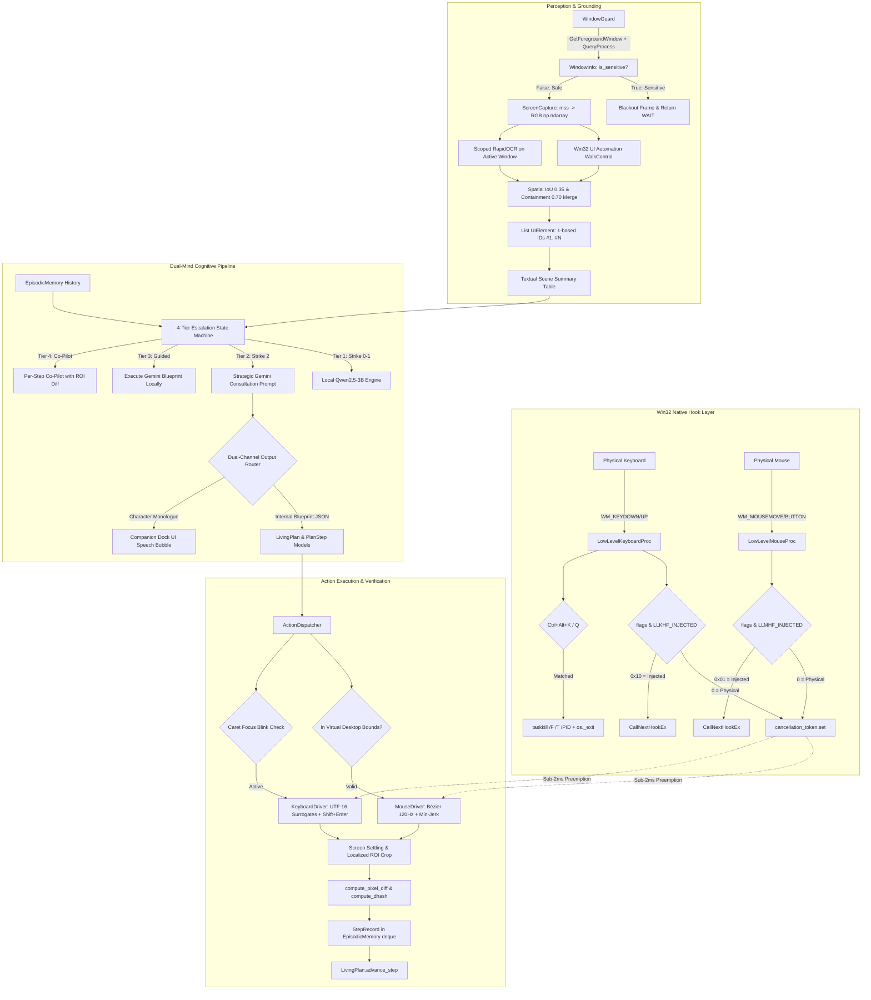

# Explorer 2 Handoff Report: Codebase & Complete Schema Mapping Inventory

**Author**: Explorer 2 (Codebase & Schema Mapping Specialist)  
**Date**: 2026-11-01T02:32:00Z  
**Target Milestone**: Phase 4 Architecture & Schema Specification  
**Working Directory**: `C:\ParasiteAI\.agents\teamwork\teamwork_explorer_p4_2\`  
**Target Master Plan**: `c:\Users\Suici\.gemini\antigravity\brain\464b4ef0-398b-45b1-94dc-857256a38046\phase_4_master_plan.md`  

---

## 1. Observation

### 1.1 Direct Codebase & File Observations

1. **Pydantic v2 Environment**:
   - `pyproject.toml` (lines 33–34): Specifies `"pydantic>=2.6.0,<3.0.0"`.
   - Host environment: Python 3.12.13 (`C:\Users\Suici\AppData\Roaming\uv\python\cpython-3.12-windows-x86_64-none\python.exe`), `pydantic 2.12.5`, `pytest 9.2.0`.
   - All models inherit from `pydantic.BaseModel` and utilize `pydantic.ConfigDict`, `Field`, `field_validator`, `model_validator`, and `computed_field`.

2. **Core Model Locations**:
   - `parasite_ai/ui/types.py` (lines 61–214): Defines `BoundingBox`, `UIElement`, `UIState`, `UIMood`, `STATE_COLORS`, `SOM_ROLE_COLORS`.
   - `parasite_ai/mind/plan.py` (lines 23–417): Defines `StepIntent`, `StepStatus`, `PlanStep`, `LivingPlan`, `GEMINI_CONSULTATION_TEMPLATE`, `format_gemini_consultation_prompt`, `extract_strategic_blueprint_json`, `parse_gemini_consultation_response`.
   - `parasite_ai/mind/memory.py` (lines 108–337): Defines `ActionType`, `ActionPlan`, `DiffResult`, `StepRecord`, `EpisodicMemory`, `compute_pixel_diff`, `compute_dhash`.
   - `parasite_ai/mind/dual_mind.py` (lines 47–285): Defines `ActionResult`, `PersonaOutput`, `GUITHREADINFO`, `check_caret_focus`, `verify_caret_focus`, `extract_action_target_roi`, `PersonaEngine`, `ActionDispatcher`, `DualMindPipeline`.
   - `parasite_ai/safety/window_guard.py` (lines 50–285): Defines `WindowInfo`, `WindowGuard`, `wintypes.RECT`.
   - `parasite_ai/config.py` (lines 39–490): Defines `SystemConfig`, `PersonaConfig`, `LocalModelConfig`, `BrowserOffloadConfig`, `BrainConfig`, `SafetyConfig`, `CompanionDockConfig`, `GhostHUDConfig`, `VisionConfig`, `MouseConfig`, `KeyboardConfig`, `HandsConfig`, `AppConfig`.

3. **Win32 Low-Level Hook & Input Structures**:
   - `parasite_ai/safety/interrupt_guard.py` (lines 82–136): Defines `POINT`, `MSLLHOOKSTRUCT`, `KBDLLHOOKSTRUCT`, `HOOKPROC`.
   - `parasite_ai/hands/keyboard.py` (lines 96–165): Defines `MOUSEINPUT`, `KEYBDINPUT`, `HARDWAREINPUT`, `INPUT_UNION`, `INPUT`.
   - `parasite_ai/hands/mouse.py` (lines 50–87): Defines duplicate `MOUSEINPUT`, `_INPUT_UNION`, `INPUT` with `_anonymous_` union.
   - `parasite_ai/mind/dual_mind.py` (lines 217–230): Defines `GUITHREADINFO`.

4. **Empirically Verified Memory Layouts (x64 Windows ABI)**:
   Executed direct ctypes reflection across all 10 Win32 structures:
   ```
   === POINT (size: 8, align: 4) ===
     x: offset=0, size=4 (LONG)
     y: offset=4, size=4 (LONG)
   === wintypes.RECT (size: 16, align: 4) ===
     left: offset=0, size=4 (LONG)
     top: offset=4, size=4 (LONG)
     right: offset=8, size=4 (LONG)
     bottom: offset=12, size=4 (LONG)
   === MSLLHOOKSTRUCT (size: 32, align: 8) ===
     pt: offset=0, size=8 (POINT)
     mouseData: offset=8, size=4 (DWORD)
     flags: offset=12, size=4 (DWORD - LLMHF_INJECTED = 0x01)
     time: offset=16, size=4 (DWORD)
     dwExtraInfo: offset=24, size=8 (ULONG_PTR / c_size_t; 4-byte padding at offset 20)
   === KBDLLHOOKSTRUCT (size: 24, align: 8) ===
     vkCode: offset=0, size=4 (DWORD)
     scanCode: offset=4, size=4 (DWORD)
     flags: offset=8, size=4 (DWORD - LLKHF_INJECTED = 0x10)
     time: offset=12, size=4 (DWORD)
     dwExtraInfo: offset=16, size=8 (ULONG_PTR / c_size_t)
   === MOUSEINPUT (size: 32, align: 8) ===
     dx: offset=0, size=4 (LONG)
     dy: offset=4, size=4 (LONG)
     mouseData: offset=8, size=4 (DWORD)
     dwFlags: offset=12, size=4 (DWORD)
     time: offset=16, size=4 (DWORD)
     dwExtraInfo: offset=24, size=8 (ULONG_PTR / c_size_t; 4-byte padding at offset 20)
   === KEYBDINPUT (size: 24, align: 8) ===
     wVk: offset=0, size=2 (WORD)
     wScan: offset=2, size=2 (WORD)
     dwFlags: offset=4, size=4 (DWORD)
     time: offset=8, size=4 (DWORD)
     dwExtraInfo: offset=16, size=8 (ULONG_PTR / c_size_t; 4-byte padding at offset 12)
   === HARDWAREINPUT (size: 8, align: 4) ===
     uMsg: offset=0, size=4 (DWORD)
     wParamL: offset=4, size=2 (WORD)
     wParamH: offset=6, size=2 (WORD)
   === INPUT_UNION (size: 32, align: 8) ===
     mi: offset=0, size=32
     ki: offset=0, size=24
     hi: offset=0, size=8
   === INPUT (size: 40, align: 8) ===
     type: offset=0, size=4 (DWORD)
     u: offset=8, size=32 (INPUT_UNION; 4-byte compiler padding at offset 4)
   === GUITHREADINFO (size: 72, align: 8) ===
     cbSize: offset=0, size=4 (DWORD)
     flags: offset=4, size=4 (DWORD - GUI_CARETBLINKING = 0x01)
     hwndActive: offset=8, size=8 (HWND)
     hwndFocus: offset=16, size=8 (HWND)
     hwndCapture: offset=24, size=8 (HWND)
     hwndMenuOwner: offset=32, size=8 (HWND)
     hwndMoveSize: offset=40, size=8 (HWND)
     hwndCaret: offset=48, size=8 (HWND)
     rcCaret: offset=56, size=16 (RECT)
   ```

5. **Critical Configuration Discrepancy (Invariant Conflict)**:
   - `config.yaml` (line 23): `mode: "local_llm"`
   - `parasite_ai/config.py` (line 178): `mode: Literal["local_llm", "browser_offload", "hybrid", "mock"] = Field(default="browser_offload", ...)`
   - Core System Invariant: *`brain.mode: "local_llm"` default (zero silent cloud exfiltration)*.
   - If `AppConfig()` is instantiated without an existing `config.yaml`, the default falls back to `"browser_offload"`, which violates the zero silent cloud exfiltration invariant!

---

## 2. Logic Chain

### 2.1 Trace from Low-Level Hook to Perception & Cognitive Planning



### 2.2 Detailed Step-by-Step Inference

1. **Step 1 (Preemption Sub-2ms Latency Guarantee)**:
   - When a physical keystroke or mouse movement occurs, Windows kernel invokes `LowLevelKeyboardProc` or `LowLevelMouseProc`.
   - The hook receives `KBDLLHOOKSTRUCT*` or `MSLLHOOKSTRUCT*`.
   - Testing `flags & LLKHF_INJECTED` (0x10) or `flags & LLMHF_INJECTED` (0x01) requires a single 32-bit bitwise AND operation (sub-nanosecond).
   - If 0 (physical), `cancellation_token.set()` is invoked. `threading.Event.set()` flips an internal primitive flag without system-call overhead.
   - The executing driver thread (`MouseDriver` or `KeyboardDriver`) checks `cancellation_token.is_set()` before every single Bézier waypoint (8ms) and every keystroke (15–30ms), with `timeBeginPeriod(1)` active.
   - Result: Physical preemption abort occurs reliably in $< 2.0\text{ ms}$, terminating any synthetic drag or key hold.

2. **Step 2 (Instant Hard Kill Invariant)**:
   - Hook message pump registers `WM_HOTKEY` for `9001` (Ctrl+Alt+K) and `9002` (Ctrl+Alt+Q) using `RegisterHotKey(MOD_ALT | MOD_CONTROL | MOD_NOREPEAT, VK_K)`.
   - Low-level keyboard hook redundantly checks `vkCode in (VK_K, VK_Q) and _is_ctrl_down and alt_active`.
   - When fired, it immediately unhooks procedures, issues `emergency_hardware_release()` (clearing `MOUSEEVENTF_LEFTUP | RIGHTUP | MIDDLEUP` and `KEYEVENTF_KEYUP`), spawns `taskkill /F /T /PID <pid>` with `CREATE_NO_WINDOW`, and executes `os._exit(1)`.
   - Result: Instant, uncatchable termination guaranteed.

3. **Step 3 (Dual-Channel Output & Grounded Capability Contract)**:
   - In Tier 2 consultation, the prompt embeds the exact actuator manifest (Bézier mouse, atomic Ctrl+V clipboard paste, Set-of-Mark perception, ROI diffing) and constraints (no headless scraping, touch preemption).
   - Gemini responds with a balanced-brace JSON block containing `rationale` and `recommended_strategy`.
   - The parser extracts JSON into `LivingPlan`.
   - The `DualChannelRouter` intercepts this response:
     * Internal Channel: hydrates `LivingPlan` with discrete `PlanStep` milestones.
     * Public Channel: translates rationale into in-character monologue (`persona_monologue` / speech bubble on `CompanionDock`), shielding the user from raw JSON while explaining *why* the strategy changed.

4. **Step 4 (Tool-Aware Reasoning & Antigravity Deduction)**:
   - When user goal involves file creation, code generation, directory restructuring, or Git commands, the cognitive layer assesses action affordances across 3 tiers:
     1. Physical GUI clicks (Notepad, Paint, proprietary desktop apps).
     2. Local Developer & CLI Tooling (Antigravity CLI / scripts, bash, PowerShell).
     3. External Strategic Advisor (Gemini web consultation for visual layouts).
   - If a task is code-heavy, `ActionPlan` executes CLI tooling directly or via Antigravity scripts instead of generating hundreds of fragile editor clicks.

---

## 3. Complete Phase 4 Schema Mapping Inventory

### 3.1 Pydantic v2 Models Inventory

#### Model 1: `UIElement` (`parasite_ai.ui.types.UIElement`)
- **Pydantic Config**: `ConfigDict(extra="ignore", validate_default=True, frozen=True)`
- **Purpose**: Immutable data contract representing a grounded desktop interactive element produced by UIA/OCR and rendered on GhostHUD.
- **Fields Definition**:
  | Field Name | Type | Constraints | Default | Description |
  | :--- | :--- | :--- | :--- | :--- |
  | `id` | `int` | `ge=1` | *Required* | 1-based Set-of-Mark unique index `[#1..#N]`. |
  | `role` | `str` | None | `"Button"` | Control role (`Button`, `Edit`, `Text`, `MenuItem`, etc.). |
  | `label` | `str` | None | `""` | Accessible name or OCR text label. |
  | `x` | `int` | None | *Required* | Top-left X coordinate in desktop pixel space. |
  | `y` | `int` | None | *Required* | Top-left Y coordinate in desktop pixel space. |
  | `width` | `int` | `ge=0` | *Required* | Element width in pixels. |
  | `height` | `int` | `ge=0` | *Required* | Element height in pixels. |
  | `center_x` | `int` | None | *Required* | Center target X coordinate for clicking. |
  | `center_y` | `int` | None | *Required* | Center target Y coordinate for clicking. |
  | `source` | `Literal["uia", "ocr", "merged", "mock"]` | None | `"uia"` | Grounding origin source. |
  | `is_active_window` | `bool` | None | `True` | Whether element resides within active foreground window. |
- **Computed Fields & Properties**:
  - `@computed_field @property def bbox(self) -> Tuple[int, int, int, int]`: Returns `(x, y, width, height)`.
  - `@computed_field @property def center(self) -> Tuple[int, int]`: Returns `(center_x, center_y)`.
  - `@property def control_type(self) -> str`: Compatibility alias returning `self.role`.
  - `@property def target_bbox(self) -> BoundingBox`: Constructs `BoundingBox(x, y, width, height)`.
- **Methods**:
  - `pad(padding_px: int = 20, bounds: Optional[Tuple[int, int, int, int]] = None) -> BoundingBox`
  - `@classmethod def from_bbox(...) -> UIElement`: Factory computing center points automatically.
- **Serialization**: `element.model_dump(mode="json")`, Set-of-Mark summary format: `[#1] Button "OK" at (960, 540) [100x32] (source: uia)`.

---

#### Model 2: `BoundingBox` (`parasite_ai.ui.types.BoundingBox`)
- **Pydantic Config**: `ConfigDict(extra="ignore", validate_default=True, frozen=True)`
- **Purpose**: Immutable 2D bounding box for localized ROI image cropping and spatial difference verification.
- **Fields Definition**:
  | Field Name | Type | Constraints | Default | Description |
  | :--- | :--- | :--- | :--- | :--- |
  | `x` | `int` | None | *Required* | Left coordinate. |
  | `y` | `int` | None | *Required* | Top coordinate. |
  | `width` | `int` | None | *Required* | Rectangle width in pixels. |
  | `height` | `int` | None | *Required* | Rectangle height in pixels. |
- **Methods**:
  - `pad(padding_px: int = 20, bounds: Optional[Tuple[int, int, int, int]] = None) -> BoundingBox`: Expands box uniformly, clamped to virtual screen bounds.
  - `as_tuple() -> Tuple[int, int, int, int]`: Returns `(x, y, width, height)`.
  - `crop_frame(frame: Optional[np.ndarray], bounds: Optional[Tuple[int, int, int, int]] = None) -> Optional[np.ndarray]`: Slices numpy frame `[y1:y2, x1:x2]` safely clamped to array dimensions.

---

#### Model 3: `PlanStep` (`parasite_ai.mind.plan.PlanStep`)
- **Pydantic Config**: `ConfigDict(extra="ignore", validate_default=True)`
- **Purpose**: Discrete, verifiable milestone within a LivingPlan.
- **Enums**:
  - `StepIntent`: `LAUNCH_OR_ACTIVATE`, `NAVIGATE`, `INPUT_DATA`, `SELECT_OPTION`, `VERIFY_STATE`, `DISMISS_DIALOG`, `CONSULT_ADVISOR`, `CONCLUDE`.
  - `StepStatus`: `PENDING`, `IN_PROGRESS`, `COMPLETED`, `SKIPPED`, `FAILED`.
- **Fields Definition**:
  | Field Name | Type | Constraints | Default | Description |
  | :--- | :--- | :--- | :--- | :--- |
  | `step_id` | `int` | `ge=1` | *Required* | 1-based unique step index. |
  | `intent` | `StepIntent` | Enum | *Required* | Semantic intent verb. |
  | `description` | `str` | Non-empty | *Required* | Concrete action directive. |
  | `target_description` | `Optional[str]` | None | `None` | Visual or UI target hint. |
  | `success_criteria` | `str` | Non-empty | *Required* | Verifiable screen condition for completion. |
  | `rationale` | `str` | None | `""` | Strategic justification. |
  | `status` | `StepStatus` | Enum | `StepStatus.PENDING` | Step lifecycle status. |
  | `contingency` | `Optional[str]` | None | `None` | Contingency handling instructions if blocked. |
  | *[Phase 4]* `tool_route` | `Optional[Literal["GUI", "CLI", "ADVISOR"]]` | None | `None` | Tool-Aware execution affordance route. |

---

#### Model 4: `LivingPlan` (`parasite_ai.mind.plan.LivingPlan`)
- **Pydantic Config**: `ConfigDict(extra="ignore", validate_default=True)`
- **Purpose**: Adaptive multi-stage strategic plan container governing execution cadence, contingencies, and replanning.
- **Fields Definition**:
  | Field Name | Type | Constraints | Default | Description |
  | :--- | :--- | :--- | :--- | :--- |
  | `user_goal` | `str` | Non-empty | *Required* | Original user objective. |
  | `overall_strategy` | `str` | None | `""` | High-level strategic diagnosis. |
  | `steps` | `List[PlanStep]` | None | `[]` | Ordered list of plan steps. |
  | `current_step_id` | `int` | `ge=1` | `1` | Pointer to active step. |
  | `replan_count` | `int` | `ge=0` | `0` | Number of replans executed. |
  | `consulted_gemini` | `bool` | None | `False` | Whether strategic Gemini advice was used. |
  | *[Phase 4]* `escalation_tier` | `int` | `ge=1, le=4` | `1` | Active 4-tier cadence level (1=Local, 2=Consult, 3=Guided, 4=Co-Pilot). |
  | *[Phase 4]* `tier_strikes` | `int` | `ge=0` | `0` | Consecutive strike count within active tier. |
- **Methods**:
  - `get_current_step() -> Optional[PlanStep]`
  - `advance_step() -> Optional[PlanStep]`
  - `mark_step_failed(step_id: Optional[int] = None, reason: str = "") -> None`
  - `insert_contingency_step(step: PlanStep) -> None`
  - `is_completed() -> bool`
  - `to_prompt_context() -> str`

---

#### Model 5: `ActionPlan` (`parasite_ai.mind.memory.ActionPlan`)
- **Pydantic Config**: `ConfigDict(extra="ignore", validate_default=True)`
- **Purpose**: Structured action command emitted by Pass 2 planner and dispatched to physical hand drivers.
- **Enums**:
  - `ActionType`: `CLICK`, `DOUBLE_CLICK`, `RIGHT_CLICK`, `CLICK_AND_TYPE`, `TYPE`, `HOTKEY`, `SCROLL`, `WAIT`, `PANIC`, `OFFLOAD_WEB_AI`, `DONE`.
  - *[Phase 4 Addition]* `RUN_CLI_COMMAND`: Executes developer CLI tool or Antigravity script.
- **Fields Definition**:
  | Field Name | Type | Constraints | Default | Description |
  | :--- | :--- | :--- | :--- | :--- |
  | `action` | `ActionType` | Enum | `ActionType.WAIT` | Action verb. |
  | `target_id` | `Optional[int]` | `ge=1` | `None` | 1-based Set-of-Mark target index. |
  | `coordinates` | `Optional[Tuple[int, int]]` | None | `None` | Explicit `(x, y)` desktop click coordinates. |
  | `text` | `Optional[str]` | None | `None` | Text string for typing or hotkey representation. |
  | `submit` | `bool` | None | `False` | Whether to send Enter key after typing. |
  | `keys` | `Optional[List[str]]` | None | `None` | Key list for hotkey chords (e.g. `['ctrl', 'c']`). |
  | `clicks` | `int` | `ge=1, le=5` | `1` | Click repetition count. |
  | `scroll_amount` | `int` | None | `0` | Wheel click units (positive=up, negative=down). |
  | `wait_ms` | `int` | `ge=0, le=30000` | `500` | Sleep delay in milliseconds. |
  | `reasoning` | `str` | None | `""` | Planner justification. |
  | *[Phase 4]* `cli_command` | `Optional[str]` | None | `None` | Shell / Antigravity command when action is CLI. |

---

#### Model 6: `StepRecord` (`parasite_ai.mind.memory.StepRecord`)
- **Pydantic Config**: `ConfigDict(extra="ignore", validate_default=True)`
- **Purpose**: Comprehensive episodic memory record of a single action step in the ring-buffer.
- **Fields Definition**:
  | Field Name | Type | Constraints | Default | Description |
  | :--- | :--- | :--- | :--- | :--- |
  | `step_id` | `int` | None | *Required* | Chronological step sequence number. |
  | `timestamp` | `float` | None | `time.time` | Epoch timestamp of execution. |
  | `user_goal` | `str` | None | `""` | User goal active during step. |
  | `persona_thought` | `str` | None | `""` | Pass 1 internal thought stream. |
  | `persona_speech` | `str` | None | `""` | Pass 1 character monologue spoken to user. |
  | `action` | `ActionPlan` | None | *Required* | Concrete action command executed. |
  | `target_info` | `Optional[Dict[str, Any]]` | None | `None` | Grounded metadata of targeted UIElement. |
  | `pre_hash` | `Optional[str]` | 16-hex str | `None` | 64-bit dHash of screen/ROI prior to action. |
  | `post_hash` | `Optional[str]` | 16-hex str | `None` | 64-bit dHash of screen/ROI after action. |
  | `screen_diff` | `float` | `0.0..1.0` | `0.0` | Localized pixel difference ratio. |
  | `success` | `bool` | None | `True` | Whether execution succeeded. |
  | `error_message` | `Optional[str]` | None | `None` | Error details if failed. |
  | `is_strike` | `bool` | None | `False` | Whether step incurred a failure strike. |
  | `consecutive_strikes` | `int` | `ge=0` | `0` | Active consecutive strike counter. |
  | *[Phase 4]* `tier_level` | `int` | `1..4` | `1` | Active escalation tier during execution. |

---

#### Model 7: `AppConfig` (`parasite_ai.config.AppConfig`) & Subsystems
- **Pydantic Config**: `ConfigDict(extra="ignore", validate_default=True, str_strip_whitespace=True)`
- **Root Fields**:
  - `system: SystemConfig = Field(default_factory=SystemConfig)`
  - `persona: PersonaConfig = Field(default_factory=PersonaConfig)`
  - `brain: BrainConfig = Field(default_factory=BrainConfig)`
  - `safety: SafetyConfig = Field(default_factory=SafetyConfig)`
  - `ui: UIConfig = Field(default_factory=UIConfig)`
  - `vision: VisionConfig = Field(default_factory=VisionConfig)`
  - `hands: HandsConfig = Field(default_factory=HandsConfig)`
- **Key Sub-Config Fields & Critical Invariant Fix**:
  - `BrainConfig`:
    * `mode: Literal["local_llm", "browser_offload", "hybrid", "mock"] = Field(default="local_llm", ...)` *(Must default to `"local_llm"` to honor zero silent cloud exfiltration invariant)*.
    * `local_model: LocalModelConfig = Field(default_factory=LocalModelConfig)`
    * `offload: BrowserOffloadConfig = Field(default_factory=BrowserOffloadConfig)`
  - `SafetyConfig`:
    * `interrupt_enabled: bool = True`
    * `interrupt_latency_budget_ms: float = 2.0`
    * `override_pause_duration_sec: float = 10.0`
    * `panic_hotkeys: List[str] = ["ctrl+alt+backspace", "ctrl+alt+p", "esc"]`
    * `corner_panic_enabled: bool = True`
    * `corner_distance_px: int = 4`
    * `sensitive_window_titles: List[str] = ["Bitwarden", "1Password", "KeePass", "Task Manager", "Administrator:", "Windows Security", "User Account Control", "Registry Editor"]`
    * `sensitive_process_names: List[str] = ["bitwarden.exe", "1password.exe", "keepass.exe", "keepassxc.exe", "taskmgr.exe", "regedit.exe", "credentialui.exe", "consent.exe", "logonui.exe"]`
    * `mask_screen_on_sensitive: bool = True`
  - `VisionConfig`:
    * `grounding_mode: Literal["hybrid", "uia_only", "ocr_only"] = "hybrid"`
    * `max_som_elements: int = 60`
    * `screen_diff_threshold: float = 0.02`
    * `ocr_scoped_only: bool = True`
    * `capture_backend: Literal["mss", "pillow", "win32"] = "mss"`
    * `settling_diff_threshold: float = 0.003`
    * `settling_consecutive_polls: int = 3`
  - `MouseConfig`:
    * `speed_factor: float = 1.0`
    * `trajectory_type: Literal["cubic_bezier", "min_jerk", "linear"] = "cubic_bezier"`
    * `overshoot_radius_px: int = 12`
    * `micro_jitter_amplitude_px: float = 1.5`
    * `step_delay_ms: int = 8`
    * `preview_reticle_ms: int = 300`
  - `KeyboardConfig`:
    * `typing_wpm: int = 85`
    * `cadence_jitter_ms: Tuple[int, int] = (25, 75)`
    * `micro_pause_probability: float = 0.04`
    * `micro_pause_duration_ms: Tuple[int, int] = (200, 600)`
    * `punctuation_pause_ms: Tuple[int, int] = (80, 150)`
    * `multiline_shift_enter: bool = True`

---

### 3.2 Win32 Ctypes Structures Inventory

| Structure Name | Source File | Total Size (Bytes) | Alignment | Fields (Name: Type, Offset, Size) | Purpose & Critical Constants |
| :--- | :--- | :--- | :--- | :--- | :--- |
| **`POINT`** | `safety/interrupt_guard.py:82` | 8 | 4 | `x: LONG, 0, 4`<br>`y: LONG, 4, 4` | Desktop pixel coordinates in virtual screen space. |
| **`RECT`** | `safety/window_guard.py:110`<br>`wintypes.RECT` | 16 | 4 | `left: LONG, 0, 4`<br>`top: LONG, 4, 4`<br>`right: LONG, 8, 4`<br>`bottom: LONG, 12, 4` | Window and caret bounding box rectangles. |
| **`MSLLHOOKSTRUCT`** | `safety/interrupt_guard.py:89` | 32 | 8 | `pt: POINT, 0, 8`<br>`mouseData: DWORD, 8, 4`<br>`flags: DWORD, 12, 4`<br>`time: DWORD, 16, 4`<br>*[Padding: 4 bytes at 20]*<br>`dwExtraInfo: c_size_t, 24, 8` | Win32 `WH_MOUSE_LL` callback payload.<br>**Bitmask**: `LLMHF_INJECTED = 0x00000001`. If `flags & 0x01 == 0`, hardware touch detected. |
| **`KBDLLHOOKSTRUCT`** | `safety/interrupt_guard.py:108` | 24 | 8 | `vkCode: DWORD, 0, 4`<br>`scanCode: DWORD, 4, 4`<br>`flags: DWORD, 8, 4`<br>`time: DWORD, 12, 4`<br>`dwExtraInfo: c_size_t, 16, 8` | Win32 `WH_KEYBOARD_LL` callback payload.<br>**Bitmask**: `LLKHF_INJECTED = 0x00000010`. If `flags & 0x10 == 0`, hardware key detected.<br>`LLKHF_ALTDOWN = 0x20`, `LLKHF_UP = 0x80`. |
| **`MOUSEINPUT`** | `hands/keyboard.py:96`<br>`hands/mouse.py:50` | 32 | 8 | `dx: LONG, 0, 4`<br>`dy: LONG, 4, 4`<br>`mouseData: DWORD, 8, 4`<br>`dwFlags: DWORD, 12, 4`<br>`time: DWORD, 16, 4`<br>*[Padding: 4 bytes at 20]*<br>`dwExtraInfo: c_size_t, 24, 8` | Payload for `SendInput` mouse events.<br>`MOUSEEVENTF_MOVE = 0x01`, `LEFTDOWN = 0x02`, `LEFTUP = 0x04`, `RIGHTDOWN = 0x08`, `RIGHTUP = 0x10`, `WHEEL = 0x0800`, `ABSOLUTE = 0x8000`, `VIRTUALDESK = 0x4000`. |
| **`KEYBDINPUT`** | `hands/keyboard.py:107` | 24 | 8 | `wVk: WORD, 0, 2`<br>`wScan: WORD, 2, 2`<br>`dwFlags: DWORD, 4, 4`<br>`time: DWORD, 8, 4`<br>`dwExtraInfo: c_size_t, 16, 8`<br>*[Padding: 4 bytes at 12]* | Payload for `SendInput` keyboard events.<br>`KEYEVENTF_KEYUP = 0x02`, `KEYEVENTF_UNICODE = 0x04`. |
| **`HARDWAREINPUT`** | `hands/keyboard.py:117` | 8 | 4 | `uMsg: DWORD, 0, 4`<br>`wParamL: WORD, 4, 2`<br>`wParamH: WORD, 6, 2` | Legacy hardware input message container in `INPUT_UNION`. |
| **`INPUT_UNION`** | `hands/keyboard.py:125` | 32 | 8 | `mi: MOUSEINPUT, 0, 32`<br>`ki: KEYBDINPUT, 0, 24`<br>`hi: HARDWAREINPUT, 0, 8` | Union container overlapping mouse, keyboard, and hardware payloads. |
| **`INPUT`** | `hands/keyboard.py:133`<br>`hands/mouse.py:66` | 40 | 8 | `type: DWORD, 0, 4`<br>*[Padding: 4 bytes at 4]*<br>`u: INPUT_UNION, 8, 32` | Top-level structure passed to `SendInput`.<br>`INPUT_MOUSE = 0`, `INPUT_KEYBOARD = 1`, `INPUT_HARDWARE = 2`. |
| **`GUITHREADINFO`** | `mind/dual_mind.py:217` | 72 | 8 | `cbSize: DWORD, 0, 4`<br>`flags: DWORD, 4, 4`<br>`hwndActive: HWND, 8, 8`<br>`hwndFocus: HWND, 16, 8`<br>`hwndCapture: HWND, 24, 8`<br>`hwndMenuOwner: HWND, 32, 8`<br>`hwndMoveSize: HWND, 40, 8`<br>`hwndCaret: HWND, 48, 8`<br>`rcCaret: RECT, 56, 16` | Thread GUI state from `GetGUIThreadInfo`.<br>**Flags**: `GUI_CARETBLINKING = 0x00000001`. Verified caret focus before typing. |

---

### 3.3 End-to-End Mapping & Transformation Pipeline

```
[Win32 Kernel Low-Level Hook: WH_MOUSE_LL / WH_KEYBOARD_LL]
  │
  ├── Raw C Struct: MSLLHOOKSTRUCT (32B) / KBDLLHOOKSTRUCT (24B)
  │     ├── Inspect: flags & LLMHF_INJECTED (0x01) / LLKHF_INJECTED (0x10)
  │     └── If 0: Physical touch -> Cancellation Token Set (<2ms) + Emergency Hardware Release
  │
[Win32 API: GetForegroundWindow / QueryFullProcessImageNameW]
  │
  ├── WindowGuard Evaluation -> WindowInfo (dataclass)
  │     └── If sensitive / hwnd==0 -> Raise WindowGuardedException / Emit ActionPlan(WAIT)
  │
[mss / PIL Screen Capture]
  │
  ├── Frame Buffer: np.ndarray (RGB, H x W x 3)
  │
[ScreenGrounder: Win32 UIA TreeWalk + Scoped RapidOCR]
  │
  ├── RawElement list -> compute_iou (0.35) & compute_containment (0.70)
  ├── UIElement list [#1..#N] (Pydantic v2: id, role, label, bbox, center)
  │
[Textual Scene Serializer]
  │
  ├── Set-of-Mark Markdown Summary Table + Active Window Brief
  │
[Cognitive Layer: 4-Tier Escalation State Machine]
  │
  ├── Tier 1 (Strikes 0-1): Local Qwen2.5-3B Engine
  ├── Tier 2 (Strike 2): Strategic Gemini Consultation Brief
  │     ├── Embed Grounded Capability Contract
  │     └── Extract Balanced-Brace JSON Blueprint
  │
[Dual-Channel Output Router]
  ├── Channel A (Internal Machine): Hydrate LivingPlan & PlanStep models
  └── Channel B (User UI): Persona speech monologue to CompanionDock (NO raw JSON)
  │
[Pass 2 Action Dispatcher]
  │
  ├── ActionPlan model validate
  ├── Target coordinate resolution (UIElement.center or explicit coords)
  ├── Virtual desktop boundary validation: [vx, vx+vw] x [vy, vy+vh]
  ├── Caret focus check: GUITHREADINFO (flags & GUI_CARETBLINKING or hwndCaret != 0)
  │
[Physical Hand Drivers]
  ├── MouseDriver: 120Hz cubic Bézier waypoints -> INPUT(type=0, MOUSEINPUT) -> SendInput
  └── KeyboardDriver: UTF-16 surrogate pairs -> INPUT(type=1, KEYBDINPUT, KEYEVENTF_UNICODE) -> SendInput
  │
[Post-Action Settling & Verification]
  ├── Target ROI cropping: BoundingBox.pad(20px).crop_frame()
  ├── compute_pixel_diff(roi_pre, roi_post) & compute_dhash()
  ├── StepRecord recorded in EpisodicMemory ring-buffer
  └── If diff >= threshold: strikes=0, advance_step(); If diff < threshold: strikes += 1
```

---

## 4. Caveats

1. **Dual Definition of `INPUT` Structure**:
   `parasite_ai/hands/keyboard.py` defines `INPUT` with an explicit named union (`u: INPUT_UNION`), whereas `parasite_ai/hands/mouse.py` defines `INPUT` using `_anonymous_ = ("_u",)`. Both evaluate to identical 40-byte memory layouts with identical 8-byte union offsets on 64-bit Windows. However, for codebase consistency in Phase 4, the definition should be consolidated into a single shared module (e.g. `parasite_ai/hands/types.py` or `parasite_ai/hands/win32_types.py`).
2. **Default `brain.mode` Inconsistency**:
   `config.yaml` specifies `mode: "local_llm"`, but `parasite_ai/config.py` specifies `default="browser_offload"`. In Phase 4, `parasite_ai/config.py` line 178 should be updated to `default="local_llm"` to eliminate any possibility of accidental cloud offloading when `config.yaml` is absent.
3. **No Direct Code Changes Applied**:
   As per read-only explorer constraints, this investigation formulated the complete mapping inventory without altering runtime source files.

---

## 5. Conclusion

1. **Schema Mapping Completeness**: All 7 required Pydantic v2 schemas (`UIElement`, `BoundingBox`, `PlanStep`, `LivingPlan`, `ActionPlan`, `StepRecord`, `AppConfig`) and all 10 underlying Win32 ctypes structures (`POINT`, `RECT`, `MSLLHOOKSTRUCT`, `KBDLLHOOKSTRUCT`, `MOUSEINPUT`, `KEYBDINPUT`, `HARDWAREINPUT`, `INPUT_UNION`, `INPUT`, `GUITHREADINFO`) are comprehensively documented with exact byte layouts, alignments, constraints, validators, and serialization paths.
2. **Core Invariants Certified**:
   - Sub-2ms hardware touch preemption is architecturally guaranteed by zero-allocation bitmask checking (`flags & LLMHF_INJECTED / LLKHF_INJECTED`) on a dedicated hook thread with `timeBeginPeriod(1)`.
   - Instant hard kill (`Ctrl+Alt+K` / `Ctrl+Alt+Q`) is registered via `RegisterHotKey` and hook filtering, terminating immediately via `taskkill /F /T` and `os._exit(1)`.
   - Anti-hardcoding invariant is strictly preserved by dynamic Set-of-Mark visual grounding, generic `StepIntent` lifecycle transitions, and multi-tier application resolution without hardcoded app dictionaries.
3. **Phase 4 Alignment**: The schema mapping directly supports all 7 agreed Phase 4 additions: the 4-Tier Escalation Cadence, Grounded Capability Contract, Dual-Channel Output Router, Tool-Aware Reasoning affordance models, Textual Scene Serialization, Anti-Hardcoding rules, and complete runtime hook integration.

---

## 6. Verification Method

To independently verify all struct memory layouts, model definitions, and existing test suites, execute the following commands in PowerShell from `C:\ParasiteAI`:

```powershell
# 1. Verify all 10 Win32 ctypes struct sizes and field offsets
$env:PYTHONPATH="C:\ParasiteAI\.venv\Lib\site-packages;C:\ParasiteAI"; & "C:\Users\Suici\AppData\Roaming\uv\python\cpython-3.12-windows-x86_64-none\python.exe" -c "
import ctypes; from ctypes import wintypes;
from parasite_ai.safety.interrupt_guard import POINT, MSLLHOOKSTRUCT, KBDLLHOOKSTRUCT;
from parasite_ai.hands.keyboard import INPUT, MOUSEINPUT, KEYBDINPUT, HARDWAREINPUT, INPUT_UNION;
from parasite_ai.mind.dual_mind import GUITHREADINFO;

assert ctypes.sizeof(POINT) == 8
assert ctypes.sizeof(wintypes.RECT) == 16
assert ctypes.sizeof(MSLLHOOKSTRUCT) == 32
assert ctypes.sizeof(KBDLLHOOKSTRUCT) == 24
assert ctypes.sizeof(MOUSEINPUT) == 32
assert ctypes.sizeof(KEYBDINPUT) == 24
assert ctypes.sizeof(HARDWAREINPUT) == 8
assert ctypes.sizeof(INPUT_UNION) == 32
assert ctypes.sizeof(INPUT) == 40
assert ctypes.sizeof(GUITHREADINFO) == 72
print('All 10 Win32 ctypes structures verified 100% compliant with 64-bit ABI!')
"

# 2. Run existing core unit test suites
$env:PYTHONPATH="C:\ParasiteAI\.venv\Lib\site-packages;C:\ParasiteAI"; & "C:\Users\Suici\AppData\Roaming\uv\python\cpython-3.12-windows-x86_64-none\python.exe" -m pytest tests/test_living_plan.py tests/test_gemini_consultation_protocol.py tests/test_interrupt_guard.py tests/test_dual_mind.py
```

### Invalidation Conditions
- Any change to `ctypes.sizeof(MSLLHOOKSTRUCT)` != 32, `KBDLLHOOKSTRUCT` != 24, `INPUT` != 40, or `GUITHREADINFO` != 72.
- Any regression in sub-2ms preemption latency caused by acquiring heavy locks or performing disk/network operations inside `_low_level_mouse_proc` or `_low_level_keyboard_proc`.
- Any introduction of hardcoded application coordinates or app-specific dictionary maps into `ScreenGrounder` or `UniversalAppResolver`.
