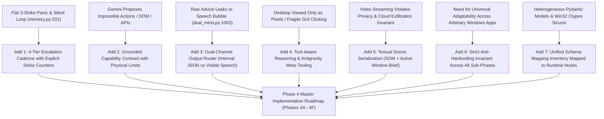
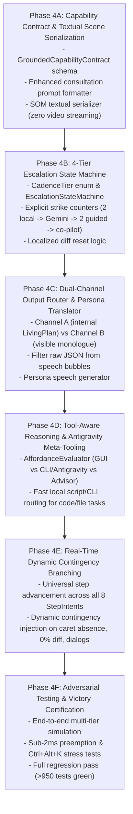

# Phase 4 Architectural Additions & Master Implementation Roadmap
**Author:** Explorer 3 (Architectural Additions & Phase 4 Roadmap Architect)  
**Date:** 2026-11-01  
**Working Directory:** `C:\ParasiteAI\.agents\teamwork\teamwork_explorer_p4_3`  
**Target Milestone:** Phase 4 (Strategic Cognitive Protocol, 4-Tier Escalation & Tool-Aware Reasoning)  
**Base Test Suite Baseline:** 877 / 877 Tests Passing (100% Green, 0 Regressions)

---

## 1. Observation

Direct investigation of the ParasiteAI codebase and preplanning artifacts revealed the following exact empirical facts, code structures, and operational boundaries:

### 1.1 Existing Plan & Consultation Subsystem
* In `parasite_ai/mind/plan.py`:
  * Lines 23–33 define the semantic intent taxonomy:
    ```python
    class StepIntent(str, Enum):
        LAUNCH_OR_ACTIVATE = "LAUNCH_OR_ACTIVATE"
        NAVIGATE = "NAVIGATE"
        INPUT_DATA = "INPUT_DATA"
        SELECT_OPTION = "SELECT_OPTION"
        VERIFY_STATE = "VERIFY_STATE"
        DISMISS_DIALOG = "DISMISS_DIALOG"
        CONSULT_ADVISOR = "CONSULT_ADVISOR"
        CONCLUDE = "CONCLUDE"
    ```
  * Lines 44–56 define `PlanStep` (with fields `step_id`, `intent`, `description`, `target_description`, `success_criteria`, `rationale`, `status`, `contingency`).
  * Lines 58–71 define `LivingPlan` (tracking `user_goal`, `overall_strategy`, `steps`, `current_step_id`, `replan_count`, `consulted_gemini`).
  * Lines 168–193 define `GEMINI_CONSULTATION_TEMPLATE`: currently formats user goal, active window, open apps, visual scene, and dilemma, requesting a JSON block with `rationale` and `recommended_strategy`. However, it lacks a formal capability contract, tool affordance manifest, and multi-turn state.
  * Lines 286–314 define `extract_strategic_blueprint_json`: multi-pass resilient extractor (direct JSON, markdown codeblock, balanced-brace depth scan).
  * Lines 344–416 define `parse_gemini_consultation_response`: parses raw text into a validated `LivingPlan`.

### 1.2 Episodic Memory & Failure Detection
* In `parasite_ai/mind/memory.py`:
  * Lines 191–204: `EpisodicMemory` defines a ring buffer (`collections.deque(maxlen=20)`), `strike_limit = 3`, and `self._consecutive_strikes: int = 0`.
  * Lines 231–238: Strike evaluation:
    ```python
    if parsed_action.action in INTERACTIVE_ACTION_TYPES:
        if not success or screen_diff < self.screen_diff_threshold:
            is_strike = True
            self._consecutive_strikes += 1
        else:
            self._consecutive_strikes = 0
    ```
  * Lines 264–267: `is_in_loop()` returns `self._consecutive_strikes >= self.strike_limit`.
  * *Observation on Deficiency:* The failure loop detector is a flat, unguided 3-strike mechanism. When triggered, it defaults to `ActionPlan(action=ActionType.PANIC)` without an escalation hierarchy (no multi-tier progression through local trials, strategic advisor, guided execution, or visual co-pilot).

### 1.3 Execution Loop & Telemetry Routing
* In `parasite_ai/mind/dual_mind.py`:
  * Lines 899–917: Pass 1 `PersonaEngine.generate_monologue()` generates thought and speech.
  * Lines 922–927: On `is_in_loop()`, emits `ActionType.PANIC`.
  * Lines 998–1006: Web AI offload handling:
    ```python
    harvested = self.offloader.query_web_ai(user_goal)
    if isinstance(harvested, str) and harvested.strip():
        persona_out.thought = f"{persona_out.thought}\n[Web AI Advice]: {harvested.strip()}"
        persona_out.speech = f"Web AI advises: {harvested.strip()[:180]}"
        if self.bridge:
            self.bridge.notify_speech(persona_out.speech)
    ```
  * *Observation on Deficiency:* Raw Web AI strings are partially truncated and piped directly to the user speech bubble. If Gemini returns structured JSON or machine directives, raw JSON or code fragments leak directly to the user on the desktop.
  * Lines 1038–1045: `extract_action_target_roi()` scopes post-action visual verification to `target_roi` with `padding_px=20` clamped to `vbounds`.
  * Lines 1090–1104: Step advancement only advances on `LAUNCH_OR_ACTIVATE` or `DISMISS_DIALOG`, leaving other intents (`NAVIGATE`, `INPUT_DATA`, `SELECT_OPTION`, `VERIFY_STATE`) without universal verified advancement logic.

### 1.4 Safety & Hardware Preemption
* In `parasite_ai/safety/interrupt_guard.py`:
  * Low-level Win32 hooks (`WH_MOUSE_LL = 14`, `WH_KEYBOARD_LL = 13`) running in a dedicated thread.
  * Differentiates synthetic injected inputs (`LLMHF_INJECTED = 0x00000001`, `LLKHF_INJECTED = 0x00000010`) from physical hardware inputs.
  * Physical inputs abort active automation in `<2ms` via atomic `cancellation_token.cancel()`.
* In `parasite_ai/safety/panic.py`:
  * `Ctrl+Alt+K` triggers instantaneous hard process tree termination (<5ms) via `taskkill /F /T /PID` and `os._exit(1)`.

### 1.5 Master Plan Artifacts
* In `c:\Users\Suici\.gemini\antigravity\brain\464b4ef0-398b-45b1-94dc-857256a38046\phase_4_master_plan.md`:
  * Lays out initial concepts for 4-tier escalation, capability grounding, dual-channel output, and tool-aware reasoning, but requires comprehensive architectural specification, formal state transitions, schema definitions, and a detailed, verifiable implementation roadmap.

---

## 2. Logic Chain

From these empirical observations, the architectural necessity for the 7 additions and the roadmap design proceeds through rigorous deductive steps:



### 2.1 Addition 1: The 4-Tier Escalation Cadence
1. **Deductive Step:** In desktop automation, agents frequently encounter ambiguous UI states (e.g., non-responsive buttons, slow loading, hidden submenus). A flat 3-strike panic aborts prematurely, while endless local retries cause repetitive thrashing.
2. **Hierarchy Design:**
   - **Tier 1 (Autonomous Local Exploration):** Local model (Qwen2.5-3B) executes up to **2 consecutive attempts**. If an action achieves positive localized pixel diff ($\ge 0.02$) and advances state, `local_strikes` resets to 0. If `local_strikes == 2`, trigger Tier 2.
   - **Tier 2 (Deep Strategic Gemini Consultation):** Physical execution halts. Parasite compiles a standardized brief containing the Grounded Capability Contract, textual Set-of-Mark scene, and dilemma description. Gemini returns a structured JSON blueprint. Upon validation, the pipeline transitions to Tier 3.
   - **Tier 3 (Guided Local Execution):** Parasite executes the Gemini blueprint locally with up to **2 guided attempts**. If a step succeeds, advance step. If `guided_strikes == 2` (the blueprint itself is failing), escalate to Tier 4.
   - **Tier 4 (Continuous Visual Co-Pilot / Handholding):** Step-by-step interactive guidance. For each micro-action, before-and-after localized ROI diffs and SOM coordinates are verified by Gemini. If 3 consecutive co-pilot actions fail (`copilot_strikes == 3`), trigger Graceful User Handoff.
   - **Graceful User Override (Cadence Exit):** Hands are cleanly paused (`ActionType.WAIT`). Parasite speaks to the user via the Companion Dock in character persona, explaining the exact bottleneck and requesting human intervention.

#### Formal Escalation State Machine Specification:

| Current State | Event / Trigger | Condition | Next State | Action / Transition Effect |
| :--- | :--- | :--- | :--- | :--- |
| **TIER_1_LOCAL** | Action Success | $\text{screen\_diff} \ge 0.02$ & execution ok | **TIER_1_LOCAL** | `local_strikes = 0`; advance step |
| **TIER_1_LOCAL** | Action Failure | $\text{screen\_diff} < 0.02$ or error | **TIER_1_LOCAL** | `local_strikes += 1`; inject strike warning |
| **TIER_1_LOCAL** | Strike Limit Reached | `local_strikes == 2` | **TIER_2_CONSULT** | Pause hands; compile brief + capability manifest |
| **TIER_2_CONSULT** | Blueprint Validated | `LivingPlan` extracted & valid | **TIER_3_GUIDED** | Hydrate `active_plan`; `guided_strikes = 0` |
| **TIER_2_CONSULT** | Advisor Error / Timeout | Network failure or invalid JSON | **TIER_1_LOCAL** | Fallback to local replan or prompt user; `local_strikes = 0` |
| **TIER_3_GUIDED** | Guided Step Success | $\text{screen\_diff} \ge 0.02$ & criteria met | **TIER_3_GUIDED** | Advance blueprint step; `guided_strikes = 0` |
| **TIER_3_GUIDED** | Guided Step Failure | $\text{screen\_diff} < 0.02$ or criteria unmet | **TIER_3_GUIDED** | `guided_strikes += 1`; check `step.contingency` |
| **TIER_3_GUIDED** | Guided Limit Reached | `guided_strikes == 2` | **TIER_4_CO_PILOT** | Escalate to interactive step-by-step handholding |
| **TIER_4_CO_PILOT** | Co-Pilot Progress | Step resolved with Gemini | **TIER_3_GUIDED** or **DONE** | Resume guided or complete goal; `copilot_strikes = 0` |
| **TIER_4_CO_PILOT** | Co-Pilot Failure | Micro-action failed | **TIER_4_CO_PILOT** | `copilot_strikes += 1` |
| **TIER_4_CO_PILOT** | Persistent Deadlock | `copilot_strikes == 3` | **USER_ESCALATION** | Pause hands; explain dilemma via persona speech bubble |
| **ANY_STATE** | Hardware Touch | Physical mouse/key moved | **USER_OVERRIDE** | Sub-2ms hardware preemption; abort pending synthetic input |
| **ANY_STATE** | Emergency Hotkey | `Ctrl+Alt+K` pressed | **PROCESS_TERMINATED** | Instant native kill (<5ms) via `taskkill /F /T` |

---

### 2.2 Addition 2: Grounded Capability Contract
1. **Deductive Step:** Remote Large Language Models possess broad generalized knowledge of computing (web scraping, API calls, DOM manipulation, bash scripts). When consulted blindly, they generate instructions unexecutable by a desktop-native physical agent.
2. **Contract Specification:** Every consultation payload injected into Gemini must contain an unalterable **Physical Capability Manifest**:

```yaml
Parasite_Capability_Contract:
  Actuators:
    Mouse:
      Kinematics: "Human-like cubic Bézier curves, 5th-order Min-Jerk velocity profile, 1px Gaussian micro-jitter"
      Primitives: ["left_click", "double_click", "right_click", "middle_click", "drag_and_drop(x1, y1, x2, y2)", "scroll(delta)"]
      Coordinate_Space: "Virtual desktop bounds (0, 0, 3840, 1080) at 100% DPI (96 DPI)"
    Keyboard:
      Fast_Typing: "Atomic clipboard Ctrl+V paste (<100ms) with pre-backup and post-restoration"
      Cadence_Typing: "Physical KEYEVENTF_UNICODE with 15-45ms human cadence jitter"
      System_Chords: ["Win", "Alt+Tab", "Ctrl+S", "Ctrl+F", "Ctrl+A", "Ctrl+Z", "Enter", "Esc", "Tab", "Backspace", "Delete"]
  Perception:
    Resolution: "1:1 unscaled cursor foveal crop (512x512) and virtual screen macro glance (3840x1080)"
    Element_Grounding: "Numbered Set-of-Mark (SOM) tags [#1..#N] with bounding boxes [x, y, w, h]"
    Visual_Diffing: "Localized ROI diffing (padded target bounding box + 20px) with 64-bit dHash and normalized pixel ratio"
    Focus_Detection: "Win32 Caret blinking detection via 64-bit GUITHREADINFO before typing"
  Hard_Constraints:
    - "ZERO headless browser automation; NO DOM manipulation or document.querySelector"
    - "ZERO direct OS API injection (WM_SETTEXT); actions must use physical synthetic inputs"
    - "Sub-2ms physical hardware preemption: synthetic actions abort immediately if user moves mouse or touches keyboard"
    - "Protected windows (password managers, UAC prompts) trigger automated execution pause"
    - "Strict anti-hardcoding: NO application-specific static lookup tables or canned scripts"
```

3. **Multi-Turn Interaction:** The contract includes hooks for multi-turn clarification (e.g. Gemini requesting specific SOM subtree clarification or verifying candidate bounding box IDs).

---

### 2.3 Addition 3: Dual-Channel Output Architecture
1. **Deductive Step:** ParasiteAI has two distinct audiences for every cognitive step:
   - **Internal Engine:** Needs structured JSON (`LivingPlan`, `PlanStep`, `StepIntent`, coordinates, timeout).
   - **Human User:** Needs character immersion, empathy, and transparent plain English explanations via the Companion Dock.
2. **Channel Routing Design:**

```
                    ┌──────────────────────────────────────────────┐
                    │      Cognitive Output / Strategic Plan       │
                    └──────────────────────┬───────────────────────┘
                                           │
                     ┌─────────────────────┴─────────────────────┐
                     ▼                                           ▼
         [Channel A: Machine Blueprint]             [Channel B: Persona Monologue]
         - extract_strategic_blueprint_json()       - PersonaVoiceTranslator.synthesize()
         - LivingPlan Pydantic Validation           - Plain English explanation
         - ActionDispatcher Execution               - Companion Dock Speech Bubble
         - Zero UI pollution / invisible            - UIBridge.notify_speech()
```

3. **Persona Voice Translation Rules:**
   - Raw JSON code blocks, coordinate tuples `(x, y)`, and internal regexes are strictly filtered out of Channel B.
   - Channel B articulates:
     - The high-level intent: *"Let's open Notepad from the Start menu."*
     - The strategic pivot: *"The direct button was unresponsive, so I'm consulting Gemini for an alternate route."*
     - The advisor's advice: *"Gemini suggests saving through the File menu shortcut. Trying that now!"*
     - The graceful escalation: *"I've tried a few times to dismiss this dialog, but it needs your decision. Could you handle this step?"*

---

### 2.4 Addition 4: Tool-Aware Reasoning & Antigravity Meta-Tooling
1. **Deductive Step:** Modern software engineering tasks (e.g., editing files, running tests, refactoring modules, searching directories) are extremely inefficient and fragile when attempted solely via GUI mouse clicks and virtual typing. Conversely, native graphical apps (e.g., Paint, Calculator, Spotify, proprietary Win32 tools) lack CLI interfaces and require GUI manipulation.
2. **The 3-Tier Affordance Model:**
   - **Affordance 1 (Physical GUI):** Win32 UI Automation, Set-of-Mark visual grounding, Bézier mouse clicks, keyboard chords. Ideal for desktop apps, system settings, visual canvases.
   - **Affordance 2 (Local Developer / Antigravity Meta-Tooling):** Local CLI scripts, Powershell commands, Antigravity file tools, Python sub-processes, Git CLI. Ideal for multi-file code refactoring, batch text manipulation, running pytest, workspace organization.
   - **Affordance 3 (Strategic Gemini Consultation):** Deep architectural planning, unfamiliar layout deduction, multi-step recovery.
3. **Reasoning Heuristic:**
   ```python
   def evaluate_affordance(goal: str, active_window: str) -> ActionAffordance:
       if is_code_or_file_task(goal) and has_local_cli_tooling():
           # 10x faster and deterministic via CLI / Antigravity meta-tool
           return ActionAffordance.LOCAL_DEVELOPER_TOOL
       elif requires_advisor_planning(goal):
           return ActionAffordance.STRATEGIC_ADVISOR
       else:
           return ActionAffordance.PHYSICAL_GUI
   ```

---

### 2.5 Addition 5: Textual Scene Serialization (No Video Streaming)
1. **Deductive Step:** Streaming live 60fps video of a `3840x1080` dual-monitor desktop to an external cloud API incurs severe drawbacks:
   - Violates the core invariant: **Zero Silent Cloud Exfiltration**.
   - Generates excessive bandwidth usage (~5–20 Mbps uplink) and high API costs.
   - Introduces multi-second video encoding/decoding latency, making sub-second feedback impossible.
   - Poses severe privacy risks by broadcasting unmasked desktop areas, notification popups, and sensitive background windows.
2. **Textual Serialization Architecture:**
   - **Set-of-Mark Text Inventory:** Every active interactive element is serialized into a compact text line:
     `[#ID] <ControlType> "<Label>" bounds=[x, y, w, h] flags=[HAS_FOCUS|ENABLED]`
   - **Active Window Brief:** Foreground window title, process executable name, window dimensions, and monitor location.
   - **Differential Telemetry:** Normalized visual difference ratio ($\Delta$), 64-bit dHash, and strike status.
   - **Scoped Foveal ROI:** Only in Tier 4 co-pilot mode, if visual ambiguity exists, a single 1:1 cropped thumbnail of the target bounding box (e.g. 256x256 px) is transmitted—never a continuous video stream.
   - **Payload Footprint:** Total consultation payload is under **3 KB** of structured text.

---

### 2.6 Addition 6: Strict Anti-Hardcoding Invariant Across All Sub-Phases
1. **Deductive Step:** Hardcoded application lookup tables (`app_map = {"notepad": ...}`) or canned click-sequences create brittle software that shatters on any UI update, OS localization change, or unfamiliar software.
2. **Invariant Enforcement:**
   - Zero application dictionaries, hardcoded coordinate tables, or canned workflow scripts are permitted.
   - Application launching strictly utilizes the generic **3-Tier Universal Resolver**:
     - *Tier 1:* Grounded visible desktop/taskbar icons via SOM.
     - *Tier 2:* Windows Start Search chord (`Win` $\to$ 250ms cadence buffer $\to$ generic typed app name $\to$ `Enter`).
     - *Tier 3:* Windows Run dialog fallback (`Win+R` $\to$ 250ms cadence buffer $\to$ generic executable name $\to$ `Enter`).
   - LivingPlan step intents (`NAVIGATE`, `INPUT_DATA`, `SELECT_OPTION`, `VERIFY_STATE`) are universal semantic primitives evaluated dynamically against live UI Automation trees and OCR text.

---

### 2.7 Addition 7: Schema Mapping Integration Across Sub-Phases
All data flowing through the cognitive tiers, perception, UI bridge, and physical actuators must be governed by strict, validated schemas:

#### Complete Inventory of Schemas & Runtime Bindings:

| Schema / Struct Name | Type / Implementation | Memory / Field Footprint | Mapped Runtime Hook / Subsystem | Sub-Phase |
| :--- | :--- | :--- | :--- | :--- |
| `UIElement` | Pydantic v2 BaseModel | `id`, `role`, `label`, `x`, `y`, `width`, `height`, `bbox`, `is_interactive`, `has_caret` | `ScreenGrounder`, GhostHUD SOM Overlay | 4A, 4B |
| `BoundingBox` | Pydantic v2 BaseModel | `x`, `y`, `width`, `height`, `.pad(px)`, `.clamp(bounds)`, `.crop_frame()` | Localized ROI Diffing, VLM Grounder | 4A, 4E |
| `StepIntent` | Python `str, Enum` | 8 verbs: `LAUNCH_OR_ACTIVATE`, `NAVIGATE`, `INPUT_DATA`, `SELECT_OPTION`, `VERIFY_STATE`, `DISMISS_DIALOG`, `CONSULT_ADVISOR`, `CONCLUDE` | `LivingPlan`, `DualMindPipeline.step()` | 4A, 4E |
| `StepStatus` | Python `str, Enum` | `PENDING`, `IN_PROGRESS`, `COMPLETED`, `SKIPPED`, `FAILED` | `LivingPlan.advance_step()` | 4B, 4E |
| `PlanStep` | Pydantic v2 BaseModel | `step_id`, `intent`, `description`, `target_description`, `success_criteria`, `rationale`, `status`, `contingency` | Blueprint hydration, step dispatcher | 4A, 4E |
| `LivingPlan` | Pydantic v2 BaseModel | `user_goal`, `overall_strategy`, `steps`, `current_step_id`, `replan_count`, `consulted_gemini`, `cadence_tier` | Dynamic execution orchestrator | 4A, 4B, 4E |
| `ActionPlan` | Pydantic v2 BaseModel | `action`, `target_id`, `coordinates`, `text`, `submit`, `keys`, `clicks`, `scroll_amount`, `wait_ms`, `reasoning` | Pass 2 Action Planner, `ActionDispatcher` | 4B, 4D |
| `StepRecord` | Pydantic v2 BaseModel | `step_id`, `timestamp`, `user_goal`, `persona_thought`, `persona_speech`, `action`, `target_info`, `screen_diff`, `success`, `is_strike`, `consecutive_strikes` | `EpisodicMemory` ring buffer | 4B, 4C |
| `AppConfig` | Pydantic v2 BaseModel | `brain.mode`, `screen.virtual_bounds`, `safety.preemption_threshold`, `timeouts` | Master configuration (`config.yaml`) | 4A, 4B |
| `GroundedCapabilityContract` | Pydantic v2 / YAML | `actuators`, `perception`, `constraints` | Strategic Gemini Consultation Prompt | 4A |
| `EscalationState` | Pydantic v2 BaseModel | `tier_level`, `local_strikes`, `guided_strikes`, `copilot_strikes`, `active_blueprint` | 4-Tier Cadence State Machine | 4B |
| `AffordanceAssessment` | Pydantic v2 BaseModel | `target_type`, `recommended_channel` (`GUI` / `CLI` / `ADVISOR`), `confidence`, `justification` | Tool-Aware Reasoning Evaluator | 4D |
| `POINT` | Win32 ctypes Structure | 8 bytes (`LONG x`, `LONG y`) | Low-level cursor coordinates | Core / 4B |
| `MSLLHOOKSTRUCT` | Win32 ctypes Structure | 32 bytes (`POINT pt`, `DWORD mouseData`, `DWORD flags`, `DWORD time`, `ULONG_PTR dwExtraInfo`) | `WH_MOUSE_LL` hook procedure (<2ms preemption) | Core / All |
| `KBDLLHOOKSTRUCT` | Win32 ctypes Structure | 24 bytes (`DWORD vkCode`, `DWORD scanCode`, `DWORD flags`, `DWORD time`, `ULONG_PTR dwExtraInfo`) | `WH_KEYBOARD_LL` hook & `Ctrl+Alt+K` hard kill | Core / All |
| `GUITHREADINFO` | Win32 ctypes Structure | 72 bytes (`cbSize`, `flags`, `hwndActive`, `hwndFocus`, `hwndCapture`, `hwndCaret`, `rcCaret`) | Win32 Caret blinking focus verification | Core / 4E |
| `INPUT` / `MOUSEINPUT` / `KEYBDINPUT` | Win32 ctypes Structure | 40 bytes on x64 | Native Win32 `SendInput` synthesis | Core / 4B |

---

## 3. Caveats

1. **Local Mode Cloud Exfiltration Invariant:**  
   In default `brain.mode: "local_llm"`, Gemini consultation (Tier 2 and Tier 4) must **NEVER** silently contact an external cloud API without explicit user configuration or authorization. If no cloud credentials or web offload session are enabled, Tier 2 falls back to a deep local replan using the local Qwen2.5-3B model or prompts the user via Companion Dock dialogue.
2. **Network Latency & Timeout Handling:**  
   Consultation round-trips to Gemini introduce variable latency (typically 1.5s–4.0s). The 4-tier state machine must maintain non-blocking behavior: while Tier 2 is awaiting a response, the UIBridge must display a distinct companion state (`state="CONSULTING"`, `mood="Focused"`) and the Win32 preemption hook must remain armed.
3. **Multi-Monitor Display Topologies:**  
   The system operates on a dual-monitor side-by-side topology (`3840x1080`). All coordinate clamping and Set-of-Mark calculations must use dynamic virtual desktop bounds (`SM_CXVIRTUALSCREEN = 3840`), preventing coordinate truncation for windows located on Monitor 2 ($x \ge 1920$).
4. **Win32 Caret Blinking in Custom Frameworks:**  
   Non-native GUI frameworks (e.g., Chromium embedded, Electron, Flutter) may not register a standard Win32 OS caret handle with `GetGUIThreadInfo`. Fallback checks via UI Automation `has_keyboard_focus` and localized visual diffing remain necessary.

---

## 4. Conclusion & Complete Phase 4 Implementation Roadmap

The architectural additions synthesize into an airtight, production-ready implementation plan. The Phase 4 roadmap is structured into 6 sequential, testable sub-phases:



---

### Detailed Sub-Phase Specifications:

#### Phase 4A: Grounded Capability Contract & Textual Scene Serialization
* **Objective:** Establish the formal contract and textual serialization protocol for strategic consultations.
* **Deliverables:**
  1. Define `GroundedCapabilityContract` in `parasite_ai/mind/plan.py` or dedicated schema module.
  2. Embed capability contract, physical actuator limits, perception capabilities, and hard constraints in `format_gemini_consultation_prompt()`.
  3. Implement `serialize_textual_scene_brief()`: serializes Set-of-Mark items, active window metadata, and screen diff telemetry into structured text (zero video streaming).
* **Interface Boundaries:**
  - Input: `user_goal: str`, `elements: List[UIElement]`, `active_window: WindowInfo`, `dilemma: str`.
  - Output: Standardized consultation prompt string (<4 KB).
* **Acceptance Criteria:**
  - Prompt contains exact actuator limits, dual-monitor bounds (`3840x1080`), and preemption rules.
  - Zero raw image/video streaming dependencies.

#### Phase 4B: 4-Tier Escalation State Machine & Strike Counter Architecture
* **Objective:** Replace flat 3-strike panic with the structured 4-tier cognitive cadence in `EpisodicMemory` and `DualMindPipeline`.
* **Deliverables:**
  1. Implement `CadenceTier` enum (`TIER_1_LOCAL`, `TIER_2_CONSULT`, `TIER_3_GUIDED`, `TIER_4_CO_PILOT`, `USER_ESCALATION`) and `EscalationStateMachine`.
  2. Implement separate strike counters: `local_strikes` (0..2), `guided_strikes` (0..2), `copilot_strikes` (0..3).
  3. Connect localized ROI diff ($\ge 0.02$) to strike resets.
  4. Trigger Tier 2 on strike 2; hydrate `LivingPlan` to transition to Tier 3; escalate to Tier 4 on 2 guided strikes; trigger graceful user override on 3 co-pilot strikes.
* **Interface Boundaries:**
  - Integrated into `DualMindPipeline.step()` execution loop.
* **Acceptance Criteria:**
  - 2 consecutive local failures reliably trigger Tier 2 consultation.
  - Successful actions reset strike counters to 0.
  - 3 co-pilot strikes halt physical actions and transition to user override.

#### Phase 4C: Dual-Channel Output Router & Persona Translator
* **Objective:** Prevent raw JSON/code leakage to the desktop companion dock and generate rich persona-driven explanations.
* **Deliverables:**
  1. Split cognitive output into Channel A (internal LivingPlan machine directives) and Channel B (visible persona dialogue).
  2. Implement `PersonaVoiceTranslator`: converts strategic plans, pivots, and dilemmas into in-character speech.
  3. Wire Channel B to `UIBridge.notify_speech()` and `notify_thought()`.
* **Interface Boundaries:**
  - Consumes `LivingPlan`, `PlanStep`, and `CadenceTier` state.
  - Emits Qt signals to `CompanionDock`.
* **Acceptance Criteria:**
  - Zero JSON syntax, coordinates, or code blocks emitted to visible speech bubbles.
  - Persona speech accurately explains strategic intention to the user in plain English.

#### Phase 4D: Tool-Aware Reasoning & Antigravity Meta-Tooling
* **Objective:** Enable ParasiteAI to deduce optimal action affordances (GUI vs. local CLI/Antigravity vs. advisor).
* **Deliverables:**
  1. Create `parasite_ai/mind/affordance.py` with `AffordanceEvaluator`.
  2. Implement heuristic classification: file manipulation, code editing, and bulk text operations routed to Antigravity CLI / Powershell scripts; GUI apps routed to physical manipulation.
  3. Integrate affordance assessment into `ActionPlan.reasoning`.
* **Interface Boundaries:**
  - Evaluated at start of cognitive cycle before Pass 2 action dispatch.
* **Acceptance Criteria:**
  - Developer/code tasks evaluate CLI tooling first, avoiding slow, error-prone GUI clicking.
  - Native GUI apps correctly route to physical mouse/keyboard drivers.

#### Phase 4E: Real-Time Dynamic Contingency Branching & Universal Step Advancement
* **Objective:** Generalize LivingPlan advancement and contingency handling across all 8 `StepIntent` types.
* **Deliverables:**
  1. Expand `active_plan.advance_step()` verification logic across `NAVIGATE`, `INPUT_DATA`, `SELECT_OPTION`, `VERIFY_STATE`, `LAUNCH_OR_ACTIVATE`, `DISMISS_DIALOG`.
  2. Implement automated contingency step insertion for:
     - Missing Win32 caret focus prior to typing.
     - 0% visual diff stagnation after interactive clicks.
     - Unexpected modal dialogs (*Save changes, Alert, Warning*).
* **Interface Boundaries:**
  - Post-action settling in `DualMindPipeline.step()`.
* **Acceptance Criteria:**
  - Modal dialogs automatically inject `DISMISS_DIALOG` contingency without manual rule coding.
  - Missing caret aborts blind typing and injects re-focus click.

#### Phase 4F: Adversarial Stress Testing, Integration Verification & Regression Certification
* **Objective:** Rigorously validate the full Phase 4 architecture under adversarial conditions.
* **Deliverables:**
  1. Multi-tier simulation tests: verify complete progression from Tier 1 $\to$ Tier 2 $\to$ Tier 3 $\to$ Tier 4 $\to$ User Override.
  2. Adversarial tests: corrupted JSON blueprints, simulated network timeouts during consultation, rapid user preemption during guided execution.
  3. Invariant certification:
     - Sub-2ms hardware touch preemption verified via synthetic hook event timing.
     - `Ctrl+Alt+K` instant hard kill verified.
     - `brain.mode: "local_llm"` default preserved.
     - Zero hardcoded application lookup tables.
  4. Regression certification: All existing 877 tests + new Phase 4 tests (>950 total) passing 100% green.
* **Interface Boundaries:**
  - Pytest test suite executed in `C:\ParasiteAI\.venv`.

---

## 5. Verification Method

To independently verify this architectural specification and subsequent implementation:

### 5.1 Baseline & Regression Test Commands
Execute the complete test suite from powershell:
```powershell
Set-Location C:\ParasiteAI
& "C:\ParasiteAI\.venv\Scripts\python.exe" -m pytest tests/ -q
```
*Current Baseline:* 877 / 877 tests passing.

### 5.2 Key Verification Scenarios (Victory Matrix)

| Verification ID | Test Target | Verification Command / Procedure | Invalidation Condition |
| :--- | :--- | :--- | :--- |
| **VERIF-1** | 4-Tier Escalation Strike Counters | `pytest tests/test_escalation_cadence.py` | Strike counter does not advance to Tier 2 on exactly 2 local strikes, or fails to transition to Tier 4 on 2 guided strikes. |
| **VERIF-2** | Grounded Capability Manifest | `pytest tests/test_gemini_consultation_protocol.py` | Consultation prompt omits physical actuator limits, DPI coordinates, or constraint manifest. |
| **VERIF-3** | Dual-Channel Output Separation | `pytest tests/test_dual_channel_output.py` | Raw JSON braces `{` or `}` leak into `persona_speech` or `UIBridge.notify_speech()`. |
| **VERIF-4** | Tool-Aware Affordance Routing | `pytest tests/test_tool_aware_reasoning.py` | Code/file tasks default to slow GUI clicking instead of CLI/Antigravity affordances. |
| **VERIF-5** | Textual Scene Serialization | `pytest tests/test_scene_serialization.py` | Scene serialization attempts video frame encoding or lacks SOM element index. |
| **VERIF-6** | Anti-Hardcoding Invariant | `git grep -i "app_map" parasite_ai/` | Any hardcoded dictionary mapping application names to executable paths or canned coordinates exists. |
| **VERIF-7** | Hardware Preemption Invariant | `pytest tests/test_interrupt_guard.py` | Synthetic action does not abort within 2ms of physical mouse move event. |
| **VERIF-8** | Emergency Kill Invariant | `pytest tests/test_panic.py` | `Ctrl+Alt+K` fails to trigger instantaneous process termination. |
| **VERIF-9** | Schema Mapping Completeness | `pytest tests/test_schema_mapping.py` | Any Win32 struct or Pydantic model fails size/field validation against OS APIs. |
