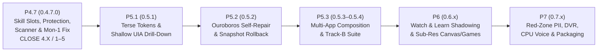

# Master Plan: Stint `P4.7` (`0.4.7.0`, Closing `1–5`) & Long-Term Roadmap (`P5`–`P7`)

## Goal Description
With the external Fatiao integration sidequest scrapped and Stages `P0`–`P4.6` having delivered a **14x–17x jump** over our [`2026-11-05` Feasibility Review](file:///c:/Users/Suici/.gemini/antigravity/brain/e08f71d9-0960-44dd-99c8-c3319e9081d6/feasibility_review.md) (`5.0% -> 70.0%–85.0%` verified pass rate, `20.0% -> 0.0%` False-DONE, `653/653` unit/integration tests green), this plan:
1. Executes **Stint `P4.7` (`0.4.7.0`)**, closing the final 10% of the initial `P0`–`P4` (Stages `1–5`) roadmap so `SKILL.md` playbooks generalize cleanly beyond exact-match benchmark prompts.
2. Establishes the **Post-`4.X` Long-Term Roadmap (`Stage P5` → `Stage P6` → `Stage P7`)** incorporating only standalone, Fatiao-free architectural upgrades while delegating `F7` operational sprawl to [`FUTURE_IDEAS.md §9.3`](file:///C:/ParasiteAI/FUTURE_IDEAS.md).

*(Note: [`FUTURE_IDEAS.md`](file:///C:/ParasiteAI/FUTURE_IDEAS.md) and [`HANDOFF.md`](file:///C:/ParasiteAI/HANDOFF.md) documentation cleanup has already been applied per user approval; zero production/test code will be modified until this `P4.7` + Long-Term Roadmap plan is approved.)*

---

## Part I — Concrete Implementation Plan for Stint `P4.7` (`0.4.7.0`, Closing `4.X`)

### Component 1: Literal vs. Generative Intent Gate & Protected Baseline Slugs
#### [MODIFY] [skills.py](file:///C:/ParasiteAI/parasite_ai/mind/skills.py)
- **Root-Cause Target (`L1-05` failure in `0.4.6.10` + `minimize-notepad`/`notepad-write-text` eviction before `0.4.6.10` pytest):**
  - Currently, regex capture skills like `notepad-write-text` (`^(?:open|launch|start)\s+notepad\s+and\s+(?:write|type)\s+['"]?(?P<text>.+?)['"]?$`) match creative/generative prompts (`"write a short two-sentence greeting"`) and literally type `"a short two-sentence greeting"`!
  - And `record_outcome(success=False)` calls `self.quarantine(...)` even on baseline shipped (`provenance == SkillProvenance.AUTHORED`) skills, moving them into `data/skills/_quarantine/` and breaking runtime availability + `test_local_playbooks.py`.
- **Changes:**
  1. In `SkillRegistry._score_skill()` (`skills.py:770-825`): When a regex `goal_pattern` captures a `text` parameter that was **not** delimited by quotes (`'` or `"`), check for generative/creative intent cues (`short`, `sentence`, `greeting`, `poem`, `story`, `essay`, `summary`, `summarize`, `overview`, `presentation`, `slide`, `explain`, `about yourself`, `draft a `). If detected, reject the verbatim-copy match (`return None`) so `UI-TARS`/Gemini actually *generates* content instead of echoing the instruction.
  2. In `SkillRegistry.quarantine()` / `record_outcome()` (`skills.py:1130-1175`): Protect `skill.provenance == SkillProvenance.AUTHORED` ("Protected Factory Slugs", matching `FUTURE_IDEAS §9.1`). When `consecutive_failures >= max_consecutive_failures` on an `AUTHORED` skill, transition `skill.state = SkillState.STALE` + log a warning instead of moving the directory to `_quarantine/`. (Drafts and user/farmed skills still quarantine normally, and `reject_draft()` still quarantines drafts.)

---

### Component 2: Synchronous Prompt-Injection & Secret `ContentScanner`
#### [NEW] [content_scanner.py](file:///C:/ParasiteAI/parasite_ai/safety/content_scanner.py)
#### [MODIFY] [skills.py](file:///C:/ParasiteAI/parasite_ai/mind/skills.py)
#### [MODIFY] [app_memory.py](file:///C:/ParasiteAI/parasite_ai/mind/app_memory.py)
- **Why in `P4.7`:** Before enabling broader `{{slot}}` crystallization and deferred `SKILL_COAUTHOR` persistence on real web/app tasks, persisted `SKILL.md` descriptions/steps and `farmed_plans` must be screened against indirect prompt injection and accidental secret capture.
- **Changes:**
  - Add zero-dependency CPU `sanitize_or_reject(text: str) -> ScanResult` in `parasite_ai/safety/content_scanner.py`:
    1. Rejects/strips instruction-override & chat-role injection markers (`<|im_start|>`, `<|endoftext|>`, `ignore previous instructions`, `ignore all prior instructions`, `[system]`).
    2. Redacts common credential patterns (`sk-proj-...`, `sk-ant-...`, `AIza...`, `Bearer <token>`, `-----BEGIN .* PRIVATE KEY-----`) with `[REDACTED_SECRET]`.
  - Invoke `ContentScanner` inside `SkillRegistry.save()` (`skills.py`) and `AppMemory.store_farmed_plan()` (`app_memory.py`).

---

### Component 3: Automatic `{{slot}}` Parameterization on Farmed-Plan Promotion
#### [MODIFY] [runtime.py](file:///C:/ParasiteAI/parasite_ai/runtime.py)
- **Root-Cause Target (`runtime.py:212-315` `_promote_farmed_plans`):**
  - Previously, every promoted farmed skill had `parameters=[]`, hardcoded strings inside `steps`, and a fixed `known_procs` dict.
- **Changes:**
  1. Add `_extract_slot_template(goal_norm: str, action_steps: List[SkillActionStep])` helper called inside `_promote_farmed_plans()`:
     - Scans for matching Windows file paths (`[a-z]:\\[^\s'"]+`), quoted literals, or standalone binary arithmetic expressions (`\d+\s*[\+\-\*\/]\s*\d+`) that appear in both `goal_norm` and any `TYPE` directive's `text`.
     - Replaces matched spans in `action_steps` with `{{path}}` / `{{text}}` / `{{expr}}`, populates `SkillParameter(name=..., required=True)`, and synthesizes a anchored `goal_patterns` regex with explicit quote/slot delimiters rather than `parameters=[]`.
  2. Consult `self.app_memory.get_last_process(prog_key)` (or `app_profiles`) as fallback alongside `known_procs` so discovered programs beyond Notepad/Calc/Paint/Explorer resolve their `container_process` automatically.

---

### Component 4: Long-Horizon `max_trace_steps` & Deferred `_pending_coauthor` Queue
#### [MODIFY] [config.py](file:///C:/ParasiteAI/parasite_ai/config.py)
#### [MODIFY] [skills.py](file:///C:/ParasiteAI/parasite_ai/mind/skills.py)
#### [MODIFY] [runtime.py](file:///C:/ParasiteAI/parasite_ai/runtime.py)
- **Changes:**
  1. Increase `SkillsConfig.max_trace_steps` default from `25` to `40` (max bound `60`) in `config.py:659` so multi-step exploratory tasks (such as building a short multi-slide/multi-section document) remain eligible for `SkillLearner`.
  2. In `SkillLearner.maybe_learn()` (`skills.py:1442`), if `ParasiteSkill` is temporarily unavailable or `result.failure` is `HARVEST_TIMEOUT` / `GENERATION_TIMEOUT`, persist the sanitized JSON trace (`ContentScanner`-clean) atomically under `data/skills/_pending_coauthor/<ts>_<slug>.json`, and add `process_pending_coauthor(max_items=1)` called opportunistically in `runtime.py` when `ParasiteSkill` is healthy.

---

### Component 5: Monitor-1 Shell Exemption & Focus Recovery Guard + Version Bump
#### [MODIFY] [dual_mind.py](file:///C:/ParasiteAI/parasite_ai/mind/dual_mind.py)
#### [MODIFY] [pyproject.toml](file:///C:/ParasiteAI/pyproject.toml)
#### [MODIFY] [__init__.py](file:///C:/ParasiteAI/parasite_ai/__init__.py)
- **Root-Cause Target (`L2-06` and `L2-07` in `0.4.6.10`):**
  - `dual_mind.py:1095-1107` rejected `hotkey(['ctrl', 'a'])` with `"Blocked off-monitor hotkey ... on foreground window 'Program Manager' centered at x=1920 outside Monitor 1 [0..1920)"` because `Progman`/`WorkerW` spans the multi-monitor desktop `[0..3840)`!
  - Fix `_validate_hotkey_safety` in `dual_mind.py:1094-1108`:
    1. Exempt multi-monitor desktop shells (`cls_lower in ("progman", "workerw")`) or check Monitor-1 overlap (`rect.left < ml + mw and rect.right > ml`) when a window spans monitors.
    2. For a genuinely off-monitor foreground app window (`rect.left >= ml + mw`), first attempt to restore foreground to the episode's target Monitor-1 window (via `GetForegroundWindow` fallback / `window_guard` or `active_window` on Monitor 1) before emitting the hard block!
- Bump version `0.4.6.10` -> `0.4.7.0` in `pyproject.toml`, `parasite_ai/__init__.py`, and `tests/integration/test_parasite_skill_pipeline.py:1192`.

---

## Part II — Post-`4.X` Long-Term Master Roadmap (`Stage P5` – `Stage P7`)

Anchored strictly to [`feasibility_review.md`](file:///c:/Users/Suici/.gemini/antigravity/brain/e08f71d9-0960-44dd-99c8-c3319e9081d6/feasibility_review.md) (`D1`–`D6`, `§10.2` Visible Actuation, `F7` Anti-Sprawl) and recorded cleanly in [`FUTURE_IDEAS.md §8–§9`](file:///C:/ParasiteAI/FUTURE_IDEAS.md#L426-L497) and [`HANDOFF.md`](file:///C:/ParasiteAI/HANDOFF.md):



### Stage `P5` (`0.5.x`) — Cognitive Speedup, Ouroboros Self-Repair & Multi-App Composition
- **`P5.1` Latency & UIA Grounding Upgrade:**
  - Terse token compression (`caveman` schema style) for `UI-TARS` `Thought:` lines and `ParasiteSkill` prompts (`~50-65%` fewer output tokens).
  - Shallow `ax_overview` (depth-3 summary) → `ax_subtree(node_id)` UIA drill-down in `ScreenGrounder` (`<50ms` Explorer/modal discovery while preserving visible Bézier actuation per `§10.2`).
- **`P5.2` Partial Sequence Splice & `Ouroboros` Self-Repair *(Strict Prerequisite to Multi-App)*:**
  - Step-level transition tracking `(step_id, pre_proc, post_proc, success)` that preserves working prefixes/suffixes and splices `UI-TARS` recovery actions locally (`Zero-Gemini`) when a middle step breaks.
  - Degraded-fallback tracking (`fallback_rescues >= 2` → `DEGRADED`) + `ParasitePhase.SKILL_REPAIR` with atomic `.snapshots/<ts>_<slug>/` pre-apply backups and auto-rollback on YAML/verifier regression.
- **`P5.3` Multi-App Composition (`P4.5.5`) + Progressive Skill Packs + Human-Loop Polish:**
  - Decompose cross-app workflows into app-scoped `SubGoal` pipelines with a shared `EpisodeBlackboard` (`{{clipboard}}`, `{{last_output}}`).
  - Support progressive `SKILL.md` (`<150` tokens) + optional `scripts/` & `references/` packs (plus opt-in sandboxed `pypdf`/`python-docx`/lightweight search CLI side-tools announced in dock per `§10.2`), structured `Ask` disambiguation (`risk_gate.py`/Discord), and zero-LLM `correctionDetect`.
- **`P5.4` Track-B Open-Ended Behavioral Benchmark (`benchmarks/behavior_suite.yaml`):**
  - Separate from locked Core-20: unseen multi-app workflows, drift self-repair, and skill co-authoring roundtrips (`Exit Gate: >= 80%` on Track-B + multi-app `L2-03`/`L3-02`/`L3-03` mastery).

### Stage `P6` (`0.6.x`) — "Watch & Learn" Human Shadowing & Adaptive Canvas/Game Cognition
- **`P6.1`–`P6.2` Passive Shadowing & "Show, Don't Tell" Macro Synthesis:** Event-driven recording of human clicks (`WM_LBUTTONUP`), masked keystrokes (`WindowGuard`), and window transitions on `InterruptGuard` or `/watch`, compiled into progressive `SKILL.md` playbooks.
- **`P6.3` Windowed Sub-Resolution & Scale-Invariant Landmarks:** `960x540` client-rect fast vision capture + normalized/corner-anchored coordinates for dense canvases and live game stretch probes (`Warsim`, `Rift Wizard`, `RimWorld`).

### Stage `P7` (`0.7.x`) — Sovereign Enterprise Hardening, Audit DVR, Voice & Packaging
- **`P7.1`:** Retire legacy `offloader.py` `rect[3] - 68` offset + Dynamic Red-Zone PII blur masks on captured frames.
- **`P7.2`:** Immutable SQLite WAL Black-Box DVR & Discord `/review` skill/anti-pattern pruning cards.
- **`P7.3`:** CPU-only Push-to-Talk Voice Companion (Whisper STT + light CPU TTS) & single-click Windows installer (`.msi` / `winget`).

### Strictly Quarantined `F7` Sprawl Policy ([`FUTURE_IDEAS.md §9.3`](file:///C:/ParasiteAI/FUTURE_IDEAS.md))
- Permanently excluded from active `P4.7`–`P7` stints: external Electron/Fatiao shells, secondary competing LLMs/Ollama (`>6.5 GB` VRAM), Playwright `crawl4ai` container, `marker`/PaddleOCR duplication, `mmBERT` ONNX secondary routers, and consumer side-skills (`qwen3-tts-voice-clone`, `maps`, `himalaya`, `easy-subtitle`, `excalidraw`, `comfyui`).

---

## Verification Plan for Stint `P4.7`

### Automated Tests (Post-Approval)
- Create `tests/unit/test_p4_7_generalization.py` covering:
  1. `SkillRegistry.match("Open Notepad and write a short two-sentence greeting")` returns `None` (`L1-05` regression guard), while `"Open Notepad and type 'Alpha 42'"` still matches cleanly.
  2. `SkillRegistry.record_outcome(..., success=False)` keeps `AUTHORED` skills active/`STALE` (never moves to `_quarantine/`).
  3. `ContentScanner` blocks injection strings (`<|im_start|>`, `ignore previous instructions`) and redacts secret tokens in `SkillRegistry.save()` and `AppMemory.store_farmed_plan()`.
  4. `_promote_farmed_plans()` extracts `{{path}}` / `{{text}}` / `{{expr}}` parameters and `goal_patterns`.
  5. `max_trace_steps=40` default + deferred `_pending_coauthor` persistence on `HARVEST_TIMEOUT` + replay drain.
  6. `_validate_hotkey_safety` allows hotkeys when `Program Manager` (`cls=Progman`) spans `[0..3840)` centered at `x=1920`.
- Run targeted suite:
  ```powershell
  .venv\Scripts\python.exe -m pytest tests/unit/test_p4_7_generalization.py tests/unit/mind/test_skill_registry.py tests/unit/mind/test_skill_learning.py tests/unit/mind/test_local_playbooks.py tests/unit/mind/test_app_memory.py tests/unit/test_p4_6_10_fixes.py tests/integration/test_parasite_skill_pipeline.py -q --tb=short
  ```

### Manual Verification (User)
1. Run one unseen non-benchmark smoke task (e.g., `"Open Chrome, navigate to docs/slides or Notepad, write an overview of ParasiteAI's safety and skill features"`) to confirm generalized execution + skill capture.
2. Optionally re-run [`run_benchmark_p4_fresh.bat`](file:///C:/ParasiteAI/run_benchmark_p4_fresh.bat) to confirm `L1-05`, `L2-06`, and `L2-07` recovery on `0.4.7.0`.

---

## Engineering Cadence Compliance Self-Audit (§1–§8)
- **§1 Single-Unit Boundary:** Stint `P4.7` (`0.4.7.0`) is one bounded execution unit closing Stage P4; `P5`–`P7` remain planned roadmap phases only.
- **§2 Mandatory Planning Gate:** Dedicated plan artifact created with `RequestFeedback: true`, `UserFacing: true`; zero source or test code edited prior to explicit approval.
- **§3 & §4:** Will run targeted `pytest` (and full suite at `4.X` closure boundary), update `CHANGELOG.md`, `HANDOFF.md`, and `walkthrough.md`.
- **§5 Roadmap Sanctity:** `0.4.6.10` -> `0.4.7.0` (`P4.7`), closing the initial `P0`–`P4` (1–5) feasibility roadmap before `0.5.x` (`Stage P5`).
- **§6–§8:** General engine mechanics only (`ContentScanner`, slot extractor, `AUTHORED` slug protection, `Progman` multi-monitor rect overlap); zero hardcoded coordinates or numerical anchoring.
