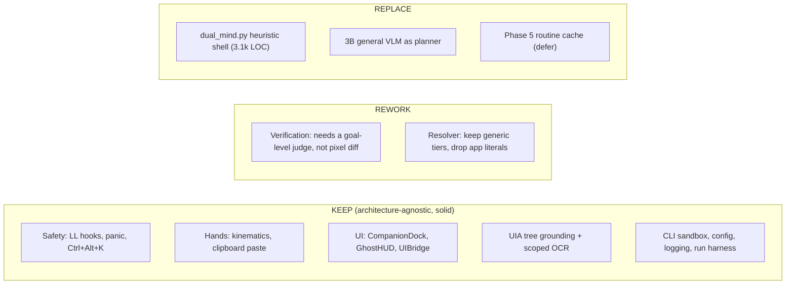
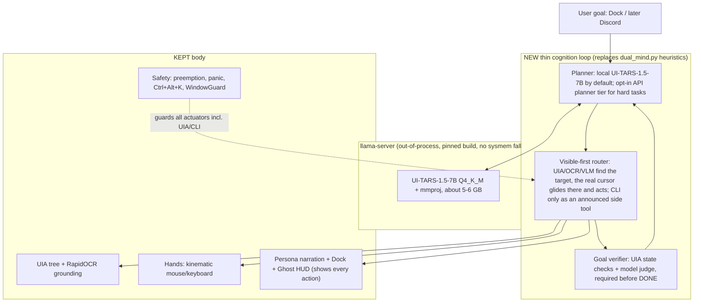

# ParasiteAI: Feasibility & Architecture Review (Pre-Alpha Checkpoint)

**Date:** 2026-11-05 · **Scope:** Goals vs. architecture, feasibility of current course, framing for comparison against the proposed new architecture.
**Evidence base:** Project docs ([PROJECT.md](file:///c:/ParasiteAI/PROJECT.md), [HANDOFF.md](file:///c:/ParasiteAI/HANDOFF.md), [FUTURE_IDEAS.md](file:///c:/ParasiteAI/FUTURE_IDEAS.md), [CHANGELOG.md](file:///c:/ParasiteAI/CHANGELOG.md)), Phase 5 plan, Discord integration plan, source code (16.3k LOC), tests (31.0k LOC), and **11 live-run logs (~37 real goal episodes, Nov 1–2)**.

> [!IMPORTANT]
> **Bottom line:** Most of the "body" is solid: safety, hands, UI, and UIA grounding. The "mind" isn't working in practice, and the planned path (Phase 5 routine caching) doesn't fix that. Building on it would put more work on a base that can't reliably complete tasks yet. **Stop Phase 5 and re-architect the cognition layer** before adding any more features.

---

## 1. Reality Check: Certified vs. Observed

| Metric | Documented status | Observed in live logs |
|---|---|---|
| Test suite | 2,178 / 2,178 green, "VICTORY CONFIRMED" | Tests are mock-driven. They check the plumbing, not whether tasks get done |
| End-to-end goal success | Implied by phase certifications | **≈0–1 real completions in ~37 episodes**. The one Notepad "intro" success came from a canned string ([dual_mind.py:2835](file:///c:/ParasiteAI/parasite_ai/mind/dual_mind.py#L2805-L2840)), not generated text |
| App launch (Notepad, Rift Wizard, Warsim, RimWorld) | "Universal resolver" | Works some of the time, often after several strikes |
| "Play X" / multi-step in-app tasks | Roadmap pillar | **Never achieved** |
| `DONE` precision | Verified via `verify_step_completion` | **Poor.** Examples: *"RimWorld search is confirmed open"* (goal: start new save); *"window minimized… task completed"* (goal: play Rift Wizard); *"typed 'introduction' three times… completed"* |
| Step latency | 3–8s target | **7–20s average per step**, with spikes up to 38s |
| Anti-hardcoding invariant | "Strictly enforced, `app_map` = 0" | **Broken in substance.** App literals appear in src: `steam` ×15, `explorer.exe` ×27, `notepad` ×12, `discord` ×6, `warsim` ×3. Process allow-lists sit in [dual_mind.py:410-630](file:///c:/ParasiteAI/parasite_ai/mind/dual_mind.py#L410-L630) and game names in prompts in [brain_manager.py:1386-1390](file:///c:/ParasiteAI/parasite_ai/mind/brain_manager.py#L1386-L1390) |
| Touch preemption | Core invariant, working | Works as designed, but **fires 200–4,000 times per run** because you keep typing while it runs. The agent and the user compete for one input stream |

> [!WARNING]
> **Your metrics are measuring the wrong thing.** There are 2× more test lines than source lines, and auditors "certify" phases, yet nothing measures task success. That's how a project can show 100% green while the real success rate is about zero. This is the most important process problem to fix, whichever architecture you choose.

---

## 2. Root-Cause Diagnosis

### 2.1 The cognition core is below the capability floor
- **Model:** Qwen2.5-VL-3B (Q4), a general-purpose VLM, asked to act as both persona (Pass 1) and GUI planner (Pass 2) inside a 4K context, with token overflows logged.
- 3B general VLMs score near the bottom on OSWorld-class desktop benchmarks. In 2025–26, the usable local tier is **7B models trained specifically for computer use** (UI-TARS-1.5-7B, Fara-7B, OpenCUA-7B). Even those succeed on only a minority of open-ended desktop tasks.

### 2.2 Compensating heuristics are piling up and not converging
- [dual_mind.py](file:///c:/ParasiteAI/parasite_ai/mind/dual_mind.py) has **3,138 lines and 354 `if/elif` branches**. Each live test leads to a new special case: taskbar double-click downgrade, console QuickEdit workaround, Steam launch-options detection, "play" needing ≥3 steps, canned intro text, and so on.
- This is the classic **"heuristic shell around a weak model"** trap. Every patch fixes one app or scenario and makes the next one more fragile. The CHANGELOG's `[Unreleased]` section is almost entirely patches of this kind.

### 2.3 Internal goal contradictions (these block any architecture until resolved)

| # | Conflict | Why it matters |
|---|---|---|
| C1 | **Works with any app** + **local-only** + **≤3.5 GB VRAM** | Today's models can't deliver all three at once. One has to give: VRAM budget (about 6 GB for a 7B CUA model), local-only (allow an opt-in cloud tier), or scope. *(Note: [config.yaml](file:///c:/ParasiteAI/config.yaml#L31) already sets `vram_budget_mb: 5500`, so the invariant has quietly drifted.)* |
| C2 | **Physical mouse/keyboard only** + **user keeps working** + **sub-2ms yield** | `SendInput` affects the whole system, so the agent can only make progress while you're idle. "Ghost Desk" virtual desktops don't fix this. The real options are to run while you're away, or to act through non-input channels (UIA Invoke/Value patterns, CLI, app APIs) |
| C3 | **"No hardcoding"** + **Watch & Learn routines** | Routines *are* stored per-app knowledge. The rule should be: **no app-specific code branches; learned per-app data is allowed** |
| C4 | **Play games autonomously** in the roadmap/test goals | Game play needs real-time, game-specific reasoning far beyond the chosen model. It's the wrong benchmark for pre-alpha |
| C5 | **Human-like Bézier motion** + **fast replay** | Fine as a UX choice, but it adds latency and does nothing for capability. Treat it as cosmetic |

### 2.4 Phase 5 is premature
Routine caching saves trajectories from runs that **rarely succeed** and whose **success checks can't be trusted** (false `DONE`). The likely result is caching wrong routines with high confidence. Memory makes a working agent faster; it can't make a non-working agent work.

---

## 3. Asset Triage: Keep vs. Replace

About **60% of the source** (safety, hands, UI, vision, config, runtime) carries over unchanged to any of the realistic alternatives. The sunk cost sits mostly in `dual_mind.py`, the prompt and heuristic layers, and the large mock test suite.

---

## 4. Candidate Directions (baseline options)

| Option | Description | Feasibility | Notes |
|---|---|---|---|
| **A. Stay the course** | Phase 5 on the current mind | ❌ Low | More code on an unproven base. The heuristics keep growing |
| **B. Brain swap, keep body** | Replace Pass 1/2 + heuristics with a CUA-trained 7B (UI-TARS/Fara/OpenCUA) behind a thin loop. Persona becomes a separate, cheap narration layer | ⚠️ Medium | Needs the VRAM ceiling raised to about 6 GB (resolves C1). Expect roughly 30–50% success on simple Windows tasks |
| **C. Structured-first hybrid** | Order of preference: CLI/API → UIA patterns (Invoke/Value/Toggle) → vision+mouse as fallback, with an LLM planner over **tools** rather than pixels | ✅ Higher | Most reliable path for common apps. Partly resolves C2. Requires relaxing "100% physical" to "100% visible" |
| **D. Tiered brain** | Local model for perception and simple steps. Opt-in frontier model (Gemini/Claude API, not browser-scraped) plans hard steps | ✅ Higher | Your 4-tier escalation already assumes this. An API replaces the fragile Chrome offloader |
| **E. Product reframe** | Companion first (persona, Discord, remote delegation); desktop control is a "while you're away" job runner | ✅ High | Matches the Discord plan and fixes C2 by design |

These options can be combined. **C + D (+ E for UX)** is the strongest baseline the new report should be measured against.

---

## 5. Scorecard for Comparing the New Architecture Report

Score each axis 1–5 for **(i) current course** and **(ii) proposed architecture**:

| # | Criterion | What "5" looks like |
|---|---|---|
| 1 | **Capability floor** | Cites model/approach with credible benchmark evidence for Windows desktop tasks |
| 2 | **Resolves C1–C5** | Each conflict explicitly decided, not ignored |
| 3 | **Generality without code special-cases** | App knowledge is learned/data, never `if "steam" in …` |
| 4 | **Verifiable success signal** | Goal-level verification (state checks, UIA properties, judge model), not pixel diff |
| 5 | **Reuse of keep-list assets** | Safety/hands/UI/UIA survive intact |
| 6 | **Coexistence with the user** | Works without fighting for the mouse (C2) |
| 7 | **Hardware fit** | Runs on RTX 4060 8 GB / 16 GB RAM at stated budget |
| 8 | **Latency** | Median step ≤5s on target tasks |
| 9 | **Incremental path** | First milestone delivers measurable task success in ≤2 weeks |
| 10 | **Evaluation-first** | Defines a task benchmark and kill/continue gates up front |

### Proposed go/no-go gate (applies to whichever path wins)
A fixed **20-task Windows benchmark** run through the existing `--goal --auto-exit-on-complete` harness:
- **L1 (10 tasks):** launch app, type text, save file, change a setting, close app
- **L2 (7 tasks):** cross-app, e.g. copy text from browser to Notepad, rename a file in Explorer
- **L3 (3 tasks):** multi-step workflows with dialogs

**Alpha gate:** L1 ≥ 70%, L2 ≥ 40%, false-`DONE` rate ≤ 5%, median step ≤ 5s, zero app-specific code branches.

---

## 6. Immediate Recommendations (regardless of report outcome)

1. **Freeze Phase 5.** Don't build memory on an unverified base.
2. **Build the task benchmark first** (Section 5 gate). From now on, task success rate is the main project metric, not test count.
3. **Revise the invariants:** "no app-specific code" (allow learned data); ~~"visible" instead of "physical-only"~~ ✅ *approved*; set the VRAM ceiling to match the chosen model.
4. **Fix doc drift:** HANDOFF bootstrap prompt still says Phase 3; PROJECT.md layout points to `g:\__Docs`; CHANGELOG says `override_pause` is 2.5s but config.yaml has 10.0; GATE_STATUS covers only M1–M5.
5. **Remove the canned intro string and the app literals** so benchmark results are honest.

---

## 7. Head-to-Head: Proposed "Local-First CUA Stack" Report

**Source:** [Local AI Stack Architecture Proposal.pdf](file:///c:/ParasiteAI/Local%20AI%20Stack%20Architecture%20Proposal.pdf) (19 pp.)
**Decision recorded:** ✅ The "physical-only" invariant is replaced by **"100% visible"** (user-approved 2026-11-05).

### 7.1 What the report proposes

| Tier | Component | Status on *your* hardware (RTX 4060 8 GB, "Profile 1") |
|---|---|---|
| 1. Inference | `llama-server` hosting **UI-TARS-1.5-7B** (or 2B / ShowUI-2B / GELab-4B) GGUF + mmproj | ✅ Fits at Q4_K_M/IQ4_XS: about **5–6 GB** |
| 2. Screen parsing | **OmniParser v2** (YOLOv8 + PaddleOCR + Florence-2) | ❌ Needs ~10.8 GB. The report itself excludes it on 8 GB |
| 3. Telemetry | **Screenpipe** daemon (all screens + mic → SQLite → MCP) | ⚠️ Runs, but needs a commercial license, records audio, and adds constant CPU/disk load |
| 4. Orchestration | **Agent-S3/S4** (desktop), **Cradle** (games/3D), Pi/Hermes/OpenClaw | ⚠️ See 7.3: the headline numbers depend on cloud models |
| 5. Host tuning | Turn off sysmem fallback, HAGS off, Force-P2 off, power profile, etc. | ✅ Sysmem-fallback setting is a good idea. ⚠️ The rest are system-wide changes on a gaming PC |

### 7.2 What the report gets right (adopt)
1. **Use a model trained for computer use, not a general VLM.** UI-TARS-1.5-7B is the correct model class, and this confirms Option B.
2. **Separate planning from grounding.** Splitting "decide what to do" from "find exactly where to click" is a proven pattern (Agent-S2/S3). Your current Pass 1/Pass 2 split is persona vs. action, which isn't the same thing.
3. **Run the model in its own process** (`llama-server`, OpenAI-compatible API) instead of in-process `llama-cpp-python`. This separates failures and makes models swappable.
4. **Set CUDA "Prefer No Sysmem Fallback"** for the inference server. One setting, and it prevents silent order-of-magnitude slowdowns.
5. **Accessibility tree + CPU OCR on 8 GB cards.** You already have this (UIA + RapidOCR), so no new work.
6. **Compile verified routines into deterministic scripts** (the SimuLang idea). This validates the *concept* of Phase 5, but it belongs after the agent can complete tasks.

### 7.3 Where the report fails (reject or correct)

> [!WARNING]
> **The headline numbers don't apply to this machine.** Agent-S3's 69.9–72.6% on OSWorld uses **GPT-5 as the planner** plus **Behavior Best-of-N with 10 parallel attempts** in separate VMs. Neither is possible on a single live local desktop. The report's own open-weights figure is that Agent-S4 lifts a **27B** model from 5.6% to **21.3%**, and a 27B model doesn't fit in 8 GB. By the report's own evidence, a fully local setup on this hardware should expect well under 20% on hard benchmarks, though simple L1 tasks should do much better.

| # | Problem | Impact |
|---|---|---|
| F1 | **Pinned llama.cpp builds `b4514`/`b5196` are older than `llama-server` multimodal support** (`libmtmd`, around `b5332`, May 2025) | Following the pin literally means `llama-server` can't serve UI-TARS with vision |
| F2 | **Bug-avoidance logic contradicts itself.** It warns about `qwen2vl`/mtmd bugs in Qwen2.5-VL, then recommends UI-TARS-1.5-7B as the fix. But **UI-TARS-1.5 is built on Qwen2.5-VL-7B** and uses the same code path | Grounding accuracy must be checked against the HF `transformers` reference before relying on it. *(This same bug class may also explain some of your current Qwen2.5-VL-3B perception failures.)* |
| F3 | **Agent-S runs model-generated Python via `exec()`** (pyautogui) | Skips your entire safety layer: touch preemption, kinematics, window guard, HUD. The report's answer is to sandbox everything in a microVM or **Windows 365 (cloud)**, which removes the "visible on your desktop" product and the local-only principle |
| F4 | **Cradle's results were with GPT-4o** and need per-game setup (DirectInput mode, hold-to-aim, large HUD, borderless 1080p) | Not feasible with a local 7B model, and per-app setup conflicts with no-hardcoding. Games also shouldn't be in alpha scope (C4) |
| F5 | **No coverage of the product itself.** Persona, Companion Dock, Ghost HUD, touch preemption, and sharing the PC with the user (C2) don't appear | It's a generic enterprise CUA reference stack, not a ParasiteAI architecture |
| F6 | **No evaluation plan or go/no-go gates.** The 3-phase rollout produces no measured task success until phase 3 | Repeats the current process failure (Section 1) |
| F7 | **Operational sprawl.** Up to 7 processes (llama-server, Screenpipe, OCR server, Perplexica Docker, Agent-S, Cradle, UI) plus conflicting dependency pins (`transformers==4.40`, Python 3.10/3.12 split) | Unrealistic for a single developer and a single 8 GB GPU. `--parallel 8` with vision KV cache won't fit in 8 GB |
| F8 | **Source quality.** Leftover citation-tool artifacts (`[span_92](start_span)…`) and many blog/Reddit references | Treat specific numbers as unverified until reproduced |

### 7.4 Scorecard (Section 5 criteria, 1–5)

| # | Criterion | Current course | Report as written | **Recommended synthesis** |
|---|---|:-:|:-:|:-:|
| 1 | Capability floor | 1 | 3 | **4** |
| 2 | Resolves C1–C5 | 1 | 2 | **4** |
| 3 | Generality without code special-cases | 1 | 3 | **4** |
| 4 | Verifiable success signal | 1 | 2 | **3** |
| 5 | Reuse of keep-list assets | 5 | 1 | **4** |
| 6 | Coexistence with user | 1 | 2 | **3** |
| 7 | Hardware fit (8 GB) | 3 | 2 | **4** |
| 8 | Latency | 1 | 3 | **3** |
| 9 | Incremental path | 2 | 2 | **4** |
| 10 | Evaluation-first | 1 | 1 | **5** |
| | **Total / 50** | **17** | **21** | **38** |

**Verdict:** The report is right about **direction** (computer-use-specialized model, planner/grounder split, out-of-process inference) and wrong about **shape** (an overbuilt enterprise stack that depends on cloud models and drops the product). Use it as a **parts catalog**, not a blueprint.

---

## 8. Recommended Synthesis: "Same Body, New Mind"

> [!NOTE]
> **Superseded by §10.2.** This paragraph originally proposed UIA patterns and CLI as first-choice actions because they don't need the cursor. The user rejected that: watching the real cursor work is a core product feature. Accessibility data is now used for *finding* targets, not for *invisibly actuating* them.

### Roadmap with gates

| Stage | Scope | Exit gate |
|---|---|---|
| **P0: Measure** (≈1 wk) | 20-task benchmark harness on the existing `--goal --auto-exit-on-complete` runner; score the current system as a baseline; strip the canned intro and app literals; set the sysmem fallback policy | Baseline numbers recorded |
| **P1: Model spike** (≈1 wk) | Recent pinned `llama-server` + UI-TARS-1.5-7B Q4_K_M; check grounding against the `transformers` reference (F2); thin adapter from UI-TARS actions to the existing hands drivers | L1 ≥ 50%, median step ≤ 6s, VRAM ≤ 6.5 GB. **If this fails:** try GELab-4B or UI-TARS-2B, or move to the API-planner tier |
| **P2: Structured-first** | Tool router (CLI → UIA patterns → vision); goal verifier; retire `dual_mind.py` heuristics module by module | L1 ≥ 70%, false-DONE ≤ 5% |
| **P3: Planner tiers** | Keep and harden the visible browser tier (search, docs, web reasoning chats) as the free default; add an opt-in API planner as an optional tier. Local UI-TARS stays as grounder (Agent-S pattern). See §10.1 | L2 ≥ 40% with a planner tier on |
| **P4: Memory** | Re-scoped Phase 5: compile **verified** trajectories into replayable routines | Repeat-task latency ↓ 5× with no success regression |
| **Deferred** | Screenpipe (optional memory), OmniParser (if you get a GPU ≥ 16 GB), Cradle/games, Discord surface | Revisit after alpha gate |

---

## 9. Decisions (original recommendations; resolved in §10)

| # | Decision | Recommendation |
|---|---|---|
| D1 | Raise the VRAM ceiling from 3.5 GB to **≈6.5 GB** for UI-TARS-1.5-7B | **Yes.** No local model below that size reaches the capability floor |
| D2 | Allow an **opt-in API planner tier** (explicit consent, never silent) | **Yes**, as a P3 option. Local-only remains the default mode with a lower capability ceiling |
| D3 | Move **games** (Warsim, Rift Wizard, etc.) out of alpha scope | **Yes.** Use the benchmark suite instead |
| D4 | Revise the no-hardcoding rule to **"no app-specific code; learned per-app data allowed"** | **Yes** |
| D5 | Adopt Screenpipe now? | **No, defer.** License, privacy, and resource cost with no benefit to the core loop |

---

## 10. Resolved Decisions & Revised Invariants (2026-11-05)

| # | Decision | Outcome |
|---|---|---|
| D1 | VRAM ceiling | ✅ **6.5 GB** (UI-TARS-1.5-7B Q4_K_M + mmproj) |
| D2 | Planner tiers | ✅ Free visible-browser tier is the **default**; opt-in API tier is optional (§10.1) |
| D3 | Games / test apps | ✅ Stay as **live probes**; the hardcoding is removed from code (§10.3) |
| D4 | Hardcoding rule | ✅ No app-specific **core code**; learned data and agent-authored skills allowed (§10.4) |
| D5 | Screenpipe | ✅ Deferred |
| D6 | Visible actuation | ✅ **Real, visible cursor stays the default way to act** (§10.2) |

### 10.1 Planner tiers (no API key required by default)

| Tier | What it is | Cost | Notes |
|---|---|---|---|
| **T0: Local** | UI-TARS-1.5-7B plans and grounds | Free | Default for every task |
| **T1: Visible browser** | Parasite opens the browser as the user and uses search, documentation, and web reasoning chats, driving the page with its real cursor and keyboard | Free (uses your own logins and free plans) | Keep the existing offloader and sentinel-clipboard harvest. Its real inputs and your logged-in session are the point |
| **T2: API planner (opt-in)** | Gemini or similar API behind an explicit toggle | Gemini has had a free tier (rate-limited, needs a free key, and free-tier prompts may be used for product improvement). Claude and OpenAI APIs are paid. **Verify current limits before relying on this** | Never enabled silently |

Risks of T1 that need handling:
- **Layout drift:** chat sites change often, so find targets by UIA/OCR/VLM, never fixed coordinates.
- **Rate limits and logins:** free web plans cap usage. Detect it and fall back to T0.
- **Privacy:** anything sent out passes the existing WindowGuard redaction and is limited to text the user could have typed.
- **Terms of service:** automating consumer chat sites is a gray area. Real visible input from the user's own session is the least contentious form, but the sites' terms still apply.

### 10.2 Visible actuation: the cursor stays

This **reverses my earlier "UIA/CLI first" ordering**. Revised invariant:

> **Visible actuation:** every interaction with the GUI is performed with real, visible cursor and keyboard input (Bézier/min-jerk motion, HUD reticle). Browser use therefore inherits the user's session and rights, like a person, not a bot.

How the pieces divide:

| Role | Method |
|---|---|
| **Finding targets** | UIA tree, OCR, and the VLM. UIA gives exact coordinates, which beats VLM guesses |
| **Acting** | The cursor glides to the target and clicks or types. No hidden `Invoke` or `SetValue` calls |
| **Verifying** | UIA state checks plus the goal-level check before `DONE` |
| **CLI tools** | Optional, announced in the dock and HUD, and limited to sandbox-whitelisted commands for things with nothing to click (file operations, git). Never a substitute for a GUI action the user would see |

What this means in practice:
- **Safety stays unchanged:** the sub-2ms touch preemption, panic hotkeys, WindowGuard, and `Ctrl+Alt+K` keep their current place.
- **C2 is not solved, it is accepted.** The agent and user can't both drive one cursor. Parasite works while you watch or step away, and yields the instant you touch the mouse. This is the product's shape, not a defect.
- **Cost is small.** Cursor travel adds a few hundred ms per action against 5–7s of model time per step, so the motion isn't the bottleneck.
- **"Ghost Desk" (background virtual desktop) is dropped from the roadmap.** It conflicts with the cursor being the point.

### 10.3 Games and test apps

You read my D3 correctly in the end: nothing is removed from the code for the sake of the tests. What changes:
- **Keep Warsim, Rift Wizard, RimWorld, Notepad and so on as live probes.** They are good generalization tests.
- **Remove the code that knows about them** (the canned intro string, app-name process lists, game names in prompts), so a pass means the agent actually figured it out.
- **Don't count games toward the alpha gate.** Pass/fail uses the 20-task desktop benchmark. Games are a reported "stretch" score for tracking progress.

### 10.4 Revised hardcoding rule

> **No app-specific logic in core code.** Per-app knowledge lives in **data**: learned routines, notes, selectors, schemas, and **agent-authored skills and scripts** in a user-visible workspace (e.g. `~/.parasite/skills/`).

Guardrails needed so self-authored code doesn't undermine the product:
1. **Immutable core:** the agent cannot modify `safety/`, `hands/` motion code, the kill switch, or the config that sets limits.
2. **Authored code is data:** it runs only through the CLI sandbox (whitelist, timeouts, touch preemption), never `exec()` in-process.
3. **Visible and reversible:** every new skill or note appears in the dock, is stored as plain files in git, and can be disabled with one click.
4. **Promotion gate:** an authored skill becomes trusted only after passing the benchmark verifier on repeated runs (links to the Phase 5 EMA and circuit-breaker design).

### 10.5 Updated next step

**P0 (measure)** is unchanged and is the next stage to plan: benchmark harness, a baseline score on today's system, removal of the canned intro and app literals, and the sysmem-fallback setting.
