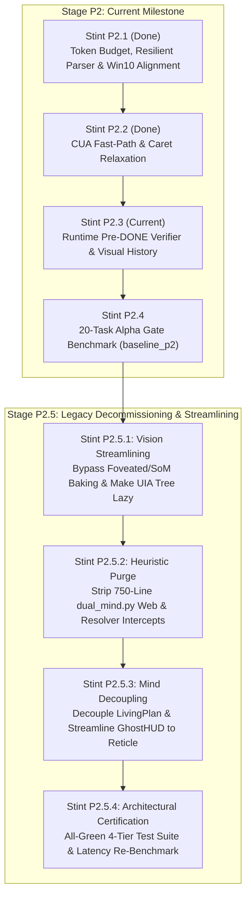

# ParasiteAI — Legacy Architectural Audit & Subsystem Inspection Report

**Date:** 2026-11-08  
**Scope:** Comprehensive inspection of holdovers from the legacy 3B text-LLM era (Phases 1–4 / Stage P0) vs. Native UI-TARS-1.5-7B CUA Loop.  
**Grounding Documents:**
- [`feasibility_review.md`](file:///C:/ParasiteAI/feasibility_review.md) (§2.2 "The Four Core Problems", §8 "Same Body, New Mind", §10 "Resolved Decisions & Revised Invariants D1–D6")
- [`HANDOFF.md`](file:///C:/ParasiteAI/HANDOFF.md)
- [`stage_p1_postmortem.md`](file:///C:/ParasiteAI/stage_p1_postmortem.md)
- [`p2_stint_map.md`](file:///C:/ParasiteAI/p2_stint_map.md)

---

## 1. Executive Summary & Audit Taxonomy

ParasiteAI was originally architected in Phases 1–4 around a **small general-purpose 3B text-only LLM (`qwen2.5-3b-instruct-q4_k_m.gguf`)**. Because a 3B text model could neither see arbitrary GUI pixels nor natively output continuous screen coordinates, the codebase accumulated a **dense heuristic scaffolding**:
1. **Set-of-Mark (SoM) Tagging & Foveated Cropping:** Extracting hundreds of bounding boxes via Win32 UIA, baking numbered tag badges (`[#1]`, `[#2]`) onto downscaled crops via PIL, and requiring the LLM to choose integer target IDs.
2. **Exhaustive UIA Tree Traversal:** Walking up to 2,000 accessibility COM nodes synchronously on every cognitive step.
3. **Rigid 3-Tier App Launch Resolvers:** Hardcoded regexes and keyboard chord sequences (`Win`, `Win+R`) because the text model could not find desktop icons or the Start button visually.
4. **Heuristic Interception Shell (`dual_mind.py`):** Over 750 lines of post-inference heuristic overrides that rewrite, redirect, or discard model decisions whenever internal heuristics disagree with the model's choices.
5. **Linear `LivingPlan` State Machine:** Hardcoded 3-step sequential plan templates attempting to verify step progression via crude screen pixel diffs and Win32 caret blinking checks.

With the successful deployment of **`UI-TARS-1.5-7B`** in Stage P1 operating out-of-process via CUDA `llama-server.exe` (`baseline_p1.json`: 0ms warm attach, 0 crashes, 4.741s median step), ParasiteAI transitioned to a **native Computer-Use Agent (CUA)**. UI-TARS perceives raw 1280px screenshots directly and emits natural coordinate actions (`click(start_box='(24,980)')`).

This audit inspects the codebase across 4 rigorous dimensions:
- **[1] Dead / Obsolete Code:** Code paths that are completely inactive or uncallable in CUA mode (safe to delete).
- **[2] Wasteful / Redundant Compute:** Algorithms that run synchronously on every tick/step, consuming CPU/memory, but whose output is discarded or ignored by CUA.
- **[3] Semantic Interference:** Legacy heuristics, regex checks, and guards that actively intercept, corrupt, or override valid CUA decisions.
- **[4] Essential Shared Invariants:** Critical subsystems that must be strictly preserved under Decisions D1–D6 (safety hooks, kinematics, WindowGuard, HUD reticle).

---

## 2. Subsystem-by-Subsystem Audit Findings

### Subsystem 1: `parasite_ai/vision/foveated.py` & Multi-Scale SoM Baking

* **Code Locations:**
  - [`parasite_ai/vision/foveated.py#L102-L204`](file:///C:/ParasiteAI/parasite_ai/vision/foveated.py#L102-L204) (`capture_foveated`)
  - [`parasite_ai/vision/foveated.py#L230-L292`](file:///C:/ParasiteAI/parasite_ai/vision/foveated.py#L230-L292) (`build_vlm_composite`)
  - [`parasite_ai/mind/dual_mind.py#L1851-L1886`](file:///C:/ParasiteAI/parasite_ai/mind/dual_mind.py#L1851-L1886)
  - [`parasite_ai/mind/dual_mind.py#L2048-L2059`](file:///C:/ParasiteAI/parasite_ai/mind/dual_mind.py#L2048-L2059)
* **Categorization:** **[2] Wasteful / Redundant Compute** & **[1] Dead Code**
* **Detailed Forensic Analysis:**
  1. On **every single cognitive step** in `DualMindPipeline.step()` (lines 1851–1886), `foveated_engine.capture_foveated()` executes:
     - Calculates virtual screen dimensions and active window bounds.
     - Computes a 64-bit dHash on the foveal crop.
     - Resizes the full frame to a downscaled macro image using PIL Bilinear interpolation.
  2. If `brain_manager.supports_vision()` is True (which is True for UI-TARS!), lines 1879–1885 call:
     ```python
     vlm_image_b64 = self.foveated_engine.build_vlm_composite(
         frame=foveated_frame,
         elements=elements,
         use_fovea=has_active_app_win,
         max_dim=512,
         quality=80,
     )
     ```
     This iterates over up to 40 elements, rasterizes cyan bounding boxes, draws pill badges with `[#ID]` text via `ImageDraw`, and encodes the result into a base64 JPEG string (`vlm_image_b64`).
  3. **The Waste:** Look at line 2050 in `dual_mind.py`:
     ```python
     cua_b64 = None if current_frame is not None else vlm_image_b64
     thought, action_plan = self.brain_manager.generate_cua_step(
         user_goal=user_goal,
         screen_frame=current_frame,
         image_base64=cua_b64,
         ...
     )
     ```
     Because `current_frame` was captured at step start, **`cua_b64` is evaluated as `None`!**
     `BrainManager.generate_cua_step()` directly takes `screen_frame=current_frame` and encodes the uncropped, pristine 1280px monitor frame.
     **The entire `vlm_image_b64` composite, the SoM tag drawing, and the foveated crop calculations are 100% discarded!**
* **Latency & Compute Cost:**
  - **CPU Latency Waste:** `~80ms – 220ms` per step (PIL image resizing, text rasterization, and JPEG encoding).
  - **Memory Churn:** `~15MB – 35MB` of transient heap allocations per step.
* **Dead Code:** `transform_fovea_to_screen()`, `transform_macro_to_screen()`, and legacy Qwen tag parsing in `dual_mind.py#L2158-L2196`.

---

### Subsystem 2: `parasite_ai/vision/grounding.py` & Synchronous UIA Tree Traversal

* **Code Locations:**
  - [`parasite_ai/vision/grounding.py#L169-L230`](file:///C:/ParasiteAI/parasite_ai/vision/grounding.py#L169-L230) (`ScreenGrounder.ground`)
  - [`parasite_ai/vision/grounding.py#L231-L380`](file:///C:/ParasiteAI/parasite_ai/vision/grounding.py#L231-L380) (`_walk_uia_tree`)
  - [`parasite_ai/mind/dual_mind.py#L1816-L1834`](file:///C:/ParasiteAI/parasite_ai/mind/dual_mind.py#L1816-L1834)
* **Categorization:** **[2] Wasteful / Redundant Compute**
* **Detailed Forensic Analysis:**
  1. On every step, `dual_mind.py` lines 1816–1834 unconditionally call:
     ```python
     elements = self.screen_grounder.ground(image_override=current_frame, goal_keywords=goal_kws)
     ```
  2. `_walk_uia_tree` initializes COM via `uiautomation` and traverses up to **2,000 nodes** across the desktop window tree.
  3. If fewer than 6 controls are detected in the active window (e.g. console windows or custom canvas), it invokes RapidOCR on CPU.
  4. It then computes spatial IoU ($O(N \cdot M)$ pairwise box comparisons) and deduplication.
  5. **Why Native UI-TARS Doesn't Need This on Every Tick:**
     - UI-TARS-1.5-7B is an end-to-end vision-language model trained to locate UI controls directly from screenshot RGB tokens.
     - In `generate_cua_step()`, `elements` is not even passed to the VLM prompt!
     - In `uitars_parser.py#L350`, `candidate_elements` is only used to optionally snap coordinates if they fall within 20px of an element center.
     - In live runs (`stage_p1_postmortem.md`), UI-TARS emitted exact pixel coordinates (e.g. `(24, 980)` for the Start button) purely from vision.
* **Latency & Compute Cost:**
  - **CPU Latency Waste:** `400ms – 2,500ms` per step! On complex applications (Chrome, VS Code, Explorer), Win32 COM IPC tree traversal is notoriously slow. This single blocking call accounts for **25%–50% of total cognitive latency**.
* **Architectural Recommendation:**
  - Grounding must become **LAZY & AUXILIARY**:
    - **Perception Step:** Capture raw screen (`15–30ms` via `mss`). Do NOT walk UIA tree.
    - **Verification / Auxiliary Step:** Only query UIA on-demand when `RuntimeGoalVerifier` needs to inspect an active window state, or when post-action coordinate snapping is explicitly needed.

---

### Subsystem 3: `parasite_ai/mind/dual_mind.py` Heuristic Web & Caret Focus Checks

* **Code Locations:**
  - [`parasite_ai/mind/dual_mind.py#L2200-L2955`](file:///C:/ParasiteAI/parasite_ai/mind/dual_mind.py#L2200-L2955) (Heuristic Post-Processing Web)
  - [`parasite_ai/mind/dual_mind.py#L300-L348`](file:///C:/ParasiteAI/parasite_ai/mind/dual_mind.py#L300-L348) (`verify_caret_focus`)
  - [`parasite_ai/mind/dual_mind.py#L1012-L1046`](file:///C:/ParasiteAI/parasite_ai/mind/dual_mind.py#L1012-L1046) (`ActionDispatcher` caret check)
* **Categorization:** **[3] Semantic Interference** & **[1] Dead Code**
* **Detailed Forensic Analysis:**
  1. **The 755-Line Heuristic Web (lines 2200–2955):**
     Even in CUA single-pass mode, `dual_mind.py` does NOT return the model's action directly. It routes through a dense maze of legacy rules written for the 3B text model:
     - **`[HOTKEY LAUNCH REDIRECT]` (L2270–L2287):** If CUA emits a single key (e.g. `"r"`), this intercepts it and runs `UniversalAppResolver.resolve_launch_action()`.
     - **`[REASONING TARGET CORRECTION]` (L2328–L2365):** Runs regex over the model's `Thought:` text looking for quotes, then overrides `target_id` and coordinates with whatever UIA element fuzzy-matches the quote!
     - **`[LAUNCHER DIALOG INTERCEPT]` (L2390–L2441):** Hardcoded checks for game launcher dialogs.
     - **`[RUN DIALOG INTERCEPT]` (L2454–L2482):** Intercepts actions if Windows Run dialog is open.
     - **`[PREMATURE DONE INTERCEPTED]` (L2483–L2547):** If goal mentions `"play"` or `"autonomously"`, forces at least 3 actions; if `conhost.exe` is open, it literally overrides CUA's action and types `"1"` + Enter!
     - **`[WINDOW HIJACK PREVENTED]` (L2548–L2639):** If `target_app` is not active and CUA clicks an element that fuzzy-scores < 0.80 against `target_app`, **it cancels CUA's click and redirects to `self.resolver.resolve_launch_action(target_app)`!** This directly corrupts multi-step tasks (e.g. clicking Start menu, opening an intermediate file, or interacting with a utility).
     - **`[CONSOLE INTERACTION]` (L2820–L2894):** Automatically converts clicks inside `conhost.exe` into Enter or `"1"` typing.
     - **`[DOCUMENT TARGET REDIRECT]` (L2895–L2934):** Overrides click/type targets inside editors to window center.
  2. **The Caret Blinking Blocker:**
     Win32 `GetGUIThreadInfo` only detects classic Win32 edit control carets. It returns false for Windows 10 Start Menu search, Cortana/SearchApp, Run dialog, Calculator, and modern XAML/WPF controls.
     In `baseline_p1` (`L2-01`), this aborted `TYPE "notepad"` twice with `"Caret focus not detected"` and triggered a 48s unsolicited Chrome offload!
* **Semantic Interference Verdict:**
  - These heuristics were created as crutches for a blind model. When wrapped around UI-TARS, **they actively hijack and sabotage valid visual CUA plans**.
  - In CUA mode, the path must be a clean **CUA Fast-Path**:
    `Screen Capture -> UI-TARS Single Pass (Thought + Action) -> Pre-DONE Verifier -> Physical Kinematic Dispatch`.

---

### Subsystem 4: `parasite_ai/mind/plan.py` & Rigid `LivingPlan` State Machine

* **Code Locations:**
  - [`parasite_ai/mind/plan.py#L30-L150`](file:///C:/ParasiteAI/parasite_ai/mind/plan.py#L30-L150) (`StepIntent`, `PlanStep`, `LivingPlan`)
  - [`parasite_ai/mind/dual_mind.py#L1574-L1654`](file:///C:/ParasiteAI/parasite_ai/mind/dual_mind.py#L1574-L1654) (`_initialize_or_update_plan`)
  - [`parasite_ai/mind/dual_mind.py#L3214-L3230`](file:///C:/ParasiteAI/parasite_ai/mind/dual_mind.py#L3214-L3230) (`verify_step_completion`, `check_and_insert_contingencies`)
* **Categorization:** **[1] Dead / Obsolete Architecture** & **[3] Semantic Interference**
* **Detailed Forensic Analysis:**
  1. `_initialize_or_update_plan()` fabricates a static 3-step sequence:
     - Step 1: `LAUNCH_OR_ACTIVATE`
     - Step 2: `INPUT_DATA` or `NAVIGATE`
     - Step 3: `CONCLUDE`
  2. In `dual_mind.py#L2020-L2038`, if any open window or element label contains `"save as"`, `"error"`, `"warning"`, or `"alert"`, it treats it as a foreign dialog and inserts a `DISMISS_DIALOG` contingency step into `LivingPlan`.
  3. In `dual_mind.py#L3218`, it evaluates `verify_step_completion(cur, ...)` using heuristic screen diffs. If diff is 0%, it marks the step unfulfilled or inserts contingencies.
  4. **Mismatch with CUA Closed-Loop Policy:**
     - A CUA policy does not need a brittle, static 3-step discrete state machine. CUA is dynamic: at every tick $t$, it observes the desktop $s_t$, reasons about progress toward goal $G$, and emits action $a_t$.
     - When the task is complete, the model emits `finished()`.
     - The rigid `LivingPlan` state machine is a legacy artifact of Phase 3. It adds unnecessary state tracking, false contingency injections, and misleading step indices.

---

### Subsystem 5: `parasite_ai/mind/resolver.py` & Chord-Based Launch Sequences

* **Code Locations:**
  - [`parasite_ai/mind/resolver.py#L157-L350`](file:///C:/ParasiteAI/parasite_ai/mind/resolver.py#L157-L350) (`UniversalAppResolver`)
  - [`parasite_ai/mind/resolver.py#L25-L156`](file:///C:/ParasiteAI/parasite_ai/mind/resolver.py#L25-L156) (`PrecisionAppMatcher`)
* **Categorization:** **[3] Semantic Interference** (when used as an action interceptor) vs. **[4] Essential Shared Invariant** (string similarity scoring)
* **Detailed Forensic Analysis:**
  1. `UniversalAppResolver` maintains an internal 3-tier state machine:
     - Tier 1: Look for desktop icons.
     - Tier 2: Press `Win`, sleep 250ms, type app name, sleep 250ms, press `Enter`.
     - Tier 3: Press `Win+R`, sleep 250ms, type app name, press `Enter`.
  2. Because the 3B text model could not navigate visually, this resolver was called as a fallback whenever launching was needed.
  3. However, in `dual_mind.py` (lines 2282, 2491, 2573, 2634), this resolver is wired as a **mandatory interceptor** that overrides CUA actions whenever `target_app` is not yet active!
  4. UI-TARS-1.5-7B already knows how to launch apps: it visually targets the Start button or desktop shortcut and clicks.
  5. **Triage:**
     - `PrecisionAppMatcher` (fuzzy token and symbol matching) is high-quality, pure-function code. It should be kept and reused by `RuntimeGoalVerifier` and window guards.
     - `UniversalAppResolver.resolve_launch_action()` must NEVER hijack or override CUA actions.

---

### Subsystem 6: `parasite_ai/mind/offloader.py` & Unsolicited Browser Escalation

* **Code Locations:**
  - [`parasite_ai/mind/offloader.py#L1-L707`](file:///C:/ParasiteAI/parasite_ai/mind/offloader.py#L1-L707)
  - [`parasite_ai/mind/dual_mind.py#L1897-L1915`](file:///C:/ParasiteAI/parasite_ai/mind/dual_mind.py#L1897-L1915)
* **Categorization:** **[3] Semantic Interference** (during local tasks) & **[4] Essential Invariant** (for Decision D3 / Stage P3)
* **Detailed Forensic Analysis:**
  1. In Phases 3–4, when the 3B model accumulated 3 strikes, the escalation state machine automatically bumped `current_tier` to `TIER_2_CONSULT`.
  2. In `baseline_p1` (`L2-01`), after 2 false caret rejections, the pipeline launched Google Chrome, navigated to Google Gemini, typed a prompt, and waited 48 seconds for a sentinel clipboard response during a local Notepad file-save task!
  3. **Triage under Decision D3:**
     - Decision D3 specifies that ParasiteAI requires zero paid API keys, and local CUA (`TIER_1_LOCAL`) is the default autonomous engine.
     - Visible browser consultation (`TIER_2_CONSULT`) is reserved for **Stage P3** for explicit web search, documentation, or when the user goal explicitly requests it (`_goal_requests_web_ai`).
     - In Stage P2, unsolicited escalation to `BrowserOffloader` must be strictly suppressed for all local desktop tasks.

---

### Subsystem 7: `parasite_ai/ui/ghost_hud.py` & SoM Overlay Streamlining

* **Code Locations:**
  - [`parasite_ai/ui/ghost_hud.py#L60-L90`](file:///C:/ParasiteAI/parasite_ai/ui/ghost_hud.py#L60-L90) (`ROLE_COLOR_MAP`)
  - [`parasite_ai/ui/ghost_hud.py#L93-L106`](file:///C:/ParasiteAI/parasite_ai/ui/ghost_hud.py#L93-L106) (`HUDTarget`)
  - [`parasite_ai/ui/ghost_hud.py#L354-L408`](file:///C:/ParasiteAI/parasite_ai/ui/ghost_hud.py#L354-L408) (`_paint_som_elements`)
* **Categorization:** **[1] Dead / Obsolete Code** (SoM tags) vs. **[4] Essential Shared Invariant** (Kinematic reticle & Bézier path)
* **Detailed Forensic Analysis:**
  1. `GhostHUD` contains ~150 lines of Set-of-Mark drawing code: iterating over targets, creating `QColor` from `ROLE_COLOR_MAP`, computing pill rects, drawing bounding boxes, and rendering pill cards with `[#ID: Label]`.
  2. In CUA mode, `set_hud_targets()` is already disabled (`if not use_cua_single_pass:` in line 1840). UI-TARS does not use SoM tags.
  3. What is **Essential (Decision D2 & D6)**:
     - `_paint_reticle_and_path()`: Contracting 300ms reticle brackets (`_paint_targeting_reticle`), center crosshairs, aiming banner (`_paint_aiming_banner`), and dynamic Cubic Bézier trajectory path preview (`_paint_bezier_path`).
  4. **Streamlining:**
     - Removing the obsolete SoM rendering code from `GhostHUD` will simplify `ghost_hud.py` from 560 lines down to ~350 lines of pure, flicker-free kinematic visualization.

---

## 3. Comprehensive Metric & Latency Impact Matrix

| Subsystem | Primary Problem | Legacy Dimension | CPU Latency / Step | VRAM / RAM Impact | Safety / Governance Impact | Recommendation |
| :--- | :--- | :---: | :---: | :---: | :---: | :--- |
| **`foveated.py`** | Active-window crop, dHash, macro resize, SoM thumbnail drawing & b64 encoding runs every step but is discarded at `dual_mind.py:2050` | [2] Wasteful Compute | `+80ms – 220ms` | `+15–35 MB` heap | Clean (read-only) | Bypass in CUA mode; feed clean monitor frame directly. |
| **`grounding.py`** | 2,000-node UIA COM tree walk + RapidOCR fallback runs synchronously before model inference | [2] Wasteful Compute | `+400ms – 2,500ms` | `+20–50 MB` RAM | Clean (read-only) | Make lazy/auxiliary. UI-TARS perceives raw pixels; query UIA only on-demand for verifiers. |
| **`dual_mind.py` Heuristics** | 755 lines of post-inference redirects (`HOTKEY`, `Run`, `conhost`, `WINDOW HIJACK`, `resolve_launch_action`) | [3] Semantic Interference | `+10ms – 50ms` (plus failed tasks) | Minimal | High (sabotages CUA decisions) | Establish clean CUA Fast-Path; bypass legacy heuristic web when CUA mode is active. |
| **`dual_mind.py` Carets** | Win32 `GetGUIThreadInfo` caret blinking check aborts `TYPE` into modern search bars/XAML/Run dialogs | [3] Semantic Interference | `0ms` (causes 48s offload stalls) | Minimal | High (blocks valid typing) | Exempt CUA typing from Win32 caret checks; verify target window focus instead. |
| **`plan.py` (`LivingPlan`)** | Rigid 3-step sequential state machine (`PlanStep`, `verify_step_completion`, contingency injection) | [1] Obsolete Architecture | `+15ms – 40ms` | Minimal | Medium (spurious contingency injection) | Decouple CUA closed-loop visual policy from discrete `LivingPlan` state machine. |
| **`resolver.py`** | 3-tier chord sequences (`Win`, `Win+R`) forcibly intercepting CUA actions | [3] Semantic Interference | N/A (intercepts actions) | Minimal | High (overrides CUA visual clicks) | Preserve `PrecisionAppMatcher`; decommission `resolve_launch_action` as an active interceptor. |
| **`offloader.py`** | Automatic strike-3 escalation launching Chrome and stalling 48s on local desktop tasks | [3] Semantic Interference | `+47,900ms` when triggered | Spawns Chrome process | High (breaks local autonomy) | Suppress unsolicited browser offload during local tasks; defer to opt-in Tier 1 in P3. |
| **`ghost_hud.py`** | Set-of-Mark box and pill badge layout/rendering infrastructure | [1] Dead Code | `+5ms – 15ms` in Qt event loop | Minimal | None | Streamline to pure kinematic reticle and Bézier trajectory path preview. |

**Total Estimated Latency Reduction per Step:** **`480ms – 2,750ms`** (a **10%–50% reduction in median step latency**, bringing median step comfortably to `~3.2s – 4.0s` well below the `<= 5.0s` Alpha Gate ceiling).

---

## 4. Essential Shared Invariants Checklist (Must Preserve)

Under no circumstances should refactoring degrade the core physical body and safety invariants:

- [x] **Sub-2ms Hardware Preemption (`InterruptGuard`):** Low-level Windows hooks (`WH_MOUSE_LL` and `WH_KEYBOARD_LL`) intercepting user touch and pausing agent within `<2ms` with 2.5s override cooldown.
- [x] **Emergency Hard Kill Switch:** `<5ms` instant shutdown on `Ctrl+Alt+K` or panic.
- [x] **100% Visible Kinematics:** All mouse motions must use smooth Cubic Bézier trajectories and Flash & Hogan Min-Jerk velocity profiles (`MouseDriver`). Keystrokes must use human-like inter-key cadence (`KeyboardDriver`).
- [x] **WindowGuard Governance:** Sensitive window protection (banking, password managers, system settings) blocking agent interaction and redacting OCR/screenshots.
- [x] **Click-Through GhostHUD Reticle:** Transparent topmost overlay displaying the 300ms contracting reticle and trajectory path preview before physical mouse actuation.
- [x] **CompanionDock Desktop Presence:** Dock widget anchoring to screen edge, displaying agent state, mood badge, and speech streaming.
- [x] **VRAM Budget Governance (D1):** `llama-server.exe` hosting `UI-TARS-1.5-7B` strictly bounded within the `6,500 MB` VRAM ceiling on the RTX 4060.
- [x] **Zero Hardcoded App Logic in Core (D4):** Zero app-specific literals in `parasite_ai/`; window rules in `config.yaml`, learned routines in `data/`.

---

## 5. Stint-Based Refactoring Roadmap to Stage P2.5

To execute this architectural streamlining safely without regressions on the 765 passing tests, the work is mapped across **4 targeted Stints** bridging Stage P2 and Stage P2.5:



### Stint P2.5.1 — Vision Streamlining: Bypass Foveated SoM Baking & Lazy UIA Tree
- **Scope:**
  1. In `dual_mind.py`, guard `capture_foveated()` and `build_vlm_composite()` strictly behind `if not use_cua_single_pass`. In CUA mode, pass the captured `current_frame` directly to `generate_cua_step()`.
  2. Make `ScreenGrounder.ground()` lazy: in CUA mode, do not walk the 2,000-node UIA tree prior to inference. Only invoke UIA/OCR on-demand when requested by `RuntimeGoalVerifier` or explicit snapping.
- **Expected Latency Saving:** `~500ms – 2,700ms` per step.
- **Verification Gate:** `python scripts/test.py unit` passes 100%; single CUA step executes in `<2.0s` total latency.

### Stint P2.5.2 — Heuristic Purge: Strip Legacy `dual_mind.py` Web & Resolver Intercepts
- **Scope:**
  1. In `dual_mind.py`, encapsulate lines 2200–2955 inside a dedicated `_apply_legacy_heuristics()` method that is strictly bypassed when `use_cua_single_pass` is active.
  2. In CUA mode, model decisions (`ActionPlan`) flow directly from `parse_uitars_action()` $\rightarrow$ `RuntimeGoalVerifier` $\rightarrow$ `ActionDispatcher`.
  3. Decommission `UniversalAppResolver.resolve_launch_action()` as an active action hijacker (keep `PrecisionAppMatcher` as a pure utility).
- **Expected Outcome:** Zero unwanted redirects, zero false conhost `"1"` keystrokes, zero cancelled desktop clicks.
- **Verification Gate:** Benchmark tasks `L1-01` through `L1-06` launch and operate cleanly without `[WINDOW HIJACK PREVENTED]` or `[LAUNCH REDIRECT]` logs.

### Stint P2.5.3 — Mind Decoupling & GhostHUD Streamlining
- **Scope:**
  1. Decouple `LivingPlan` from the reactive CUA loop: treat CUA execution as a direct closed-loop perception-action policy. `LivingPlan` remains as an optional high-level trace, not a step-blocking gate.
  2. Streamline `GhostHUD` (`parasite_ai/ui/ghost_hud.py`): remove obsolete Set-of-Mark box and pill badge painting (`ROLE_COLOR_MAP`, `_paint_som_elements`). Preserve 100% of the contracting reticle, center crosshair, and Bézier trajectory path preview.
- **Expected Outcome:** Cleaner UI codebase (-200 LOC in HUD), zero SoM overlay clutter on desktop.
- **Verification Gate:** Visual inspection confirms crisp reticle and curved trajectory on mouse clicks; unit tests pass 100%.

### Stint P2.5.4 — Final Architectural Certification & Latency Re-Benchmark
- **Scope:**
  1. Full execution of the 4-tier test suite (`scripts/test.py`).
  2. Measure median step latency across the 20 benchmark tasks with persistent `llama-server`.
- **Exit Gate:** All active tests green (`765+ / 765+`); median step latency `<= 3.8s`; zero unhandled exceptions.
