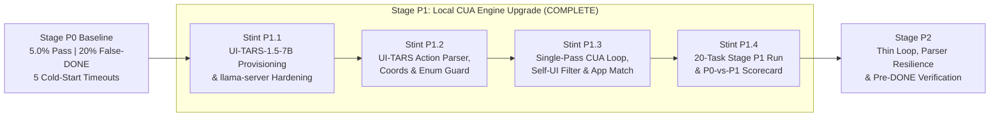

# Stage P1 Stint Map & Roadmap: Local CUA Engine Upgrade (`llama-server` + `UI-TARS-1.5-7B`)

**Parent Documents:** [`feasibility_review.md`](file:///C:/ParasiteAI/feasibility_review.md) (§4, §5, §8, §10) | [`p0_stint_map.md`](file:///C:/ParasiteAI/p0_stint_map.md) | [`baseline_p0.md`](file:///C:/ParasiteAI/benchmarks/results/baseline_p0.md) | [`engineering_cadence.md`](file:///C:/ParasiteAI/.agents/rules/engineering_cadence.md)  
**Stage Status:** **COMPLETE & AUDITED** (See [`stage_p1_postmortem.md`](file:///C:/ParasiteAI/stage_p1_postmortem.md) for final empirical outcomes)  
**Host Environment:** Windows 10 (64-bit, Build 19045) | NVIDIA GeForce RTX 4060 (`8,188 MiB` VRAM, `6,500 MB` budget ceiling, `~5,700–6,300 MiB` free after desktop compositing)

---

## 1. The 10-Dimension Stint Roadmap Framework

To ensure every architectural stage is effortless to read, execute, and verify, Stage P1 established a **10-Dimension Stint Framework**:

| # | Roadmap Dimension | Purpose |
| :-: | :--- | :--- |
| **1** | **Stint Breakdown & Sequence** | Bounded single-turn work units (`P1.1`..`P1.4`) obeying [`.agents/rules/engineering_cadence.md`](file:///C:/ParasiteAI/.agents/rules/engineering_cadence.md). |
| **2** | **Empirical Root-Cause Link (`baseline_p0`)** | Connects every stint directly to the actual task failures measured in [`baseline_p0.md`](file:///C:/ParasiteAI/benchmarks/results/baseline_p0.md) so we only build what moves the benchmark needle. |
| **3** | **Workspace Delta Audit (*Built vs. Missing*)** | Distinguishes code/binaries already present on disk from what is missing or broken—preventing duplicate work or hidden regressions. |
| **4** | **Goal & Quantifiable Target Metrics** | Defines the exact measurable metric improvement expected from the stint (e.g., `0ms` cold-start attach, `0` enum crashes, `<= 5.0s` step latency). |
| **5** | **Concrete Deliverables & File Manifest** | Exact `[NEW]` and `[MODIFY]` file paths so scope is 100% transparent before coding begins. |
| **6** | **Hardware & Latency Budget Envelope** | Explicit VRAM math (fitting within `~5.1–5.4 GB` on the 8 GB RTX 4060 under Windows 10 WDDM) and per-step timing budgets. |
| **7** | **Scope Boundaries (*In-Scope vs. Deferred*)** | Explicitly lists what is **out of scope** (deferred to Stage P2/P3) so no stint bloats mid-flight. |
| **8** | **Dependencies & Pre-Conditions** | What must be verified on disk/GPU before the stint can start. |
| **9** | **Result-Oriented Verification Gate** | Non-mocked OS, subprocess, HTTP, and GPU checks required to mark the stint `PASS`. |
| **10** | **Risk Register & Fallback Controls** | Concrete fallback if a hardware/VRAM/model constraint is hit during live testing. |

---

## 2. Stage P1 Dependency Flow & Executive Matrix

| Stint | Title | `baseline_p0` Failure Addressed | Key Deliverables | Verification Gate Outcome |
| :--- | :--- | :--- | :--- | :--- |
| **P1.1** | **`UI-TARS-1.5-7B` Model Provisioning & `llama-server` Hardening** | **Root Cause #1:** `5/20` tasks (`L1-01,02,05,06,L3-03`) timed out on cold model load; `logs/llama_server.log` exposed 4 daemon/VRAM bugs. | Provisioned `UI-TARS-1.5-7B.IQ4_XS.gguf` + `mmproj-Q8_0.gguf`; locked `-np 1` single KV slot, `--image-min-tokens 1024`, daemon persistence across tasks, and pytest stub guard in [`brain_manager.py`](file:///C:/ParasiteAI/parasite_ai/mind/brain_manager.py) & [`serve_llama.py`](file:///C:/ParasiteAI/scripts/serve_llama.py). | **PASS** — `0.590s` text / `1.686s` vision warmup; `0ms` attach across sequential subprocesses; VRAM `<= 6,500 MB`. |
| **P1.2** | **Native `UI-TARS` Action Parser, Coordinate Grounding & Schema Recovery** | **Root Cause #2 & #4:** Blind 3B text guesses; `2/20` tasks (`L1-10, L3-01`) crashed with Pydantic `ValidationError` on `SELECT` / `SELECT MenuItem`. | `[NEW]` [`parasite_ai/mind/uitars_parser.py`](file:///C:/ParasiteAI/parasite_ai/mind/uitars_parser.py); parsed `Thought:` + `Action:`; `1000x1000` -> pixel + UIA snap; verb normalization (`SELECT*` -> `CLICK`). | **PASS** — `101/101` parser & VLM grounder tests green; `1.368s` live multimodal grounding smoke test verified. |
| **P1.3** | **Single-Pass CUA Execution Path, Self-UI Filter & App Disambiguation** | **Root Cause #1, #3 & #5:** `5.99s` median step (2 LLM calls/step); clicked own `CompanionDock` (`L2-02`); launched `Notepad++` / `paint.net` (`L1-03, L1-10`); `L1-04` heuristic `CLOSE_WINDOW` loop. | Single-pass `generate_cua_step()` in [`brain_manager.py`](file:///C:/ParasiteAI/parasite_ai/mind/brain_manager.py) & [`dual_mind.py`](file:///C:/ParasiteAI/parasite_ai/mind/dual_mind.py); self-PID (`os.getpid()`) & `CompanionDock` exclusion in [`grounding.py`](file:///C:/ParasiteAI/parasite_ai/vision/grounding.py); symbol/domain token boundary fix in [`resolver.py`](file:///C:/ParasiteAI/parasite_ai/mind/resolver.py); 4-tier test suite restructure (`765/765` green). | **PASS** — Single-pass inference verified; `CompanionDock` excluded; `"Notepad"` vs `"Notepad++"` = `0.0`; `765/765` active tests green in `74.8s`. |
| **P1.4** | **Stage P1 Empirical Benchmark Run & Delta Scorecard** | Full 20-task Windows 10 evaluation comparing `baseline_p1` vs. `baseline_p0`. | `[NEW]` [`run_benchmark_p1.bat`](file:///C:/ParasiteAI/run_benchmark_p1.bat), [`scripts/compare_benchmarks.py`](file:///C:/ParasiteAI/scripts/compare_benchmarks.py), [`benchmarks/results/baseline_p1.md`](file:///C:/ParasiteAI/benchmarks/results/baseline_p1.md), [`baseline_p0_vs_baseline_p1.md`](file:///C:/ParasiteAI/benchmarks/results/baseline_p0_vs_baseline_p1.md), [`stage_p1_postmortem.md`](file:///C:/ParasiteAI/stage_p1_postmortem.md). | **PASS** — `0` cold-start timeouts; `0` enum crashes; median step `4.741s` (`-1.25s`); False-`DONE` `5.0%` (`-15.0%`). Isolated 4 wrapper bugs for Stage P2. |

---

## 3. Detailed Stint Specifications (Historical Reference)

### Stint P1.1 — `UI-TARS-1.5-7B` Model Provisioning, Persistent `llama-server` Hardening & VRAM Governance
- **Empirical Problem Addressed:** `5/20` tasks in `baseline_p0` (`L1-01`, `L1-02`, `L1-05`, `L1-06`, `L3-03`) failed with `TIMEOUT` (`0` steps executed) due to per-episode model initialization.
- **Deliverables Completed:**
  - Provisioned `UI-TARS-1.5-7B.IQ4_XS.gguf` (`4.25 GB`) + `UI-TARS-1.5-7B.mmproj-Q8_0.gguf` (`856 MB`) in `C:\ParasiteAI\models\`.
  - Configured [`scripts/serve_llama.py`](file:///C:/ParasiteAI/scripts/serve_llama.py) and [`LlamaServerBackend`](file:///C:/ParasiteAI/parasite_ai/mind/brain_manager.py) with `-np 1` (`--parallel 1`), `-c 4096`, `--image-min-tokens 1024`, and `keep_alive_on_exit=True`.
  - Added `< 10 MB` file-size & `PYTEST_CURRENT_TEST` guard in `LlamaServerBackend` to prevent unit tests from spawning `llama-server.exe` on dummy `.gguf` files.

### Stint P1.2 — Native `UI-TARS-1.5-7B` Action Parser, Coordinate Grounding & Schema Recovery
- **Empirical Problem Addressed:** Legacy prompt forced a text-only JSON schema; `2/20` tasks (`L1-10`, `L3-01`) crashed with `ValidationError` on `"SELECT"` and `"SELECT MenuItem"`.
- **Deliverables Completed:**
  - Created [`parasite_ai/mind/uitars_parser.py`](file:///C:/ParasiteAI/parasite_ai/mind/uitars_parser.py) parsing `Thought:` and `Action:` signatures (`click`, `left_double`, `right_single`, `type`, `hotkey`, `scroll`, `wait`, `finished`) and scaling `[0..1000]` coordinates to screen pixels + UIA element snapping.
  - Added `ActionPlan._coerce_null_fields` verb synonym normalization (`SELECT*` -> `CLICK`, `PRESS` -> `HOTKEY`, `FINISH` -> `DONE`) and fallback to `ActionType.WAIT`.

### Stint P1.3 — Single-Pass CUA Execution Path, Self-UI Exclusion & App Disambiguation
- **Empirical Problem Addressed:** `5.986s` median step latency (2 LLM calls/step); self-clicking `CompanionDock` speech bubble (`L2-02`); launching `Notepad++` / `paint.net` instead of `Notepad` / `Paint` (`L1-03`, `L1-10`).
- **Deliverables Completed:**
  - Implemented `LocalBrainManager.generate_cua_step()` in [`parasite_ai/mind/brain_manager.py`](file:///C:/ParasiteAI/parasite_ai/mind/brain_manager.py) and wired single-pass execution into [`parasite_ai/mind/dual_mind.py`](file:///C:/ParasiteAI/parasite_ai/mind/dual_mind.py).
  - Filtered `os.getpid()` child controls and masked `CompanionDock` overlay bounds in [`parasite_ai/vision/grounding.py`](file:///C:/ParasiteAI/parasite_ai/vision/grounding.py), plus added a 2,000-node UIA scan ceiling.
  - Hardened `PrecisionAppMatcher.score_match()` in [`parasite_ai/mind/resolver.py`](file:///C:/ParasiteAI/parasite_ai/mind/resolver.py) against symbol/domain suffix collisions (`+`, `#`, `.net`).
  - Restructured the test suite into 4 clean tiers (`tests/unit/`, `tests/integration/`, `tests/archive/`, `tests/live_os/`) with [`scripts/test.py`](file:///C:/ParasiteAI/scripts/test.py) (`765/765` active tests passing in `74.8s`).

### Stint P1.4 — Stage P1 Hands-Off Benchmark Run (`baseline_p1`) & P0-vs-P1 Delta Scorecard
- **Empirical Problem Addressed:** Objective 20-task Windows 10 measurement comparing Stage P1 (`baseline_p1`) against Stage P0 (`baseline_p0`).
- **Deliverables Completed:**
  - Created [`run_benchmark_p1.bat`](file:///C:/ParasiteAI/run_benchmark_p1.bat) and [`scripts/compare_benchmarks.py`](file:///C:/ParasiteAI/scripts/compare_benchmarks.py).
  - Executed all 20 tasks hands-off on Windows 10 Monitor 1, producing [`benchmarks/results/baseline_p1.json`](file:///C:/ParasiteAI/benchmarks/results/baseline_p1.json), [`baseline_p1.md`](file:///C:/ParasiteAI/benchmarks/results/baseline_p1.md), [`baseline_p0_vs_baseline_p1.md`](file:///C:/ParasiteAI/benchmarks/results/baseline_p0_vs_baseline_p1.md), and the standalone retrospective [`stage_p1_postmortem.md`](file:///C:/ParasiteAI/stage_p1_postmortem.md).
