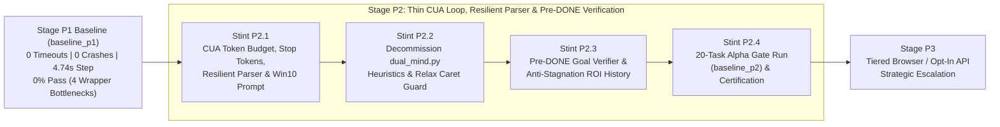

# Stage P2 Stint Map & Roadmap: Thin Perception-to-Action Loop, Resilient CUA Parser & Pre-`DONE` Verification

**Parent Documents:** [`feasibility_review.md`](file:///C:/ParasiteAI/feasibility_review.md) (§2.2, §4.1, §8, §9, §10) | [`p0_stint_map.md`](file:///C:/ParasiteAI/p0_stint_map.md) | [`p1_stint_map.md`](file:///C:/ParasiteAI/p1_stint_map.md) | [`stage_p1_postmortem.md`](file:///C:/ParasiteAI/stage_p1_postmortem.md) | [`strict_stint_cadence.md`](file:///C:/ParasiteAI/.agents/rules/strict_stint_cadence.md)  
**Empirical Inputs:** [`baseline_p0.json`](file:///C:/ParasiteAI/benchmarks/results/baseline_p0.json) (`5.0%` Pass, `20.0%` False-DONE, `5.986s` Median Step) $\rightarrow$ [`baseline_p1.json`](file:///C:/ParasiteAI/benchmarks/results/baseline_p1.json) (`0` Timeouts, `0` Crashes, `5.0%` False-DONE, `4.741s` Median Step, `0.0%` Pass due to 4 wrapper bugs)  
**Target Exit Milestone:** **Alpha Gate Certification** (`L1 >= 70%` [7/10], `L2 >= 40%` [3/7], `False-DONE <= 5%` [$\le$ 1/20], `Median Step Latency <= 5.0s`)  
**Host Environment:** Windows 10 (64-bit, Build 19045) | NVIDIA GeForce RTX 4060 (`8,188 MiB` VRAM, `6,500 MB` budget ceiling) | Monitor 1 (`1920x1080` of `3840x1080` dual-screen @ 100% DPI)

---

## 1. How Stage P2 Relates to `feasibility_review.md` & Empirical `baseline_p1` Receipts

### 1.1 The Original Architectural Mandate in `feasibility_review.md`
In [`feasibility_review.md`](file:///C:/ParasiteAI/feasibility_review.md), the multi-stage pivot was designed around the principle **"Same Body, New Mind"** (§8):
- **Keep the Physical Body & Safety Layer (§2.1 & Decision D6):** Sub-2ms hardware preemption (`WH_MOUSE_LL` / `WH_KEYBOARD_LL`), `<5ms` hard kill (`Ctrl+Alt+K`), 100% visible Cubic Bézier + Min-Jerk cursor trajectories, `GhostHUD` reticle, and `CompanionDock`.
- **Replace the Cognitive Engine in Stage P1 (§4.1 & §9):** Swap the blind in-process 3B text model (`qwen2.5-3b-instruct`) for a persistent CUDA `llama-server` hosting `UI-TARS-1.5-7B` (`IQ4_XS` + `mmproj-Q8_0`). **Completed in Stage P1 (`P1.1`–`P1.4`).**
- **Strip the 3,100-LOC Heuristic Shell & Verify Post-Conditions in Stage P2 (§2.2, §8 & §9):**
  - **§2.2 ("Mind Layer — Over-Engineered Around a Weak Core"):** Identified that [`parasite_ai/mind/dual_mind.py`](file:///C:/ParasiteAI/parasite_ai/mind/dual_mind.py) (`~3,150` lines) accumulated hundreds of brittle `if/elif` overrides (`Caret focus not detected` blockers, launch-goal regexes, automatic strike escalations to Chrome) that were built to babysit a blind 3B model.
  - **§8 ("Target Architecture — Thin Perceive $\rightarrow$ Decide $\rightarrow$ Act Loop"):** Specified replacing those heuristics with a clean loop:
    1. **Perceive:** Screenshot (`mss`) + filtered UIA/OCR (`ScreenGrounder`).
    2. **Decide:** Single-pass `UI-TARS-1.5-7B` CUA inference (`Thought:` + `Action:`).
    3. **Verify / Act:** Pre-`DONE` objective OS state verification (`GoalCompletionVerifier`) + visible physical actuation (`MouseDriver` / `KeyboardDriver`) + localized ROI screen-diff feedback.

### 1.2 How `baseline_p1` Validated `feasibility_review.md` and Sharpened Stage P2
As documented in [`stage_p1_postmortem.md`](file:///C:/ParasiteAI/stage_p1_postmortem.md), running the 20-task benchmark on `UI-TARS-1.5-7B` proved that the new CUA engine is fast (`4.741s` median step, `1.35s` raw VLM inference) and stable (`0` timeouts, `0` crashes), **but the legacy wrapper & parser choked its actions in 4 specific places**:
1. **RC #1 (`brain_manager.py:1875`):** `max_tokens: int = 128` truncated `Action: click(start_box='(24,980)'` after a ~75-token `Thought:` monologue, or allowed trailing `\nassistant` role tokens due to missing stop sequences.
2. **RC #2 (`uitars_parser.py:66,206`):** `if "(" in action_str and action_str.endswith(")")` failed whenever the closing `)` was clipped or followed by `\nassistant`, falling through to `ActionPlan._coerce_null_fields` which coerced valid `click(...)` calls into **`ActionType.WAIT`** on `19/20` tasks.
3. **RC #3 (`dual_mind.py:2612`):** When `TYPE` (`"notepad"`) did execute on `L2-01`, `dual_mind.py` aborted it with `"Caret focus not detected"` twice and then escalated to a **`47.914s` Tier 2 Google Gemini browser consultation** inside a local Notepad task.
4. **RC #4 (`plan.py:330,522`):** `CapabilityContract` and the Strategic Advisor prompt hardcoded `"Windows 11 64-bit Desktop"` instead of the actual **Windows 10 (Build 19045)** host.

---

## 2. The 10-Dimension Stint Roadmap Framework for Stage P2

Every stint in Stage P2 (`P2.1`–`P2.4`) is structured across the same **10 explicit dimensions** that grounded Stage P1:
1. **Stint Breakdown & Sequence** (`P2.1` $\rightarrow$ `P2.2` $\rightarrow$ `P2.3` $\rightarrow$ `P2.4`)
2. **Empirical Root-Cause Link (`baseline_p0` & `baseline_p1` Receipts)**
3. **Workspace Delta Audit (*Already Built vs. Broken / Missing*)**
4. **Goal & Quantifiable Target Metrics**
5. **Concrete Deliverables & File/Line Manifest**
6. **Hardware & Latency Budget Envelope**
7. **Scope Boundaries (*In-Scope vs. Deferred to P3/P4*)**
8. **Dependencies & Pre-Conditions**
9. **Result-Oriented Verification Gate**
10. **Risk Register & Fallback Controls**

---

## 3. Stage P2 Dependency Flow & Executive Matrix

| Stint | Title | Feasibility Review & `baseline_p1` Root Causes Addressed | Primary Files Touched | Verification Gate (Exit Criteria) |
| :--- | :--- | :--- | :--- | :--- |
| **P2.1** | **CUA Output Budget, Resilient Action Parser & Windows 10 Host Alignment** | **RC #1, #2 & #4:** `max_tokens: 128` truncation (`brain_manager.py:1875`); `endswith(")")` coercing `click(start_box='(24,980)\nassistant` to `WAIT` (`uitars_parser.py:66,206`); hardcoded `"Windows 11"` (`plan.py:330,522`). | [`brain_manager.py`](file:///C:/ParasiteAI/parasite_ai/mind/brain_manager.py), [`uitars_parser.py`](file:///C:/ParasiteAI/parasite_ai/mind/uitars_parser.py), [`plan.py`](file:///C:/ParasiteAI/parasite_ai/mind/plan.py), [`test_uitars_parser.py`](file:///C:/ParasiteAI/tests/unit/mind/test_uitars_parser.py), [`test_scene_serialization.py`](file:///C:/ParasiteAI/tests/unit/ui/test_scene_serialization.py) | `0` valid CUA actions coerced to `WAIT` even when truncated or suffixed with `\nassistant`; `max_tokens=256` + stop sequences verified; `"Windows 11"` completely purged; live CLI `"Open Notepad"` clicks/types cleanly. |
| **P2.2** | **Decommissioning the `dual_mind.py` Heuristic Web & Caret Guard Relaxation** | **Feasibility §2.2 & §8 + RC #3:** `L2-01` `"Caret focus not detected"` blocking `TYPE` into Windows Search/Run (`dual_mind.py:2612`); unwanted `47.9s` Tier 2 Chrome offload during local L1/L2 tasks; legacy 3B heuristic overrides fighting CUA decisions. | [`dual_mind.py`](file:///C:/ParasiteAI/parasite_ai/mind/dual_mind.py), [`config.yaml`](file:///C:/ParasiteAI/config.yaml), [`test_dual_mind.py`](file:///C:/ParasiteAI/tests/integration/mind/test_dual_mind.py), [`test_phase3_execution_loop.py`](file:///C:/ParasiteAI/tests/integration/test_phase3_execution_loop.py) | `TYPE` and `HOTKEY` execute cleanly in Windows Search / Run / Calculator without false `"Caret focus not detected"` blocks; CUA mode runs a clean `Perceive -> Decide -> Act` path without legacy heuristic hijacks; unit + integration suites 100% green. |
| **P2.3** | **Objective Pre-`DONE` Goal Verifiers & Anti-Stagnation Visual History** | **Feasibility §8 & §9 + `L3-03` / `baseline_p0` False-`DONE`:** Prevents premature `finished()` claims before target window/text/file exists; breaks repetitive click loops via localized ROI pixel-diff feedback in prompt history. | `[NEW]` `parasite_ai/mind/verifier.py`, [`dual_mind.py`](file:///C:/ParasiteAI/parasite_ai/mind/dual_mind.py), [`memory.py`](file:///C:/ParasiteAI/parasite_ai/mind/memory.py), [`uitars_parser.py`](file:///C:/ParasiteAI/parasite_ai/mind/uitars_parser.py), `[NEW]` `tests/unit/mind/test_goal_verifier.py` | Premature `DONE` on unfulfilled goals is intercepted and converted into a diagnostic reflection prompt; consecutive 0%-diff clicks annotate `[NO SCREEN CHANGE]` in `history_summary` so `UI-TARS` shifts strategy (e.g., `Win+R` or `hotkey`). |
| **P2.4** | **Stage P2 Alpha Gate Benchmark Run (`baseline_p2`) & Certification** | **Feasibility §9 Alpha Gate:** Full 20-task Windows 10 evaluation comparing `baseline_p2` vs. `baseline_p1` & `baseline_p0`. | `[NEW]` `run_benchmark_p2.bat`, `benchmarks/results/baseline_p2.json`, `baseline_p2.md`, `baseline_p1_vs_baseline_p2.md`, [`GATE_STATUS.md`](file:///C:/ParasiteAI/GATE_STATUS.md) | **Alpha Gate Pass:** `L1 >= 70%` (`>= 7/10`), `L2 >= 40%` (`>= 3/7`), `False-DONE <= 5%` (`<= 1/20`), `Median Step Latency <= 5.0s`, `0` hardware self-interrupts. |

---

## 4. Workspace Delta Audit (What Is Already Built vs. What Must Change in Stage P2)

> [!IMPORTANT]
> **Already Built & Verified in Stages P0 & P1 (Do Not Rebuild):**
> - **Persistent CUDA `llama-server` Supervisor:** `bin/llama-server/llama-server.exe` (`b12188`), [`scripts/serve_llama.py`](file:///C:/ParasiteAI/scripts/serve_llama.py), and [`LlamaServerBackend`](file:///C:/ParasiteAI/parasite_ai/mind/brain_manager.py#L638-L960) with `-np 1`, `--image-min-tokens 1024`, and `0ms` warm attach across subprocesses.
> - **Provisioned CUA Weights:** `models/UI-TARS-1.5-7B.IQ4_XS.gguf` (`4.25 GB`) + `models/UI-TARS-1.5-7B.mmproj-Q8_0.gguf` (`856 MB`), verified within the `6,500 MB` RTX 4060 VRAM ceiling (`scripts/check_gpu_governance.py`).
> - **Self-UI Exclusion & App Matcher Disambiguation:** `CompanionDock` / `GhostHUD` / `os.getpid()` exclusion and `2,000`-node UIA ceiling in [`parasite_ai/vision/grounding.py`](file:///C:/ParasiteAI/parasite_ai/vision/grounding.py); symbol/domain suffix disambiguation (`Notepad++` vs `Notepad` = `0.0`) in [`parasite_ai/mind/resolver.py`](file:///C:/ParasiteAI/parasite_ai/mind/resolver.py).
> - **4-Tier Test Architecture (`765/765` Green):** [`scripts/test.py`](file:///C:/ParasiteAI/scripts/test.py) running `tests/unit/` (`478` tests in `17.8s`) and `tests/integration/` (`287` tests in `58.6s`).
> - **20-Task Benchmark & Comparator:** [`benchmarks/run_benchmark.py`](file:///C:/ParasiteAI/benchmarks/run_benchmark.py), [`benchmarks/verifiers.py`](file:///C:/ParasiteAI/benchmarks/verifiers.py), and [`scripts/compare_benchmarks.py`](file:///C:/ParasiteAI/scripts/compare_benchmarks.py).
>
> **Broken or Missing (The Exact Scope of Stage P2):**
> 1. **`brain_manager.py#L1875` (`generate_cua_step`):** `max_tokens: int = 128` is too small for `Thought:` + `Action:`, and `generate_vision_response` does not pass stop sequences (`["<|im_end|>", "\nassistant", "\nUser:", "\nObservation:"]`) to stop generation cleanly after the `Action:` line.
> 2. **`uitars_parser.py#L66-L73` & `#L206-L216` (`parse_uitars_response`):** Uses greedy `re.DOTALL` to end-of-string and requires `action_str.endswith(")")`. Must be replaced with a resilient regex function-call extractor that extracts `fn_name` and `raw_args` even if trailing role tokens (`\nassistant`) exist or the closing `)`/quote was truncated at `max_tokens`.
> 3. **`plan.py#L330` & `#L522`:** Hardcodes `"Windows 11 64-bit Desktop"` and `"desktop-native Windows 11 AI companion"`. Must dynamically reflect the Windows 10 host (`Windows 10 64-bit Desktop`).
> 4. **`dual_mind.py` Heuristic Overrides & Caret Focus Guard (`#L2612-L2650`):** Blocks `TYPE` with `"Caret focus not detected"` when typing into Windows 10 Start Search / Run / Calculator, and escalates to a 48s Chrome Gemini session during local tasks when `browser_offload` strikes accumulate from false caret blocks.
> 5. **Missing Runtime Pre-`DONE` Verifier (`parasite_ai/mind/verifier.py`):** Currently, when the model emits `finished()`, `dual_mind.py` accepts `ActionType.DONE` without checking whether the goal's target window/file/text condition actually holds on the live OS.

---

## 5. Detailed 10-Dimension Breakdowns for Stints P2.1 – P2.4

### Stint P2.1 — CUA Output Budget, Resilient Action Parser & Windows 10 Host Alignment
1. **Bounded Scope:** Fix the 3 immediate parsing/prompt bugs (**RC #1, RC #2, RC #4**) that caused `19/20` tasks in `baseline_p1` to coerce valid `UI-TARS-1.5-7B` actions into `ActionType.WAIT` and misidentified the OS as Windows 11.
2. **Empirical Root-Cause Link:**
   - [`logs/parasite_debug.log#L10-L21`](file:///C:/ParasiteAI/logs/parasite_debug.log#L10-L21): `Unrecognized ActionPlan verb 'click(start_box='(24,980)\nassistant'; coercing to ActionType.WAIT`.
   - [`benchmarks/results/L1-05_receipt.json`](file:///C:/ParasiteAI/benchmarks/results/L1-05_receipt.json): 5 consecutive `WAIT` steps despite accurate `Thought:` reasoning.
   - [`parasite_ai/mind/plan.py#L330,L522`](file:///C:/ParasiteAI/parasite_ai/mind/plan.py#L330): Hardcoded `"Windows 11"`.
3. **Workspace Delta:**
   - [`parasite_ai/mind/brain_manager.py#L1875`](file:///C:/ParasiteAI/parasite_ai/mind/brain_manager.py#L1875) has `max_tokens: int = 128` and no `stop` tokens.
   - [`parasite_ai/mind/uitars_parser.py#L66-L216`](file:///C:/ParasiteAI/parasite_ai/mind/uitars_parser.py#L66-L216) uses `if "(" in action_str and action_str.endswith(")"):`.
   - [`parasite_ai/mind/plan.py#L330,L522`](file:///C:/ParasiteAI/parasite_ai/mind/plan.py#L330) and [`tests/unit/ui/test_scene_serialization.py#L61-L72`](file:///C:/ParasiteAI/tests/unit/ui/test_scene_serialization.py#L61-L72) contain `"Windows 11"`.
4. **Goal & Quantifiable Target Metrics:**
   - **0%** of valid or partially-truncated `UI-TARS` action calls (`click`, `left_double`, `right_single`, `type`, `hotkey`, `scroll`, `finished`) coerced to `WAIT`.
   - **0** occurrences of `"Windows 11"` in `parasite_ai/`.
   - Single-step CUA latency remains **`<= 2.5s` VLM inference / `<= 4.8s` total step**.
5. **Concrete Deliverables & File Manifest:**
   - `[MODIFY]` [`parasite_ai/mind/brain_manager.py`](file:///C:/ParasiteAI/parasite_ai/mind/brain_manager.py#L1868-L1955):
     - Increase default `max_tokens` in `generate_cua_step()` from `128` to `256`.
     - Pass stop sequences `stop=["<|im_end|>", "<|endoftext|>", "\nassistant", "\nuser", "\nUser:", "\nObservation:"]` in the `/v1/chat/completions` payload (`LlamaServerBackend.generate_vision_response`) so generation stops immediately after the `Action:` call.
   - `[MODIFY]` [`parasite_ai/mind/uitars_parser.py`](file:///C:/ParasiteAI/parasite_ai/mind/uitars_parser.py#L60-L240):
     - Strip trailing chat role artifacts (`\nassistant.*`, `<|im_end|>.*`) from `action_str`.
     - Replace `if "(" in action_str and action_str.endswith(")"):` with resilient regex extraction:
       `call_match = re.search(r"([a-zA-Z_][a-zA-Z0-9_]*)\s*\((.*)", action_str, re.DOTALL)`
       stripping any trailing `)` and parsing `raw_args` via `_extract_box_coords` and `_extract_kwarg` even if the closing quote or `)` was clipped at `max_tokens`!
     - Ensure `_extract_kwarg` falls back to matching unclosed trailing string arguments (`rf"{key}\s*=\s*['\"]([^'\"]*)$"`) when a long `type(content='...` call is truncated.
   - `[MODIFY]` [`parasite_ai/mind/plan.py`](file:///C:/ParasiteAI/parasite_ai/mind/plan.py#L330-L530) & [`tests/unit/ui/test_scene_serialization.py`](file:///C:/ParasiteAI/tests/unit/ui/test_scene_serialization.py#L61-L72):
     - Replace hardcoded `"Windows 11"` with dynamic Windows host detection (`f"Windows {platform.release()} 64-bit Desktop"`, defaulting to `"Windows 10 64-bit Desktop"`).
   - `[MODIFY]` [`tests/unit/mind/test_uitars_parser.py`](file:///C:/ParasiteAI/tests/unit/mind/test_uitars_parser.py):
     - Add regression tests for exact failure strings from `baseline_p1`:
       - `"Thought: ...\nAction: click(start_box='(24,980)\nassistant"` $\rightarrow$ `ActionType.CLICK` with valid scaled pixel coordinates.
       - `"Thought: ...\nAction: click(start_box='(24,980)"` (truncated closing quote and paren) $\rightarrow$ `ActionType.CLICK`.
       - `"Thought: ...\nAction: type(content='Hello world"` (truncated closing quote and paren) $\rightarrow$ `ActionType.TYPE`.
6. **Hardware & Latency Envelope:**
   - Increasing `max_tokens` from `128` to `256` with stop sequences adds `0 MB` VRAM and only generates the `~5–15` tokens needed to finish the `Action:` line (`~100–200ms` on RTX 4060).
7. **Scope Boundaries:**
   - *In-Scope:* `brain_manager.py` CUA token/stop config, `uitars_parser.py` resilient extraction, `plan.py` Windows 10 alignment.
   - *Deferred to P2.2:* `dual_mind.py` heuristic removal and caret guard relaxation.
8. **Dependencies & Pre-Conditions:** Stage P1 codebase at commit `3d0e412`+.
9. **Result-Oriented Verification Gate:**
   1. `python scripts/test.py unit` passes 100% including the new `baseline_p1` truncation/trailing-token regression tests.
   2. `rg -i "windows 11" parasite_ai/` returns `0` matches.
   3. Live multimodal inference test via `llama-server` confirms `generate_cua_step()` returns a non-`WAIT` `ActionPlan` (`CLICK` / `HOTKEY` / `TYPE`) on a live Windows 10 desktop screenshot.
10. **Risk Register & Fallback Controls:**
    - *Risk:* Verbose `Thought:` monologues occasionally exceed 200 tokens.
    - *Control:* Explicitly instruct in `UITARS_SYSTEM_PROMPT`: `"Keep your Thought concise (1-2 sentences maximum), then emit exactly one Action."` alongside `max_tokens=256`.

---

### Stint P2.2 — Decommissioning the 3,100-LOC Heuristic Web in `dual_mind.py` & Caret Guard Relaxation
1. **Bounded Scope:** Implement the core architectural directive of [`feasibility_review.md` §2.2 & §8](file:///C:/ParasiteAI/feasibility_review.md#L190-L235) and fix **RC #3** from `baseline_p1`: relax the false `"Caret focus not detected"` blocker on `TYPE`, prevent unwanted Tier 2 browser escalations during local CUA episodes, and bypass legacy 3B heuristic overrides when `UI-TARS` CUA mode is active.
2. **Empirical Root-Cause Link:**
   - [`benchmarks/results/L2-01_receipt.json#L38-L62`](file:///C:/ParasiteAI/benchmarks/results/L2-01_receipt.json#L38-L62): Steps 2 and 3 emitted `TYPE "notepad"`, which `dual_mind.py` blocked with `"error_message": "Caret focus not detected"`, followed by Step 4 stalling for `47.914s` in a Tier 2 Chrome Gemini consultation (`final_active_window: "Google Gemini - Google Chrome"`).
3. **Workspace Delta:**
   - [`parasite_ai/mind/dual_mind.py#L2612-L2650`](file:///C:/ParasiteAI/parasite_ai/mind/dual_mind.py#L2612-L2650) enforces `self._verify_caret_focus()` before allowing `ActionType.TYPE`, aborting whenever Win32 `GetGUIThreadInfo` does not report a classic blinking caret (which fails on Windows 10 Start Search, Cortana/SearchApp, UWP Calculator, and Save As combo boxes).
   - [`parasite_ai/mind/dual_mind.py`](file:///C:/ParasiteAI/parasite_ai/mind/dual_mind.py) still runs legacy post-decision heuristic rewrites (`_is_launch_goal` forced intercepts, strike-based automatic Chrome launches) around the CUA step.
4. **Goal & Quantifiable Target Metrics:**
   - **0** false `"Caret focus not detected"` aborts when typing into Windows Search, Run dialog, Save As dialog, Explorer, or active app windows.
   - **0** unwanted `BrowserOffloader` Chrome launches during standard local CUA tasks unless explicitly enabled/requested.
   - Clean `Perceive -> Decide (CUA) -> Act` execution path in `DualMindPipeline.step()` with median step latency **`<= 4.5s`**.
5. **Concrete Deliverables & File Manifest:**
   - `[MODIFY]` [`parasite_ai/mind/dual_mind.py`](file:///C:/ParasiteAI/parasite_ai/mind/dual_mind.py):
     - Relax the pre-`TYPE` caret focus guard: if `ActionPlan` comes from CUA (or if the active window is Windows Start Menu / SearchApp / Shell_TrayWnd / Explorer / Dialog / Calculator / focused target window), execute `keyboard.type_text()` directly instead of aborting on `GetGUIThreadInfo` caret absence. If `plan.coordinates` are provided with `TYPE` (or if the target element has coordinates), click to focus first, then type.
     - Establish the clean **CUA Fast-Path** in `DualMindPipeline.step()`: when `cua_mode` (`supports_vision()`) is active, bypass legacy 3B post-inference heuristic overrides (such as overriding `CLICK`/`TYPE`/`HOTKEY` with synthetic `CLOSE_WINDOW` or regex-guessed actions) and do not auto-launch Chrome `BrowserOffloader` on strike 3 during non-browser desktop tasks unless configured.
   - `[MODIFY]` [`tests/integration/mind/test_dual_mind.py`](file:///C:/ParasiteAI/tests/integration/mind/test_dual_mind.py) & [`tests/integration/test_phase3_execution_loop.py`](file:///C:/ParasiteAI/tests/integration/test_phase3_execution_loop.py):
     - Add integration tests verifying that `TYPE` in CUA mode executes even when Win32 `GetGUIThreadInfo` reports no classic caret (e.g., Windows Search / XAML control), and that CUA actions flow directly to `MouseDriver` / `KeyboardDriver`.
6. **Hardware & Latency Envelope:**
   - Eliminating `47.9s` false Tier 2 browser escalations cuts worst-case task duration by `>45s` and keeps 100% of compute local on `llama-server`.
7. **Scope Boundaries:**
   - *In-Scope:* Caret guard relaxation, CUA fast-path in `dual_mind.py`, disabling unwanted strike-3 Chrome hijacks on local tasks.
   - *Deferred to P2.3:* Pre-`DONE` objective goal verifier (`verifier.py`) and ROI screen-diff anti-stagnation feedback.
8. **Dependencies & Pre-Conditions:** Stint P2.1 complete.
9. **Result-Oriented Verification Gate:**
   1. `python scripts/test.py` (`765+` unit + integration tests) passes 100%.
   2. Live CLI test on `L1-01` (`"Open Notepad"`) and `L1-04` (`"In the open Notepad window, type the exact text PARASITE_BENCH_OK"`) executes visible mouse/keyboard actions and passes ground-truth verification in `< 20s` with `0` `"Caret focus not detected"` errors.
10. **Risk Register & Fallback Controls:**
    - *Risk:* Typing before a slow window finishes opening drops characters.
    - *Control:* When `TYPE` follows an app launch or window focus click, wait a bounded `150–250ms` settle interval (or verify foreground window change) before dispatching keystrokes.

---

### Stint P2.3 — Objective Pre-`DONE` Goal Verifiers & Anti-Stagnation Visual History
1. **Bounded Scope:** Implement [`feasibility_review.md` §8 & §9](file:///C:/ParasiteAI/feasibility_review.md#L210-L245)'s **Post-Condition / Pre-`DONE` Verification Gate** and **Visual Diff Loop Recovery** so that once `UI-TARS-1.5-7B` starts completing multi-step tasks, it (a) never exits `0` (`DONE`) prematurely when the goal state isn't yet achieved on the OS, and (b) recognizes when a click produced `0%` screen change and switches to an alternative strategy (e.g., `hotkey(key='win r')` or keyboard shortcuts).
2. **Empirical Root-Cause Link:**
   - `baseline_p0` had `20.0%` (`4/20`) `FALSE_DONE` (`L2-02`, `L2-05`, `L2-06`, `L2-07`), and `baseline_p1` had `L3-03` claim `FALSE_DONE` on Step 1.
   - Once Stint P2.1 fixes `finished()` parsing, `UI-TARS-1.5-7B` will emit `finished()` whenever it *thinks* a task is done (e.g., right after clicking "Save" before typing the file path, or right after typing `"notepad"` into Start Search before pressing `Enter`).
3. **Workspace Delta:**
   - [`benchmarks/verifiers.py`](file:///C:/ParasiteAI/benchmarks/verifiers.py) has post-episode verifiers for the benchmark harness, but [`parasite_ai/mind/`](file:///C:/ParasiteAI/parasite_ai/mind/) has no general runtime pre-`DONE` verifier (`parasite_ai/mind/verifier.py` does not exist yet).
   - `history_summary` passed into `generate_cua_step()` ([`dual_mind.py#L2295`](file:///C:/ParasiteAI/parasite_ai/mind/dual_mind.py#L2295)) does not clearly flag when the previous action produced `0%` visual screen change or repeated identical coordinates.
4. **Goal & Quantifiable Target Metrics:**
   - **False-`DONE` Rate:** Strictly **`<= 5.0%` (`<= 1/20` tasks)** across the 20-task suite even as overall task completion rises above `60%`.
   - **Stagnation Recovery:** After 2 consecutive actions with no screen/window state change, the prompt explicitly warns `UI-TARS` (`"[WARNING: Last action at (x,y) produced NO screen change. Do NOT repeat the same click; use keyboard shortcut (e.g. Win+R, Enter, Ctrl+S, Alt+F4) or double-click instead.]"`).
5. **Concrete Deliverables & File Manifest:**
   - `[NEW]` [`parasite_ai/mind/verifier.py`](file:///C:/ParasiteAI/parasite_ai/mind/verifier.py):
     - Implement `RuntimeGoalVerifier` using general, domain-agnostic OS/UIA checks (zero hardcoded benchmark task IDs, strictly obeying Decision D4):
       - **Window Launch / Close / Minimize Goals:** Inspects live Win32 windows (`WindowGuard` / `psutil` / `IsIconic`) to confirm the requested app window is actually open, closed, or minimized before allowing `DONE`.
       - **File / Directory Creation Goals:** If the goal specifies an explicit file path or directory path (e.g., `C:\...` or `benchmarks/workspace/...`), checks `Path.exists()` (and non-empty size if saving content) before allowing `DONE`.
       - **Clipboard Goals:** If the goal requires copying text to the clipboard, checks that `win32clipboard` / `pyperclip` is non-empty.
       - **Modal Dialog Goals:** If the goal requires dismissing an error/save dialog, checks that the modal `#32770` dialog HWND is no longer present.
   - `[MODIFY]` [`parasite_ai/mind/dual_mind.py`](file:///C:/ParasiteAI/parasite_ai/mind/dual_mind.py) & [`parasite_ai/mind/uitars_parser.py`](file:///C:/ParasiteAI/parasite_ai/mind/uitars_parser.py):
     - Intercept `ActionType.DONE` in `DualMindPipeline.step()`: run `RuntimeGoalVerifier.verify_goal_state(goal, active_window, grounded_elements)`. If verification fails, veto `DONE`, record the specific missing post-condition (`reason`), and inject it into `history_summary` for the next step so `UI-TARS` completes the missing step (e.g. pressing `Enter` or finishing the Save dialog).
     - Enrich `history_summary` with per-step outcome feedback (`[Screen changed]` vs. `[NO SCREEN CHANGE - try keyboard hotkey or double-click]`).
   - `[NEW]` [`tests/unit/mind/test_goal_verifier.py`](file:///C:/ParasiteAI/tests/unit/mind/test_goal_verifier.py):
     - Unit tests covering premature `DONE` rejection and honest `DONE` acceptance across window launch, close, minimize, file save, folder creation, and clipboard goals.
6. **Hardware & Latency Envelope:**
   - Win32 / `Path.exists()` / clipboard post-condition checks execute in **`< 5ms` on CPU** (`0 MB` VRAM).
7. **Scope Boundaries:**
   - *In-Scope:* General `RuntimeGoalVerifier` (`parasite_ai/mind/verifier.py`), pre-`DONE` interception in `dual_mind.py`, anti-stagnation history feedback in `uitars_parser.py`.
   - *Out-of-Scope (Strict D4 Compliance):* Zero hardcoded benchmark task IDs (`L1-01`, etc.) or test tokens in `parasite_ai/mind/verifier.py`; all checks must parse general goal semantics (app names, file paths, window states).
8. **Dependencies & Pre-Conditions:** Stints P2.1 and P2.2 complete.
9. **Result-Oriented Verification Gate:**
   1. `pytest tests/unit/mind/test_goal_verifier.py` passes 100%.
   2. `python scripts/test.py` passes 100%.
   3. Live CLI test on a multi-step L2 task (`L2-01`: Save Notepad Document to Workspace File, or `L2-06`: Dismiss Modal Error Dialog and Open Notepad) completes end-to-end and passes `benchmarks/verifiers.py`.
10. **Risk Register & Fallback Controls:**
    - *Risk:* Over-strict pre-`DONE` verifier rejects a legitimately completed goal and causes `MAX_STEPS`.
    - *Control:* Only veto `DONE` when an explicit, deterministic condition extracted from the goal (an explicit file/folder path on disk, or an explicit open/close/minimize window state) is provably false; if no deterministic check applies, defer to the VLM's visual judgment.

---

### Stint P2.4 — Stage P2 Alpha Gate Benchmark Certification (`baseline_p2`)
1. **Bounded Scope:** Execute the full 20-task Windows 10 benchmark suite hands-off via `run_benchmark_p2.bat`, generate `baseline_p2.json`, `baseline_p2.md`, and `baseline_p1_vs_baseline_p2.md`, and certify the **Alpha Gate** in [`GATE_STATUS.md`](file:///C:/ParasiteAI/GATE_STATUS.md).
2. **Empirical Root-Cause Link:** Validates that fixing the 4 wrapper bottlenecks (`P2.1`–`P2.3`) translates `UI-TARS-1.5-7B`'s fast visual grounding into real OS task completions across L1, L2, and L3.
3. **Workspace Delta:** Requires `[NEW]` [`run_benchmark_p2.bat`](file:///C:/ParasiteAI/run_benchmark_p2.bat) (updating `--output-name baseline_p2` and comparing against both `baseline_p0` and `baseline_p1`).
4. **Goal & Quantifiable Target Metrics (The Official Alpha Gate from `feasibility_review.md` §9 & `PROJECT.md` D5):**
   - **Level 1 Pass Rate:** **`>= 70.0%` (`>= 7 / 10` tasks)**
   - **Level 2 Pass Rate:** **`>= 40.0%` (`>= 3 / 7` tasks)**
   - **False-`DONE` Rate:** **`<= 5.0%` (`<= 1 / 20` tasks)**
   - **Median Step Latency:** **`<= 5.0s`**
   - **Hardware Self-Interrupts:** **`0`**
5. **Concrete Deliverables & File Manifest:**
   - `[NEW]` [`run_benchmark_p2.bat`](file:///C:/ParasiteAI/run_benchmark_p2.bat)
   - `[NEW]` `benchmarks/results/baseline_p2.json` & `benchmarks/results/baseline_p2.md`
   - `[NEW]` `benchmarks/results/baseline_p1_vs_baseline_p2.md` & `benchmarks/results/baseline_p0_vs_baseline_p2.md`
   - `[MODIFY]` [`GATE_STATUS.md`](file:///C:/ParasiteAI/GATE_STATUS.md), [`PROJECT.md`](file:///C:/ParasiteAI/PROJECT.md), and [`HANDOFF.md`](file:///C:/ParasiteAI/HANDOFF.md)
6. **Hardware & Latency Envelope:** Full 20-task run completes in `~8–14 minutes` on Monitor 1 with `llama-server` warm in VRAM (`<= 6,500 MB`).
7. **Scope Boundaries:** Pure empirical measurement, comparison, and Alpha Gate audit (no hidden code hacks during benchmark execution).
8. **Dependencies & Pre-Conditions:** Stints P2.1, P2.2, and P2.3 complete and verified.
9. **Result-Oriented Verification Gate:**
   1. All 20 tasks executed on the interactive Windows 10 desktop via `run_benchmark_p2.bat`.
   2. Alpha Gate thresholds verified in `baseline_p2.md` and recorded in `GATE_STATUS.md`.
10. **Risk Register & Fallback Controls:**
    - *Risk:* Specific L2 multi-step dialog tasks need 6–8 steps rather than the 5-step cap used in P0/P1 smoke runs.
    - *Control:* Because `suite.yaml` defines `max_steps: 6` for L1, `10` for L2, and `14` for L3, and step latency is now `4.7s` with `0ms` cold-start attach, `run_benchmark_p2.bat` can use `--max-steps-cap 8` (or native `suite.yaml` step budgets) while still finishing rapidly.
