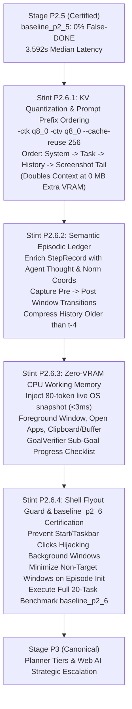

# Stage P2.6 Master Plan: Local Context & Working Memory Optimization

**Stage Identifier:** `Stage P2.6` (Pivot Stage 2.6 — Intermediary Context & Working Memory Optimization)  
**Parent Roadmap Documents:** [`feasibility_review.md`](file:///C:/ParasiteAI/feasibility_review.md) (§8, §10.1) | [`p2_stint_map.md`](file:///C:/ParasiteAI/p2_stint_map.md) | [`HANDOFF.md`](file:///C:/ParasiteAI/HANDOFF.md)  
**Governance Rules:** [`.agents/rules/engineering_cadence.md`](file:///C:/ParasiteAI/.agents/rules/engineering_cadence.md) (§1 Single-Unit Boundary, §5 Roadmap Sanctity)  
**Hardware Profile:** NVIDIA GeForce RTX 4060 (`8,188 MiB` Dedicated VRAM, `6,500 MB` Hard Budget — Invariant D1)

---

## 1. Roadmap Alignment & Continuity

Per Section 5 of `.agents/rules/engineering_cadence.md`, the canonical roadmap milestones remain strictly preserved:
- **Stage P2 (Certified):** Thin Perception-to-Action Loop, Resilient CUA Parser & Pre-DONE Verification (`baseline_p2`).
- **Stage P2.5 (Certified):** Intermediary Housecleaning, Focus Stabilization & `baseline_p2_5` Certification.
- **Stage P2.6 (Current Target):** **Local Context & Working Memory Optimization** (Solves VLM context exhaustion, prefix cache thrashing, and single-frame amnesia on 8GB VRAM with zero added hardware).
- **Stage P3 (Preserved Canonical Milestone):** **Planner Tiers & Web AI Strategic Escalation** (Visible browser offload hardening, strategic Gemini/web reasoning chat offloader, optional opt-in API planner).
- **Stage P4 (Preserved Canonical Milestone):** **Memory Compilation & Verified Routine Caching** (SimuLang / Phase 5 re-scoped).

---

## 2. Stage P2.6 Stint Breakdown

| Stint | Title | Scope & Zero-Hardware Mechanism | Primary Files |
| :--- | :--- | :--- | :--- |
| **P2.6.1** | **Quantized KV Cache (`q8_0`), Context Expansion & Prefix-Stable Ordering** | Enable `-ctk q8_0 -ctv q8_0 --cache-reuse 256` on `llama-server.exe`; expand context to `6144`–`8192` tokens with $\le 238\text{ MiB}$ KV memory; place static text before dynamic image tail so `f_keep` cache reuse jumps from `~0.37` to `>0.90`. | `config.yaml`, `parasite_ai/config.py`, `parasite_ai/mind/brain_manager.py`, `scripts/serve_llama.py` |
| **P2.6.2** | **Semantic Episodic Ledger & State Delta Tracking** | Enrich episodic memory formatting with prior reasoning (`rec.persona_thought`), normalized coordinates `[0..1000]`, and `pre_window -> post_window` deltas so the model remembers its prior actions across single frames. | `parasite_ai/mind/memory.py`, `parasite_ai/mind/dual_mind.py` |
| **P2.6.3** | **Zero-VRAM CPU Working Memory & Sub-Goal Checklist** | Query Win32 & `RuntimeGoalVerifier` in $<3\text{ms}$ on CPU; inject an explicit ~80-token prompt block showing foreground window, running target apps, clipboard text, and completed sub-goals. | `parasite_ai/mind/verifier.py`, `parasite_ai/mind/brain_manager.py` |
| **P2.6.4** | **Shell Flyout Focus Guard & `baseline_p2_6` Benchmark Certification** | Prevent background window activation (`SetForegroundWindow`) when clicking inside open Start Menus or taskbars; run the 20-task benchmark and record `baseline_p2_6` scorecards. | `parasite_ai/mind/dual_mind.py`, `benchmarks/run_benchmark.py` |
